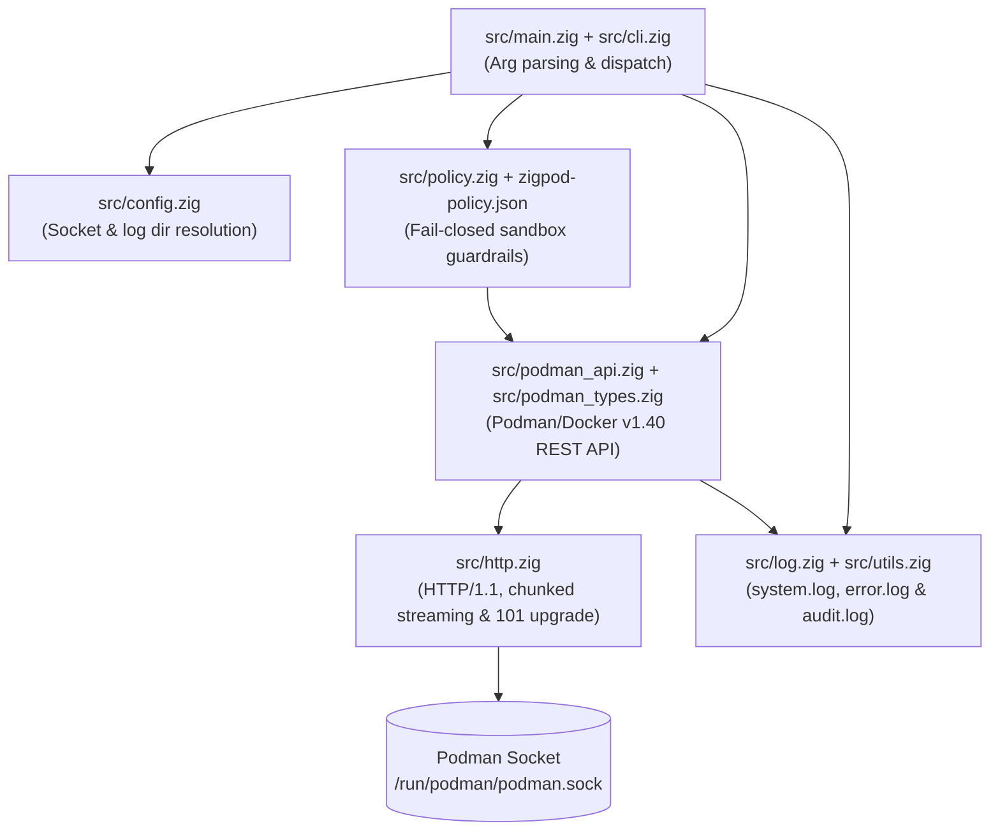

# ZigPod

**ZigPod** เป็นโปรแกรม CLI ภาษา Zig ที่ทำงานในลักษณะเดียวกับ `podman` / `docker` โดยสื่อสารกับ **Podman REST API (Docker-compatible v1.40)** ผ่าน Unix domain socket ด้วย standard library ของ Zig ล้วน ๆ (ไม่พึ่งพา external library)

A minimal Docker/Podman-compatible CLI written in pure Zig (`>= 0.13.0`) that communicates with the Podman REST API over a Unix domain socket.

---

## Architecture



---

## Project Structure

```text
zigpodza/
├─ src/
│  ├─ main.zig         # CLI entry point, dispatch & error/DENY reporting
│  ├─ cli.zig          # Subcommand & flag parser
│  ├─ config.zig       # Socket path & log directory resolution
│  ├─ demo.zig         # 14-case fail-closed ALLOW/DENY self-test suite
│  ├─ http.zig         # HTTP/1.1 Unix-socket client (Content-Length, chunked streaming, 101 upgrade, RawTermGuard)
│  ├─ podman_types.zig # Podman/Docker v1.40 DTO structs, JSON serializers & stats calculators
│  ├─ podman_api.zig   # Docker/Podman v1.40 API endpoints, security validators & LogDemuxer
│  ├─ policy.zig       # --profile=sandbox & zigpod-policy.json pre-flight engine
│  ├─ log.zig          # Timestamped file logger (system.log, error.log & SHA-256 hash-chained audit.log)
│  └─ utils.zig        # Formatting helpers (shortId, formatSize)
├─ scripts/
│  ├─ auto-audit.sh      # Static memory & security invariant checks
│  ├─ bug-dashboard.py   # Bug tracking dashboard generator & local web UI
│  ├─ check-ci-parity.py # CI workflow, Makefile, CLI, vault & README parity verifier
│  ├─ graph-query.py     # Offline Knowledge Graph CLI
│  ├─ install.sh         # Build ReleaseSafe binary and install to PATH
│  ├─ security-check.sh  # Run leak/security tests, ELF hardening, and optional balorsh check
│  └─ smoke.sh           # 4-stage parity, graph, static audit, and mock-daemon E2E test suite
├─ examples/
│  └─ demo.sh          # End-to-end sample workflow script
├─ .github/workflows/
│  └─ ci.yml           # GitHub Actions CI (test & release build)
├─ .agents/skills/
│  └─ zigpod-wrapper/SKILL.md
├─ build.zig           # Zig build configuration
├─ build.zig.zon       # Zig package manifest
├─ Dockerfile          # Multi-stage Alpine container image
├─ zigpod.toml         # Sample runtime settings reference
├─ zigpod-policy.json  # Fail-closed sandbox security policy guardrails
├─ projectplan.md      # Initial design document
├─ audit.log           # SHA-256 hash-chained tamper-evident audit log
├─ system.log          # Runtime system & info/debug/warn/error/deny log
├─ error.log           # Runtime error-only log
└─ LICENSE             # MIT License
```

---

## Prerequisites

- **Zig** `0.13.0` or newer
- **Podman** with the API socket active:
  - Rootless: `systemctl --user enable --now podman.socket`
  - Rootful: `sudo systemctl enable --now podman.socket`
  - Manual: `podman system service -t 0`

---

## Build & Installation

```bash
# Build debug binary
zig build

# Build optimized release binary (./zig-out/bin/zigpod)
zig build -Doptimize=ReleaseSafe

# Or use the installer script (defaults to PREFIX=/usr/local)
./scripts/install.sh
```

---

## Usage Examples

```bash
# Show help or version
zigpod --help
zigpod --version
zigpod version

# Pull an image
zigpod pull alpine:3.20

# List local images
zigpod images

# Run a container (attached, auto-removed after logs are printed)
zigpod run --rm -e GREETING=hello alpine:3.20 sh -c 'echo "$GREETING from zigpod"'

# Bind-mount a host directory read-only (default) and a writable cache
zigpod run --rm -v /srv/data:/data -v /srv/cache:/cache:rw alpine:3.20 ls /data

# Mount a Podman-managed named volume
zigpod run --rm -v myvol:/var/lib/data alpine:3.20 ls /var/lib/data

# Publish container ports (TCP by default, repeatable, IPv4 host address optional)
zigpod run --rm -p 8080:80 -p 127.0.0.1:9000:9000/udp alpine:3.20 sleep 1

# Run with a hardened network/identity profile
zigpod run --rm --network none -w /work -u 1000:1000 --cap-drop ALL --cap-add NET_BIND_SERVICE alpine:3.20 id

# Run with the fail-closed sandbox profile (enforces zigpod-policy.json guardrails)
zigpod run --rm --profile=sandbox alpine:3.20 id

# Run an interactive TTY shell inside a container
zigpod run --rm -it alpine:3.20 sh

# Run a container in the background with a name
zigpod run -d --name demo-alpine alpine:3.20 sleep 60

# List containers (-a includes stopped containers)
zigpod ps
zigpod ps -a

# Fetch or stream container logs (-f follows live output)
zigpod logs demo-alpine
zigpod logs -f demo-alpine

# Snapshot container CPU, memory, and PID resource usage
zigpod stats --no-stream
zigpod stats --no-stream demo-alpine

# List running processes inside a container or send an allow-listed signal
zigpod top demo-alpine
zigpod kill -s SIGTERM demo-alpine

# Manage named volumes and inspect container networks
zigpod volume ls
zigpod volume create app-data
zigpod volume inspect app-data
zigpod volume rm app-data
zigpod network ls
zigpod network inspect podman

# Inspect a container or image (state, IP, mounts, hardening limits)
zigpod inspect demo-alpine
zigpod inspect alpine:3.20

# Run a command in a live container (supports -i/-t/-it; exit code is propagated)
zigpod exec demo-alpine ls -la
zigpod exec -it demo-alpine sh

# Verify the SHA-256 hash-chained audit log (plain or structured JSON with DENY telemetry)
zigpod audit
zigpod audit --json

# Stop and remove a container
zigpod stop demo-alpine
zigpod rm -f demo-alpine
```

### Global Options

- `-v, --verbose` — แสดงข้อความระดับ `INFO` / `DEBUG` บน stderr ด้วย
- `--socket PATH` — ระบุ path ของ Unix socket เอง (รองรับทั้ง `/path/to.sock` และ `unix:///path/to.sock`)
- `-h, --help` — แสดงวิธีใช้งาน
- `--version` — แสดงเวอร์ชันของ client

---

## Configuration & Logging

### Socket Resolution Order

1. `--socket PATH`
2. `$ZIGPOD_SOCKET`
3. `$CONTAINER_HOST` หรือ `$DOCKER_HOST` (หากขึ้นต้นด้วย `unix://`)
4. `$XDG_RUNTIME_DIR/podman/podman.sock` (ถ้ามีไฟล์อยู่จริง)
5. `/run/podman/podman.sock`

### Log Files (`system.log` & `error.log`)

- บันทึกไฟล์ลงใน `$ZIGPOD_LOG_DIR` หรือโฟลเดอร์ปัจจุบัน (`.`) โดยอัตโนมัติ
- **`system.log`**: บันทึกทุกเหตุการณ์ (`DEBUG`, `INFO`, `WARN`, `ERROR`) พร้อมเวลา UTC แบบ ISO-8601
- **`error.log`**: บันทึกเฉพาะข้อความระดับ `ERROR` เพื่อให้ตรวจสอบข้อผิดพลาดได้ทันที

---

## Running Tests

```bash
zig build test
```

ชุด unit test ครอบคลุม:
- CLI argument/flag parsing และ error-path leak check (`src/cli.zig`)
- Configuration & socket URI stripping (`src/config.zig`)
- HTTP/1.1 response parsing (`Content-Length` และ `Transfer-Encoding: chunked`), malformed chunked/CRLF injection rejection และ mock Unix-socket round-trip (`src/http.zig`)
- File logger & UTC timestamp formatting (`src/log.zig`)
- Helper formatting (`src/utils.zig`)
- Container ID/name validation, Docker stream log demultiplexing, JSON response deserialization และ mock Unix-socket end-to-end lifecycle (`src/podman_api.zig`)
- Host bind-mount policy validator (`validateHostPath`), bind/volume mount classification และ `Mounts` JSON serialization (`src/podman_api.zig`)
- Port-publishing validator (`validatePortMapping`), `ExposedPorts`/`PortBindings` JSON serialization และ CLI `-p` parsing (`src/cli.zig`, `src/podman_api.zig`)
- Network/identity/capability validators (`validateNetworkMode`, `validateWorkdir`, `validateUser`, `validateCapability`) และ CLI `--network`/`-w`/`-u`/`--cap-*` parsing (`src/cli.zig`, `src/podman_api.zig`)
- Container/image inspect (`inspect` → `GET /containers/{id}/json` แล้ว fallback `GET /images/{name}/json`) พร้อม `validateResourceRef()` ป้องกัน request-line injection (`src/podman_api.zig`)
- Exec (`exec` → `POST /containers/{id}/exec` + `POST /exec/{id}/start` + `GET /exec/{id}/json`) ทั้งโหมดปกติและ interactive TTY (`101 Switching Protocols` + `RawTermGuard`), demultiplex output, propagation ของ exit code และ validation ของ exec ID (`src/podman_api.zig`)
- Container resource stats (`stats --no-stream` → `GET /containers/{id}/stats?stream=false`), streaming `pullImage`, `logs -f` (`LogDemuxer`), และ `attachContainer` (`src/podman_api.zig`, `src/podman_types.zig`)
- Sandbox security profile (`--profile=sandbox`), `zigpod-policy.json` pre-flight guardrails (`src/policy.zig`), `dispatch()` orphan cleanup (`BUG-012`) และ `DENY` audit JSON telemetry (`src/main.zig`, `src/log.zig`)
- Deterministic PRNG property & fuzz tests สำหรับ `parseResponse`/`decodeChunked`, `demuxLogs`/`LogDemuxer`, `parseMemoryBytes`/`cli.parse`, และ `verifyAuditFile`/`writeAuditJson`

---

## Security & Memory Testing

- **Memory Leak Detection**:
  - ทุก `test` block ใช้ `std.testing.allocator` เพื่อตรวจจับ memory leak, double-free และ invalid free โดยอัตโนมัติ
  - ใน runtime (`src/main.zig`) ใช้ `std.heap.GeneralPurposeAllocator` และตรวจสอบ `gpa.deinit() == .leak` ก่อนออกจากโปรแกรม
- **Input & Protocol Hardening**:
  - `http.validateRequestTarget` ป้องกัน CRLF/header injection และ whitespace ใน HTTP request path
  - `http.decodeChunked` ใช้ checked arithmetic (`std.math.add`) และตรวจสอบ CRLF trailer ของทุก chunk เพื่อป้องกัน integer overflow และ out-of-bounds read
  - `podman_api.validateIdentifier` ป้องกัน path traversal (`..`, `/`) และ query/header injection บน container ID และ name
  - `podman_api.validateHostPath` (BUG-014) บังคับ **fail-closed host mount policy**: บล็อกการ bind-mount `/`, `/etc`, `/proc`, `/sys`, `/dev`, `/boot`, `/run`, `/var/run`, `/var/lib/docker`, `/var/lib/containers`, `/root` และบังคับ default `:ro` สำหรับ sensitive paths
  - `podman_api.validatePortMapping` (BUG-015) ปฏิเสธพอร์ตนอกช่วง `1..65535`, โปรโตคอลที่ไม่อยู่ใน allow-list (`tcp`/`udp`/`sctp`) และ host address ที่ไม่ใช่ IPv4 literal ก่อนส่งคำขอไปยัง daemon
  - `podman_api.validateNetworkMode` / `validateWorkdir` / `validateUser` / `validateCapability` (BUG-016) จำกัด `--network` เป็น allow-list, บังคับ `--workdir` เป็น absolute traversal-free path, ตรวจรูปแบบ `--user` และปฏิเสธชื่อ capability ที่ไม่ใช่ `ALL`/uppercase ก่อนส่งคำขอไปยัง daemon
  - `podman_api.validateResourceRef` (BUG-017) จำกัด `inspect` target ให้เป็น image/container reference เท่านั้น (ตัด space, control char, `?`, `#`) เพื่อป้องกัน HTTP request-line injection
  - `podman_api.createExec`/`startExec`/`startExecInteractive`/`inspectExec` (BUG-018) ตรวจ container ID, `--user`, `--workdir` และ exec ID ที่ได้จาก daemon ก่อนนำไปประกอบ URL, demultiplex output stream และคืนค่า exit code ของคำสั่ง
  - `policy.applySandboxDefaults` / `policy.checkRunPolicy` (BUG-019) บังคับค่าเริ่มต้นแบบ fail-closed สำหรับ `--profile=sandbox` และตรวจเพดานทุกข้อกับ `zigpod-policy.json` แบบ pre-flight ก่อนคุยกับ daemon พร้อมบันทึก `Logger.deny` ลง hash-chained `audit.log`
- **Automated Security Check Script**:

```bash
./scripts/security-check.sh
```

- **Optional Balor (`balorsh`) Integration**:
  - หากติดตั้ง `balorsh` (`/usr/local/bin/balorsh` / `/opt/balorsh`) สามารถใช้ `balorsh llm` (persona `loganalyst` / `blueteam`) เพื่อวิเคราะห์ไฟล์ `system.log` และ `error.log` รวมถึงใช้ `balorsh networkscan` / `webexploit` ทดสอบ container service ที่เปิดพอร์ตผ่าน ZigPod ได้

---

## Extending the CLI

1. เพิ่ม variant ใน `Command` และ parser logic ใน [src/cli.zig](src/cli.zig)
2. เพิ่ม request/response struct และฟังก์ชัน HTTP endpoint ใน [src/podman_api.zig](src/podman_api.zig)
3. เชื่อมต่อ subcommand ในฟังก์ชัน `dispatch` ของ [src/main.zig](src/main.zig)
4. เพิ่ม unit test ในโมดูลที่เกี่ยวข้องแล้วรัน `zig build test`


## Hardening, Self-Test, Audit & Knowledge Graph

### Container Hardening Flags (`zigpod run`)

Apply defense-in-depth limits in `HostConfig` when launching containers:

- `-m, --memory <SIZE>`: Memory limit (`b`, `k`, `m`, `g` suffixes supported with checked `std.math.mul`)
- `--pids-limit <N>`: Maximum container process count
- `--read-only`: Mount the container root filesystem read-only (`ReadonlyRootfs`)
- `--no-new-privileges`: Set `SecurityOpt: ["no-new-privileges"]`
- `-v, --volume SRC:DST[:ro|rw]`: Bind-mount a host path or named volume (repeatable, default **read-only**)
- `-p, --publish [IP:]HOST:CONTAINER[/tcp|udp|sctp]`: Publish a container port (repeatable)
- `--network <MODE>`: Network mode, one of `none`, `bridge`, `host`, `pasta`, `slirp4netns` (`HostConfig.NetworkMode`)
- `-w, --workdir <PATH>`: Container working directory (`WorkingDir`)
- `-u, --user <USER[:GROUP]>`: Run as user (and optional group) (`User`)
- `--cap-drop <CAP>` / `--cap-add <CAP>`: Drop/add a Linux capability, repeatable (`HostConfig.CapDrop` / `CapAdd`)
- `--profile=sandbox`: Apply fail-closed sandbox defaults (`--read-only`, `--no-new-privileges`, `--cap-drop=ALL`, `--network=none`, `--pids-limit=64`, `--memory=256m`, bounded `/tmp` tmpfs) and enforce `zigpod-policy.json`
- `--policy <FILE>`: Enforce a custom `zigpod-policy.json` guardrail file pre-flight
- `-i, --interactive` / `-t, --tty` (`-it`): Attach interactive stdin and allocate a pseudo-TTY over HTTP `101 Switching Protocols`

```bash
zigpod run --rm -m 64m --pids-limit 32 --read-only --no-new-privileges alpine:3.20 echo ok
zigpod run --rm --profile=sandbox alpine:3.20 echo sandbox-ok
```

#### Host Path Policy Validator (`-v`)

`podman_api.validateHostPath` (BUG-014) is fail-closed. Every `-v` source is validated **before** any request reaches the daemon:

- Sources starting with `/` are treated as **bind mounts**; anything else is a **named volume** (name must be alphanumeric, `-`, `_`, `.`).
- Both host source and container target must be absolute, traversal-free (`..`/`.`/`//`/trailing-slash rejected), control-char-free, and ≤ 4096 bytes.
- Bind mounts default to **read-only**; pass `:rw` to opt out.
- The following host subtrees are always rejected: `/`, `/etc` (except a read-only allow-list of `/etc/localtime`, `/etc/timezone`, `/etc/hosts`, `/etc/resolv.conf`, `/etc/nsswitch.conf`, `/etc/hostname`), `/proc`, `/sys`, `/dev`, `/boot`, `/run`, `/var/run`, `/var/lib/docker`, `/var/lib/containers`, and `/root`.
- Sensitive allow-listed `/etc` files may only be mounted read-only (`:rw` is rejected).

#### Port Publishing Policy (`-p`)

`podman_api.validatePortMapping` (BUG-015) validates every `-p` mapping **before** any request reaches the daemon:

- Accepted forms: `CONTAINER`, `CONTAINER/proto`, `HOST:CONTAINER[/proto]`, and `IPV4:HOST:CONTAINER[/proto]` (the host address must be a valid IPv4 literal).
- Container and host ports must be in `1..65535`; the protocol allow-list is `tcp` (default), `udp`, and `sctp`.
- Container ports are emitted in `ExposedPorts` (`{"80/tcp":{}}`); mappings with an explicit host port also populate `HostConfig.PortBindings` (`{"80/tcp":[{"HostIp":"127.0.0.1","HostPort":"8080"}]}`).

#### Network, Identity & Capability Policy (`--network` / `-w` / `-u` / `--cap-*`)

`podman_api.validateNetworkMode`, `validateWorkdir`, `validateUser`, and `validateCapability` (BUG-016) validate every identity/network flag **before** any request reaches the daemon:

- `--network` is restricted to the allow-list `none`, `bridge`, `host`, `pasta`, and `slirp4netns`; arbitrary values are rejected so the daemon never receives unexpected network configuration.
- `-w/--workdir` reuses the container-path policy: absolute, traversal-free (`..`/`.`/`//`/trailing-slash rejected), control-char-free, and ≤ 4096 bytes.
- `-u/--user` accepts `USER` or `USER:GROUP`, where each field is alphanumeric plus `_`, `-`, `.` and does not start with `-`/`.`.
- `--cap-drop`/`--cap-add` accept `ALL` or an uppercase `[A-Z][A-Z0-9_]*` capability name (e.g. `NET_ADMIN`); lowercase names and injection characters are rejected.
- `createContainer` re-validates all of these (defense in depth) before serializing the request.

#### Inspecting Containers & Images (`inspect`)

`zigpod inspect TARGET` tries `GET /containers/{id}/json` first and falls back to `GET /images/{name}/json` on `404`, printing a stable subset of fields: id, name, image, created, state/exit code, IP address, `WorkingDir`/`User`, `HostConfig` hardening limits (`NetworkMode`, `ReadonlyRootfs`, `Memory`, `PidsLimit`, `AutoRemove`, `CapDrop`/`CapAdd`, `SecurityOpt`), and mounts. `podman_api.validateResourceRef` (BUG-017) accepts image-reference characters (`/`, `:`, `@`) but rejects spaces, control characters, `?`, and `#` so the target cannot alter the HTTP request line.

#### Running Commands in a Live Container (`exec`)

`zigpod exec [OPTIONS] CONTAINER CMD...` creates an exec instance (`POST /containers/{id}/exec`), starts it (`POST /exec/{id}/start`), demultiplexes the Docker stream to stdout/stderr (or upgrades to HTTP `101 Switching Protocols` with `RawTermGuard` when `-i`/`-t`/`-it` is specified), then reads `GET /exec/{id}/json` and propagates the command's exit code as the CLI exit status. `-e/--env`, `-u/--user`, and `-w/--workdir` are validated with the same validators as `run`; the daemon-allocated exec ID is re-validated with `validateIdentifier` before it is reused in a URL (BUG-018). The start call uses the blocking socket timeout so long-running commands are not cut off.

### Built-In 14-Case Fail-Closed Self-Test (`zigpod demo`)

Run the deterministic 14-case `ALLOW`/`DENY` verification suite locally (no running Podman daemon required):

```bash
zigpod demo
# or via Makefile:
make demo
```

### Tamper-Evident Audit Log (`zigpod audit`)

In addition to `system.log` and `error.log`, `Logger` maintains a SHA-256 hash-chained `audit.log` and records security policy violations as structured `DENY` events. Verify chain integrity or export JSON telemetry for `balorsh` / SIEM analysis with:

```bash
zigpod audit                    # checks audit.log in configured log_dir
zigpod audit /path/to.log       # checks a specific audit log file
zigpod audit --json             # outputs structured JSON with valid/entries/deny_events/deny_records
```

### Verification & Offline Knowledge Graph CLI

Use the top-level [Makefile](Makefile) and verification scripts to keep builds, CI, docs, and static checks in sync:

```bash
make verify          # run tests, security gate, ReleaseSafe build, demo, E2E smoke, parity, graph update
make check-ci        # verify CI workflow, Makefile, CLI, vault docs, and README parity
make e2e             # run scripts/smoke.sh (mock Unix socket + hardened run + audit tamper test)
python3 scripts/graph-query.py update
python3 scripts/graph-query.py query "memory"
python3 scripts/graph-query.py explain verifyAuditFile
python3 scripts/graph-query.py path BUG-002 cli.zig

# Bug Tracking Dashboard (CLI / Obsidian Note / Web UI)
make bugs            # terminal summary of tracked bugs, module tests, and security gates
make dashboard       # update docs/vault/Bug-Dashboard.md & .zig-cache/bug-dashboard.html
make dashboard-serve # start local web UI on http://127.0.0.1:8765
python3 scripts/bug-dashboard.py summary --json
```
