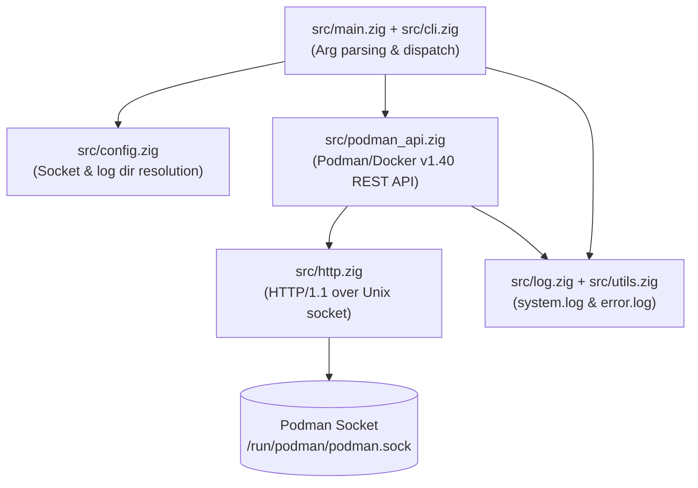

# ZigPod

**ZigPod** เป็นโปรแกรม CLI ภาษา Zig ที่ทำงานในลักษณะเดียวกับ `podman` / `docker` โดยสื่อสารกับ **Podman REST API (Docker-compatible v1.40)** ผ่าน Unix domain socket ด้วย standard library ของ Zig ล้วน ๆ (ไม่พึ่งพา external library)

A minimal Docker/Podman-compatible CLI written in pure Zig (`>= 0.13.0`) that communicates with the Podman REST API over a Unix domain socket.

---

## Architecture



---

## Project Structure

```text
zigpodza/
├─ src/
│  ├─ main.zig         # CLI entry point, dispatch & error reporting
│  ├─ cli.zig          # Subcommand & flag parser
│  ├─ config.zig       # Socket path & log directory resolution
│  ├─ http.zig         # Minimal HTTP/1.1 Unix-socket client (Content-Length & chunked)
│  ├─ podman_api.zig   # Docker/Podman v1.40 API structs & endpoints
│  ├─ log.zig          # Timestamped file logger (system.log & error.log)
│  └─ utils.zig        # Formatting helpers (shortId, formatSize)
├─ scripts/
│  └─ install.sh       # Build ReleaseSafe binary and install to PATH
├─ examples/
│  └─ demo.sh          # End-to-end sample workflow script
├─ .github/workflows/
│  └─ ci.yml           # GitHub Actions CI (test & release build)
├─ .agents/skills/
│  └─ zigpod-wrapper/SKILL.md
├─ build.zig           # Zig build configuration
├─ build.zig.zon       # Zig package manifest
├─ Dockerfile          # Multi-stage Alpine container image
├─ zigpod.toml         # Sample runtime settings reference
├─ projectplan.md      # Initial design document
├─ system.log          # Runtime system & info/debug/warn/error log
├─ error.log           # Runtime error-only log
└─ LICENSE             # MIT License
```

---

## Prerequisites

- **Zig** `0.13.0` or newer
- **Podman** with the API socket active:
  - Rootless: `systemctl --user enable --now podman.socket`
  - Rootful: `sudo systemctl enable --now podman.socket`
  - Manual: `podman system service -t 0`

---

## Build & Installation

```bash
# Build debug binary
zig build

# Build optimized release binary (./zig-out/bin/zigpod)
zig build -Doptimize=ReleaseSafe

# Or use the installer script (defaults to PREFIX=/usr/local)
./scripts/install.sh
```

---

## Usage Examples

```bash
# Show help or version
zigpod --help
zigpod --version
zigpod version

# Pull an image
zigpod pull alpine:3.20

# List local images
zigpod images

# Run a container (attached, auto-removed after logs are printed)
zigpod run --rm -e GREETING=hello alpine:3.20 sh -c 'echo "$GREETING from zigpod"'

# Run a container in the background with a name
zigpod run -d --name demo-alpine alpine:3.20 sleep 60

# List containers (-a includes stopped containers)
zigpod ps
zigpod ps -a

# Fetch container logs
zigpod logs demo-alpine

# Stop and remove a container
zigpod stop demo-alpine
zigpod rm -f demo-alpine
```

### Global Options

- `-v, --verbose` — แสดงข้อความระดับ `INFO` / `DEBUG` บน stderr ด้วย
- `--socket PATH` — ระบุ path ของ Unix socket เอง (รองรับทั้ง `/path/to.sock` และ `unix:///path/to.sock`)
- `-h, --help` — แสดงวิธีใช้งาน
- `--version` — แสดงเวอร์ชันของ client

---

## Configuration & Logging

### Socket Resolution Order

1. `--socket PATH`
2. `$ZIGPOD_SOCKET`
3. `$CONTAINER_HOST` หรือ `$DOCKER_HOST` (หากขึ้นต้นด้วย `unix://`)
4. `$XDG_RUNTIME_DIR/podman/podman.sock` (ถ้ามีไฟล์อยู่จริง)
5. `/run/podman/podman.sock`

### Log Files (`system.log` & `error.log`)

- บันทึกไฟล์ลงใน `$ZIGPOD_LOG_DIR` หรือโฟลเดอร์ปัจจุบัน (`.`) โดยอัตโนมัติ
- **`system.log`**: บันทึกทุกเหตุการณ์ (`DEBUG`, `INFO`, `WARN`, `ERROR`) พร้อมเวลา UTC แบบ ISO-8601
- **`error.log`**: บันทึกเฉพาะข้อความระดับ `ERROR` เพื่อให้ตรวจสอบข้อผิดพลาดได้ทันที

---

## Running Tests

```bash
zig build test
```

ชุด unit test ครอบคลุม:
- CLI argument/flag parsing (`src/cli.zig`)
- Configuration & socket URI stripping (`src/config.zig`)
- HTTP/1.1 response parsing ทั้ง `Content-Length` และ `Transfer-Encoding: chunked` (`src/http.zig`)
- File logger & UTC timestamp formatting (`src/log.zig`)
- Helper formatting (`src/utils.zig`)
- Docker stream log demultiplexing และ JSON response deserialization (`src/podman_api.zig`)

---

## Extending the CLI

1. เพิ่ม variant ใน `Command` และ parser logic ใน [src/cli.zig](src/cli.zig)
2. เพิ่ม request/response struct และฟังก์ชัน HTTP endpoint ใน [src/podman_api.zig](src/podman_api.zig)
3. เชื่อมต่อ subcommand ในฟังก์ชัน `dispatch` ของ [src/main.zig](src/main.zig)
4. เพิ่ม unit test ในโมดูลที่เกี่ยวข้องแล้วรัน `zig build test`
