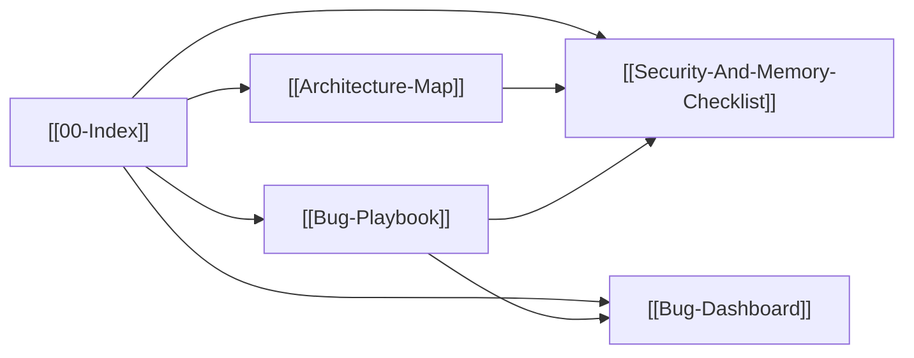

---
tags:
  - moc
  - zigpod
  - obsidian-vault
aliases:
  - ZigPod Knowledge Vault
  - Index
status: active
---

# ZigPod Knowledge Vault (Obsidian MOC)

> [!tip] Dual-Purpose Knowledge Base
> โฟลเดอร์ `docs/vault/` ออกแบบให้เปิดเป็น **Obsidian Vault** เพื่อดู Graph View และใช้ `rg` ค้นหา tag / bug pattern ได้ทันทีระหว่างทำงานกับ AI

## Knowledge Graph



## Notes

- [[Bug-Dashboard]] — แดชบอร์ดสรุปสถานะบั๊ก (`BUG-001` ถึง `BUG-037`), Coverage ของ Unit Tests ต่อโมดูล และสถานะ Security/Memory Gates
- [[Architecture-Map]] — แผนผังโมดูล, เส้นทางข้อมูล, Ownership ของหน่วยความจำ และ Trust Boundaries
- [[Bug-Playbook]] — คลังบันทึก Bug & Post-mortem (`BUG-001` ถึง `BUG-037`) พร้อมวิธีป้องกันไม่ให้เกิดซ้ำ
- [[Security-And-Memory-Checklist]] — กฎเหล็กที่ตรวจอัตโนมัติด้วย `scripts/auto-audit.sh` และ `scripts/security-check.sh`

## Quick Queries for AI (`rg`)

```bash
# ค้นหารูปแบบบั๊กทั้งหมดใน Vault
rg -n "#bug-pattern" docs/vault/

# ค้นหากฎเกี่ยวกับ memory safety และ security gate
rg -n "#memory-safety|#security-gate" docs/vault/

# รันตัวตรวจจับผิดอัตโนมัติ
./scripts/auto-audit.sh
```
