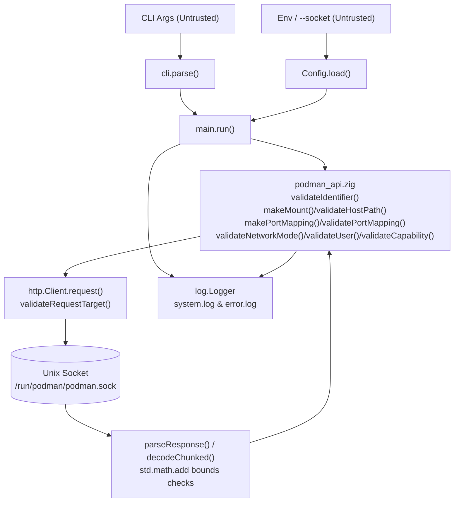

---
tags:
  - architecture
  - memory-safety
  - trust-boundary
aliases:
  - Module Architecture
status: active
---

# Architecture & Memory Ownership Map

กลับไปที่ [[00-Index]] · ดูเช็กลิสต์ที่ [[Security-And-Memory-Checklist]]

## Data Flow & Trust Boundaries

## Module Map & Memory Ownership

| Module | Link | Responsibility | Allocation Owner / Deinit |
| :--- | :--- | :--- | :--- |
| Entry Point | [src/main.zig](../../src/main.zig) | Arg collection, config/log setup, command dispatch (`demo`/`audit`/`run`/`inspect`/`exec`), GPA leak check, best-effort container cleanup on `run` failure paths | `ArenaAllocator` over `GeneralPurposeAllocator`; passes `gpa_allocator` to `demo`; frees `createContainer` Id via `defer`; asserts `gpa.deinit() != .leak` |
| Self-Test Demo | [src/demo.zig](../../src/demo.zig) | 14-case fail-closed ALLOW/DENY enforcement & mock lifecycle demo | Caller allocator (`gpa_allocator` / `std.testing.allocator`), temp `/tmp/zp-demo-*` cleaned via `defer` |
| CLI Parser | [src/cli.zig](../../src/cli.zig) | Subcommands & flags (`run`, `ps`, `images`, `pull`, `stop`, `rm`, `logs`, `version`, `audit`, `demo`, `inspect`, `exec`, `stats`, `--memory`, `--pids-limit`, `--read-only`, `--no-new-privileges`, `-v`/`--volume SRC:DST[:ro\|rw]`, `-p`/`--publish [IP:]HOST:CONTAINER[/proto]`, `--network MODE`, `-w`/`--workdir`, `-u`/`--user`, `--cap-drop`/`--cap-add`) | `Parsed.deinit(allocator)` frees `r.env`, `r.volumes`, `r.ports`, `r.cap_drop`, `r.cap_add`, `e.env`, and `s.containers` |
| Config | [src/config.zig](../../src/config.zig) | Socket auto-detection (warns on non-`unix://` `CONTAINER_HOST`/`DOCKER_HOST`) & log directory resolution | `Config.deinit(allocator)` frees owned `socket_path` and `log_dir` |
| HTTP Client | [src/http.zig](../../src/http.zig) | HTTP/1.1 over Unix domain socket (`Content-Length`, chunked, `streamRequest` incremental body/chunked reader, `upgrade` HTTP `101 Switching Protocols` + `RawTermGuard` termios, per-read `waitReadable` poll, `blocking_timeout_ms` for wait/pull/follow) | `Response.deinit()` frees `body`; `StreamResponse.deinit()` frees `error_body`; `UpgradedConn.deinit()` frees `initial_data`/`error_body` and closes socket |
| Podman API | [src/podman_api.zig](../../src/podman_api.zig) | Docker/Podman `/v1.40` endpoints, `HostConfig` hardening, `Mounts` (bind/named volume), `makeMount`/`validateHostPath` fail-closed policy (BUG-014), `ExposedPorts`/`PortBindings` with `makePortMapping`/`validatePortMapping` (BUG-015), `NetworkMode`/`CapDrop`/`CapAdd` + `WorkingDir`/`User` with `validateNetworkMode`/`validateWorkdir`/`validateUser`/`validateCapability` (BUG-016), `inspect` (container-then-image) with `validateResourceRef` (BUG-017), `exec` (`createExec`/`startExec`/`inspectExec`) with exec-ID + identity validation (BUG-018), `demuxLogs`; `wait`/`pull`/`exec start` use `blocking_timeout_ms` (BUG-007) | `createContainer`/`createExec` return duped IDs (caller frees); `std.json.Parsed` freed via `defer parsed.deinit()` |
| Policy Engine | [src/policy.zig](../../src/policy.zig) | `--profile=sandbox` fail-closed defaults (`--read-only`, `--no-new-privileges`, `--cap-drop=ALL`, `--network=none`, `--pids-limit=64`, `--memory=256m`, bounded `/tmp` tmpfs) and pre-flight `zigpod-policy.json` guardrail enforcement (BUG-019) | `loadPolicyFile()` returns `std.json.Parsed(Policy)` freed by caller via `defer lp.deinit()` |
| Logger | [src/log.zig](../../src/log.zig) | ISO-8601 UTC logging to `system.log`, `error.log`, and SHA-256 hash-chained `audit.log` (`verifyAuditFile`, `writeAuditJson`, `Logger.deny`); audit writes take `flock` + re-read chain head; crash-interrupted tails repaired at init (BUG-008/009); files `0640` | Stack buffer `[4096]u8`; `Logger.deinit()` closes file handles; `writeAuditJson()` frees temp file buffer & `deny_list` via `defer` |
| Utils | [src/utils.zig](../../src/utils.zig) | `shortId`, `formatSize`, re-exports `log.zig` | Stack buffer formatting (no heap allocations) |

## Trust Boundaries

> [!warning] Untrusted Inputs Requiring Validation
> 1. **Container IDs / Names** → ต้องผ่าน `podman_api.validateIdentifier()` ก่อนประกอบ URL path หรือ query
> 2. **HTTP Request Targets** → ต้องผ่าน `http.validateRequestTarget()` ก่อนเขียน HTTP request line
> 3. **Chunked Transfer Sizes & Multiplexed Log Frames** → ต้องคำนวณด้วย `std.math.add()` และตรวจ `max_response_bytes` เสมอ
> 4. **Host Mount Sources / Container Targets (`-v`)** → ต้องผ่าน `podman_api.makeMount()` → `validateHostPath()` / `validateVolumeName()` / `validateContainerPath()` ก่อนสร้าง `Mounts`; `createContainer` ตรวจซ้ำแบบ defense-in-depth
> 5. **Published Ports (`-p`)** → ต้องผ่าน `podman_api.makePortMapping()` → `validatePortMapping()` (ช่วง `1..65535`, proto allow-list, IPv4 host address) ก่อนสร้าง `ExposedPorts`/`PortBindings`; `createContainer` ตรวจซ้ำแบบ defense-in-depth
> 6. **Network / Identity / Capabilities (`--network`, `-w`, `-u`, `--cap-*`)** → ต้องผ่าน `podman_api.validateNetworkMode()` (allow-list), `validateWorkdir()` (absolute traversal-free), `validateUser()`, และ `validateCapability()` (uppercase allow-list) ก่อนสร้าง `HostConfig`/`WorkingDir`/`User`; `createContainer` ตรวจซ้ำแบบ defense-in-depth
> 7. **Inspect Targets (`inspect TARGET`)** → ต้องผ่าน `podman_api.validateResourceRef()` ก่อนประกอบ `/containers/{target}/json` หรือ `/images/{target}/json`; รองรับ `/`, `:`, `@` ของ image reference แต่ตัด space/control char/`?`/`#` เพื่อกัน request-line injection (BUG-017)
> 8. **Exec IDs (`exec`)** → container ID, `--user`, `--workdir` ผ่าน validator เดิม; exec ID ที่ daemon คืนมาต้องผ่าน `validateIdentifier()` ก่อนใช้ใน `/exec/{id}/start` และ `/exec/{id}/json` เพื่อไม่ให้ daemon เบี่ยงเบนไป path อื่น (BUG-018)

## Related Notes

- [[Bug-Playbook]]
- [[Security-And-Memory-Checklist]]
