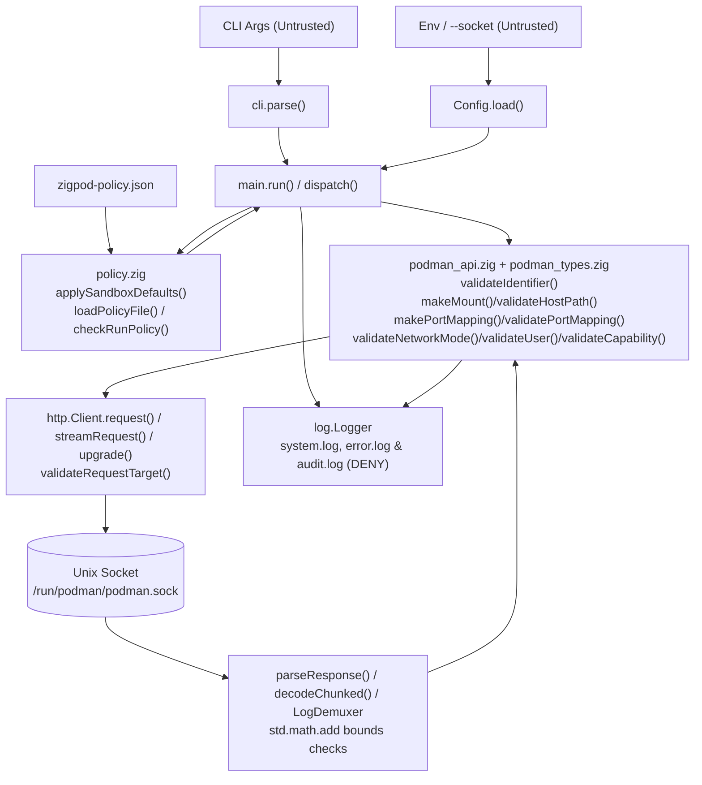

---
tags:
  - architecture
  - memory-safety
  - trust-boundary
aliases:
  - Module Architecture
status: active
---

# Architecture & Memory Ownership Map

กลับไปที่ [[00-Index]] · ดูเช็กลิสต์ที่ [[Security-And-Memory-Checklist]]

## Data Flow & Trust Boundaries

## Module Map & Memory Ownership

| Module | Link | Responsibility | Allocation Owner / Deinit |
| :--- | :--- | :--- | :--- |
| Entry Point | [src/main.zig](../../src/main.zig) | Arg collection, config/log setup, command dispatch (`demo`/`audit`/`run`/`attach`/`cp`/`network`/`inspect`/`exec`/`stats`), `--env-file` pre-flight merge, GPA leak check, best-effort container cleanup on `run` failure paths (BUG-012) | `ArenaAllocator` over `GeneralPurposeAllocator`; passes `gpa_allocator` to `demo`; frees `createContainer` Id, `MergedEnv`, and `loaded_pol` via `defer` (BUG-020); asserts `gpa.deinit() != .leak` |
| Self-Test Demo | [src/demo.zig](../../src/demo.zig) | 18-case fail-closed ALLOW/DENY enforcement & mock lifecycle demo | Caller allocator (`gpa_allocator` / `std.testing.allocator`), temp `/tmp/zp-demo-*` cleaned via `defer` |
| CLI Parser | [src/cli.zig](../../src/cli.zig) | Subcommand dispatcher (`parse`) & per-command flag parsers (`run`, `attach`, `cp`, `exec`, `stats`, `kill`, `volume`, `network`, `build`, `pod`, etc.) + re-exports `cli_types` and `cli_specs` | `Parsed.deinit(allocator)` frees `r.env`, `r.env_files`, `r.labels`, `r.volumes`, `r.ports`, `r.cap_drop`, `r.cap_add`, `e.env`, and `s.containers` |
| CLI Types | [src/cli_types.zig](../../src/cli_types.zig) | Usage text, `Global`, `Command` union, option structs (`RunOpts`, `AttachOpts`, `CpOpts`, `NetworkOpts`, `ExecOpts`, etc.), `Parsed.deinit`, `ParseError`, and shared arg cursor helpers | Value types and borrowed slices; `Parsed.deinit` frees owned option slices |
| CLI Specs | [src/cli_specs.zig](../../src/cli_specs.zig) | Value & spec parsers (`parseMemoryBytes` BUG-004, `parseCpuNanos`, `parseEnvFilePath`, `parseLabelSpec`, `parseEntrypoint`, `parseHostname`, `parseRestartPolicy`, `parseNetworkDriver`, `parseCpEndpoints`, `parsePidsLimit`, `parseVolumeSpec`, `parsePortSpec`, `parseNetworkMode`, `parseWorkdir`, `parseUserSpec`, `parseCapName`, `parseSignal`) | Stack/borrowed slices (no heap allocations) |
| Completion | [src/completion.zig](../../src/completion.zig) | Shell tab-completion generator (`bash`, `zsh`, `fish`) covering all subcommands and `run`/`network`/`attach`/`cp` options | Static comptime strings (no heap allocations) |
| Config | [src/config.zig](../../src/config.zig) | Socket auto-detection (warns on non-`unix://` `CONTAINER_HOST`/`DOCKER_HOST`), TOML config loader (`zigpod.toml`), & log directory resolution | `Config.deinit(allocator)` frees owned `socket_path` and `log_dir` |
| HTTP Client | [src/http.zig](../../src/http.zig) | HTTP/1.1 over Unix domain socket (`Client.request`, `streamRequest`, `upgrade`, per-read `waitReadable` poll, `blocking_timeout_ms` for wait/pull/follow) + re-exports `http_types` and `http_parser` | `Response.deinit()` frees `body`; `StreamResponse.deinit()` frees `error_body`; `UpgradedConn.deinit()` frees `initial_data`/`error_body` and closes socket |
| HTTP Types | [src/http_types.zig](../../src/http_types.zig) | HTTP client constants, `Error`, `Response`, `StreamResponse`, `ResponseHead`, `UpgradedConn`, `RawTermGuard` termios guard, and `validateRequestTarget` (BUG-005) | `Response`/`StreamResponse`/`UpgradedConn` `deinit()` free owned buffers |
| HTTP Parser | [src/http_parser.zig](../../src/http_parser.zig) | `parseResponseHead`, `parseResponse`, and `decodeChunked` with `std.math.add` bounds checks (BUG-004/010) | `parseResponse` returns owned body freed by caller (`Response.deinit()`) |
| Podman Types | [src/podman_types.zig](../../src/podman_types.zig) | API error set, DTO structs (`ContainerCreateRequest`, `HostConfig`, `RestartPolicy`, `LabelsMap`, `NetworkCreateRequest`, `Mount`, `PortMapping`, `ContainerStats`), custom JSON serializers (`PortBindings`, `TmpfsBounds`, `LabelsMap`), CPU/memory stats helpers | Value types and borrowed slices; serialized buffers freed by caller (`defer allocator.free(body)`) |
| Podman API | [src/podman_api.zig](../../src/podman_api.zig) | Facade & Container/Exec/Attach `/v1.40` endpoints (`createContainer`, `startContainer`, `stopContainer`, `restartContainer`, `pauseContainer`, `unpauseContainer`, `renameContainer`, `killContainer`, `topContainer`, `removeContainer`, `waitContainer`, `fetchLogs`, `listContainers*`, `createExec`/`startExec`/`startExecInteractive`/`inspectExec`/`execCommandWithIo`, `attachContainer`); re-exports `podman_validate`, `podman_logs`, `podman_images`, `podman_system` | `createContainer`/`createExec` return duped IDs (caller frees); `std.json.Parsed` freed via `defer parsed.deinit()` |
| Podman Validate | [src/podman_validate.zig](../../src/podman_validate.zig) | Fail-closed input & security validators (`validateIdentifier`, `validateResourceRef`, `makeMount`/`validateHostPath` BUG-014, `makePortMapping`/`validatePortMapping` BUG-015, `validateNetworkMode`/`validateWorkdir`/`validateUser`/`validateCapability` BUG-016, `validateNanoCpus`, `validateHostname`, `validateRestartPolicy`, `validateLabel`, `validateNetworkDriver`, `validateCpContainerPath`, `validateTarEntryPath`, `validateTarSymlinkTarget`, `loadAndMergeEnv`, `validateSignal`) + shared URL/API helpers | `MergedEnv.deinit()` frees duped env strings & backing slice; `appendQueryEncoded` writes to caller `ArrayList` |
| Podman Logs & Stats | [src/podman_logs.zig](../../src/podman_logs.zig) | `LogDemuxer`, `demuxLogs` (`std.math.add` bounds checks, BUG-004), `computeCpuPercent`, `computeMemoryUsage`, `statsContainers`, `streamContainerStats`, `statsContainersJson` | `LogDemuxer.deinit()` frees internal buffer; `std.json.Parsed` freed via `defer` |
| Podman Images | [src/podman_images.zig](../../src/podman_images.zig) | `listImages`, `listImagesJson`, `pullImage` (`blocking_timeout_ms`, BUG-007), `removeImage`, `tagImage`, `imageHistory`, `commitContainer` | `PullStreamCtx.deinit()` frees line buffer; `std.json.Parsed` freed via `defer` |
| Podman System & Inspect | [src/podman_system.zig](../../src/podman_system.zig) | `listVolumes`/`createVolume`/`removeVolume`/`inspectVolume`, `listNetworks`/`createNetwork`/`removeNetwork`/`inspectNetwork`, `systemPing`, `systemDf`, `systemPrune`, `showVersion`, `inspect`, `inspectJson` (`validateResourceRef`, BUG-017) | `std.json.Parsed` freed via `defer parsed.deinit()` |
| Podman Transfer | [src/podman_transfer.zig](../../src/podman_transfer.zig) | Registry `search`, atomic tar-stream `save`/`export`, `application/x-tar` `load`/`import`, and bidirectional `cpToContainer`/`cpFromContainer` with two-pass Tar-Slip, symlink-escape, & regular-file enforcement (`BUG-023`) | `readInputFile`/`tarDirectoryWithPrefix` buffers freed via `defer`; `streamTarToFile` streams to temp tar & atomically renames or extracts on 2xx completion |
| Podman Build | [src/podman_build.zig](../../src/podman_build.zig) | Deterministic ustar build-context archiver (`tarBuildContext`, shared `tarDirectoryWithPrefix`/`writeTarHeader`) & `POST /v1.40/build` NDJSON stream client (`buildImage`, BUG-022) | `tarBuildContext`/`tarDirectoryWithPrefix` return owned `[]u8` freed via `defer`; `BuildStreamCtx.deinit()` frees `line_buf`, `last_error`, and duped `image_id` |
| Podman Pods | [src/podman_pods.zig](../../src/podman_pods.zig) | Libpod `/v4.0.0/libpod/pods` lifecycle endpoints (`createPod`, `listPods`, `stopPod`, `rmPod`) | `std.json.Parsed` and request buffers freed via `defer` |
| Podman Test Helpers | [src/podman_test_helpers.zig](../../src/podman_test_helpers.zig) | Shared mock Unix-socket HTTP server (`MockApiCtx`, `ScriptedReply`, `runMockPodmanServer`, `readHttpRequest`) for API unit tests | Stack buffer `[4096]u8` (test-only) |
| Policy Engine | [src/policy.zig](../../src/policy.zig) | `--profile=sandbox` fail-closed defaults (`--read-only`, `--no-new-privileges`, `--cap-drop=ALL`, `--network=none`, `--pids-limit=64`, `--memory=256m`, `--cpus=1`, bounded `/tmp` tmpfs) and pre-flight `zigpod-policy.json` guardrail enforcement (`max_nano_cpus`, secret env heuristic, BUG-019) | `loadPolicyFile()` returns `std.json.Parsed(Policy)` freed by caller via `defer lp.deinit()` |
| Logger | [src/log.zig](../../src/log.zig) | ISO-8601 UTC logging to `system.log`, `error.log`, and SHA-256 hash-chained `audit.log` (`verifyAuditFile`, `writeAuditJson`, `Logger.deny`); audit writes take `flock` + re-read chain head; crash-interrupted tails repaired at init (BUG-008/009); files `0640` | Stack buffer `[4096]u8`; `Logger.deinit()` closes file handles; `writeAuditJson()` frees temp file buffer & `deny_list` via `defer` |
| Utils | [src/utils.zig](../../src/utils.zig) | `shortId`, `formatSize`, re-exports `log.zig` | Stack buffer formatting (no heap allocations) |

## Trust Boundaries

> [!warning] Untrusted Inputs Requiring Validation
> 1. **Container IDs / Names** → ต้องผ่าน `podman_api.validateIdentifier()` ก่อนประกอบ URL path หรือ query
> 2. **HTTP Request Targets** → ต้องผ่าน `http.validateRequestTarget()` ก่อนเขียน HTTP request line
> 3. **Chunked Transfer Sizes & Multiplexed Log Frames** → ต้องคำนวณด้วย `std.math.add()` และตรวจ `max_response_bytes` เสมอ
> 4. **Host Mount Sources / Container Targets (`-v`)** → ต้องผ่าน `podman_api.makeMount()` → `validateHostPath()` / `validateVolumeName()` / `validateContainerPath()` ก่อนสร้าง `Mounts`; `createContainer` ตรวจซ้ำแบบ defense-in-depth
> 5. **Published Ports (`-p`)** → ต้องผ่าน `podman_api.makePortMapping()` → `validatePortMapping()` (ช่วง `1..65535`, proto allow-list, IPv4 host address) ก่อนสร้าง `ExposedPorts`/`PortBindings`; `createContainer` ตรวจซ้ำแบบ defense-in-depth
> 6. **Network / Identity / Capabilities (`--network`, `-w`, `-u`, `--cap-*`)** → ต้องผ่าน `podman_api.validateNetworkMode()` (allow-list), `validateWorkdir()` (absolute traversal-free), `validateUser()`, และ `validateCapability()` (uppercase allow-list) ก่อนสร้าง `HostConfig`/`WorkingDir`/`User`; `createContainer` ตรวจซ้ำแบบ defense-in-depth
> 7. **Inspect Targets (`inspect TARGET`)** → ต้องผ่าน `podman_api.validateResourceRef()` ก่อนประกอบ `/containers/{target}/json` หรือ `/images/{target}/json`; รองรับ `/`, `:`, `@` ของ image reference แต่ตัด space/control char/`?`/`#` เพื่อกัน request-line injection (BUG-017)
> 8. **Exec IDs (`exec`)** → container ID, `--user`, `--workdir` ผ่าน validator เดิม; exec ID ที่ daemon คืนมาต้องผ่าน `validateIdentifier()` ก่อนใช้ใน `/exec/{id}/start` และ `/exec/{id}/json` เพื่อไม่ให้ daemon เบี่ยงเบนไป path อื่น (BUG-018)
> 9. **Tar Transfer Input/Output Paths (`save`, `load`, `export`, `import`)** → ตรวจ `validateHostPath()` ทั้ง lexical และ `realpathAlloc` ของ input/parent dir, บล็อก symlink และ non-regular files, เขียนแบบ atomic temp+rename เมื่อ daemon ตอบ 2xx สำเร็จเท่านั้น, และจำกัดขนาด upload ด้วย `max_load_bytes` (BUG-023)
> 10. **Container Archive Copy (`cp`) & Env-File Loading (`--env-file`)** → `cpFromContainer` ทำ two-pass temp tar validation (`scanCpArchive` ตรวจ Tar-Slip + symlink relative depth ก่อนเขียน, ตามด้วย `openSubDirNoSymlink`/`rejectIfSymlink` + atomic temp write/rename) และจำกัดด้วย `max_cp_bytes`; `loadAndMergeEnv` ตรวจ `validateHostPath`/`realpathAlloc`/regular-file และขนาด `max_env_file_bytes` แล้วผสานเข้า `Env` ก่อน `policy.checkRunPolicy()` เพื่อให้ `forbid_secret_env` ตรวจจับความลับใน `--env-file` ได้ด้วย

## Related Notes

- [[Bug-Playbook]]
- [[Security-And-Memory-Checklist]]
