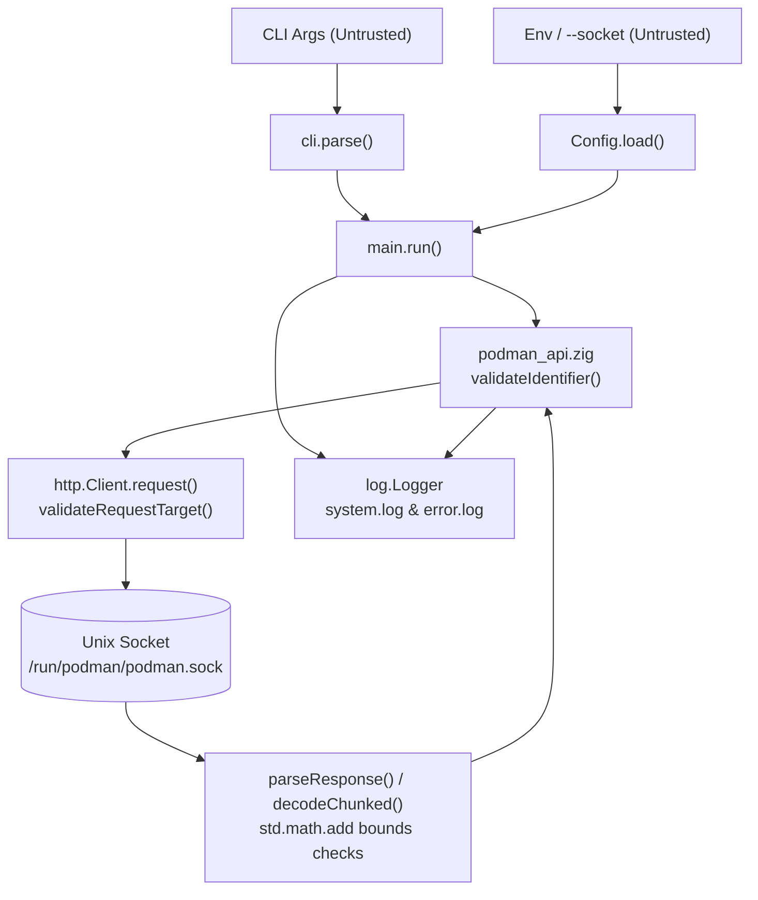

---
tags:
  - architecture
  - memory-safety
  - trust-boundary
aliases:
  - Module Architecture
status: active
---

# Architecture & Memory Ownership Map

กลับไปที่ [[00-Index]] · ดูเช็กลิสต์ที่ [[Security-And-Memory-Checklist]]

## Data Flow & Trust Boundaries

## Module Map & Memory Ownership

| Module | Link | Responsibility | Allocation Owner / Deinit |
| :--- | :--- | :--- | :--- |
| Entry Point | [src/main.zig](../../src/main.zig) | Arg collection, config/log setup, command dispatch, GPA leak check | `ArenaAllocator` over `GeneralPurposeAllocator`; asserts `gpa.deinit() != .leak` |
| CLI Parser | [src/cli.zig](../../src/cli.zig) | Subcommands & flags (`run`, `ps`, `images`, `pull`, `stop`, `rm`, `logs`, `version`) | `Parsed.deinit(allocator)` frees `r.env` |
| Config | [src/config.zig](../../src/config.zig) | Socket auto-detection & log directory resolution | `Config.deinit(allocator)` frees owned `socket_path` and `log_dir` |
| HTTP Client | [src/http.zig](../../src/http.zig) | HTTP/1.1 over Unix domain socket (`Content-Length` & chunked) | `Response.deinit()` frees `body`; request buffer freed internally |
| Podman API | [src/podman_api.zig](../../src/podman_api.zig) | Docker/Podman `/v1.40` endpoints & `demuxLogs` | `createContainer` returns duped `Id` (caller frees); `std.json.Parsed` freed via `defer parsed.deinit()` |
| Logger | [src/log.zig](../../src/log.zig) | ISO-8601 UTC file logging to `system.log` and `error.log` | Stack buffer `[4096]u8`; `Logger.deinit()` closes file handles |
| Utils | [src/utils.zig](../../src/utils.zig) | `shortId`, `formatSize`, re-exports `log.zig` | Stack buffer formatting (no heap allocations) |

## Trust Boundaries

> [!warning] Untrusted Inputs Requiring Validation
> 1. **Container IDs / Names** → ต้องผ่าน `podman_api.validateIdentifier()` ก่อนประกอบ URL path หรือ query
> 2. **HTTP Request Targets** → ต้องผ่าน `http.validateRequestTarget()` ก่อนเขียน HTTP request line
> 3. **Chunked Transfer Sizes & Multiplexed Log Frames** → ต้องคำนวณด้วย `std.math.add()` และตรวจ `max_response_bytes` เสมอ

## Related Notes

- [[Bug-Playbook]]
- [[Security-And-Memory-Checklist]]
