---
tags:
  - dashboard
  - bug-pattern
  - memory-safety
  - security-gate
aliases:
  - Bug Tracking Dashboard
status: active
---

# ZigPod Bug Tracking & Security Dashboard

กลับไปที่ [[00-Index]] · คู่มือบั๊กที่ [[Bug-Playbook]] · แผนผังระบบ [[Architecture-Map]] · เช็กลิสต์ [[Security-And-Memory-Checklist]]

> สร้างอัตโนมัติจาก [scripts/bug-dashboard.py](../../scripts/bug-dashboard.py) (`make dashboard` / `make bugs` / `make dashboard-serve`)

## Overview Metrics

| Metric | Value |
| :--- | :--- |
| Tracked Bug Patterns | **20** (20 Guarded) |
| Zig Source Modules | **10** |
| Unit & Integration Tests | **87** |
| Static Security & Memory Gates | **9/9 PASS** |

## Guard Coverage Map

```mermaid
flowchart LR
    PLAYBOOK["[[Bug-Playbook]]"] --> DASH["[[Bug-Dashboard]]"]
    BUG001["BUG-001"] --> SEC["[[Security-And-Memory-Checklist]]"]
    BUG001 --> src_http_zig["src/http.zig"]
    BUG002["BUG-002"] --> SEC["[[Security-And-Memory-Checklist]]"]
    BUG002 --> src_cli_zig["src/cli.zig"]
    BUG002 --> src_config_zig["src/config.zig"]
    BUG003["BUG-003"] --> SEC["[[Security-And-Memory-Checklist]]"]
    BUG003 --> src_config_zig["src/config.zig"]
    BUG004["BUG-004"] --> SEC["[[Security-And-Memory-Checklist]]"]
    BUG004 --> src_http_zig["src/http.zig"]
    BUG004 --> src_podman_api_zig["src/podman_api.zig"]
    BUG005["BUG-005"] --> SEC["[[Security-And-Memory-Checklist]]"]
    BUG005 --> src_podman_api_zig["src/podman_api.zig"]
    BUG005 --> src_http_zig["src/http.zig"]
    BUG006["BUG-006"] --> SEC["[[Security-And-Memory-Checklist]]"]
    BUG006 --> scripts_auto_audit_sh["scripts/auto-audit.sh"]
    BUG006 --> _github_workflows_ci_yml[".github/workflows/ci.yml"]
    BUG007["BUG-007"] --> SEC["[[Security-And-Memory-Checklist]]"]
    BUG007 --> src_http_zig["src/http.zig"]
    BUG007 --> src_podman_api_zig["src/podman_api.zig"]
    BUG008["BUG-008"] --> SEC["[[Security-And-Memory-Checklist]]"]
    BUG008 --> src_log_zig["src/log.zig"]
    BUG009["BUG-009"] --> SEC["[[Security-And-Memory-Checklist]]"]
    BUG009 --> src_log_zig["src/log.zig"]
    BUG010["BUG-010"] --> SEC["[[Security-And-Memory-Checklist]]"]
    BUG010 --> src_http_zig["src/http.zig"]
    BUG011["BUG-011"] --> SEC["[[Security-And-Memory-Checklist]]"]
    BUG011 --> scripts_auto_audit_sh["scripts/auto-audit.sh"]
    BUG012["BUG-012"] --> SEC["[[Security-And-Memory-Checklist]]"]
    BUG012 --> src_main_zig["src/main.zig"]
    BUG013["BUG-013"] --> SEC["[[Security-And-Memory-Checklist]]"]
    BUG013 --> src_log_zig["src/log.zig"]
    BUG014["BUG-014"] --> SEC["[[Security-And-Memory-Checklist]]"]
    BUG014 --> src_podman_api_zig["src/podman_api.zig"]
    BUG015["BUG-015"] --> SEC["[[Security-And-Memory-Checklist]]"]
    BUG015 --> src_podman_api_zig["src/podman_api.zig"]
    BUG015 --> src_cli_zig["src/cli.zig"]
    BUG016["BUG-016"] --> SEC["[[Security-And-Memory-Checklist]]"]
    BUG016 --> src_podman_api_zig["src/podman_api.zig"]
    BUG016 --> src_cli_zig["src/cli.zig"]
    BUG017["BUG-017"] --> SEC["[[Security-And-Memory-Checklist]]"]
    BUG017 --> src_podman_api_zig["src/podman_api.zig"]
    BUG018["BUG-018"] --> SEC["[[Security-And-Memory-Checklist]]"]
    BUG018 --> src_podman_api_zig["src/podman_api.zig"]
    BUG019["BUG-019"] --> SEC["[[Security-And-Memory-Checklist]]"]
    BUG019 --> src_policy_zig["src/policy.zig"]
    BUG019 --> src_log_zig["src/log.zig"]
    BUG020["BUG-020"] --> SEC["[[Security-And-Memory-Checklist]]"]
    BUG020 --> src_main_zig["src/main.zig"]
```

## Bug Pattern Registry

| ID | Title | Tags | Guarded Files | Status |
| :--- | :--- | :--- | :--- | :--- |
| [BUG-001](../../docs/vault/Bug-Playbook.md#L20) | Error Set Mismatch on `std.net.connectUnixSocket` | `#bug-pattern` | [http.zig](../../src/http.zig) | **Guarded** |
| [BUG-002](../../docs/vault/Bug-Playbook.md#L29) | `ArenaAllocator` in Tests Hiding Memory Leaks | `#bug-pattern` `#memory-safety` | [cli.zig](../../src/cli.zig), [config.zig](../../src/config.zig), [auto-audit.sh](../../scripts/auto-audit.sh) | **Guarded** |
| [BUG-003](../../docs/vault/Bug-Playbook.md#L40) | Sub-slice Pointer Returned from Owned Env Buffer | `#bug-pattern` `#memory-safety` | [config.zig](../../src/config.zig) | **Guarded** |
| [BUG-004](../../docs/vault/Bug-Playbook.md#L49) | Integer Overflow & OOB Read in Chunked / Frame Decoders | `#bug-pattern` `#security-gate` | [http.zig](../../src/http.zig), [podman_api.zig](../../src/podman_api.zig) | **Guarded** |
| [BUG-005](../../docs/vault/Bug-Playbook.md#L60) | Path Traversal & CRLF Injection via Container ID / Path | `#bug-pattern` `#security-gate` | [podman_api.zig](../../src/podman_api.zig), [http.zig](../../src/http.zig) | **Guarded** |
| [BUG-006](../../docs/vault/Bug-Playbook.md#L71) | Missing `ripgrep` (`rg`) on CI Runners Causing `auto-audit.sh` Failure | `#bug-pattern` `#security-gate` | [auto-audit.sh](../../scripts/auto-audit.sh), [ci.yml](../../.github/workflows/ci.yml) | **Guarded** |
| [BUG-007](../../docs/vault/Bug-Playbook.md#L82) | Half-Enforced Socket Timeout (Wait/Pull Fail Early or Hang Forever) | `#bug-pattern` `#security-gate` | [http.zig](../../src/http.zig), [podman_api.zig](../../src/podman_api.zig) | **Guarded** |
| [BUG-008](../../docs/vault/Bug-Playbook.md#L95) | Crash-Interrupted Audit Tail Poisons the Whole Hash Chain | `#bug-pattern` `#memory-safety` | [log.zig](../../src/log.zig) | **Guarded** |
| [BUG-009](../../docs/vault/Bug-Playbook.md#L107) | Concurrent Logger Writers Fork the Audit Hash Chain | `#bug-pattern` `#memory-safety` | [log.zig](../../src/log.zig) | **Guarded** |
| [BUG-010](../../docs/vault/Bug-Playbook.md#L120) | Unchecked Add in `decodeChunked` Depends on Short-Circuit Order | `#bug-pattern` `#security-gate` | [http.zig](../../src/http.zig) | **Guarded** |
| [BUG-011](../../docs/vault/Bug-Playbook.md#L129) | Locale-Dependent (Buddhist Era) Timestamps in Shell Scripts | `#bug-pattern` | [auto-audit.sh](../../scripts/auto-audit.sh) | **Guarded** |
| [BUG-012](../../docs/vault/Bug-Playbook.md#L138) | Missing Cleanup Paths in the `run` Container Lifecycle | `#bug-pattern` `#reliability` | [main.zig](../../src/main.zig) | **Guarded** |
| [BUG-013](../../docs/vault/Bug-Playbook.md#L150) | World-Readable Log Files | `#bug-pattern` `#security-gate` | [log.zig](../../src/log.zig) | **Guarded** |
| [BUG-014](../../docs/vault/Bug-Playbook.md#L159) | Host Bind Mount Without a Fail-Closed Path Policy | `#bug-pattern` `#security-gate` | [podman_api.zig](../../src/podman_api.zig) | **Guarded** |
| [BUG-015](../../docs/vault/Bug-Playbook.md#L171) | Port Publishing Without a Fail-Closed Port Policy | `#bug-pattern` `#security-gate` | [podman_api.zig](../../src/podman_api.zig), [cli.zig](../../src/cli.zig) | **Guarded** |
| [BUG-016](../../docs/vault/Bug-Playbook.md#L183) | Unvalidated Network/Identity/Capability Flags | `#bug-pattern` `#security-gate` | [podman_api.zig](../../src/podman_api.zig), [cli.zig](../../src/cli.zig) | **Guarded** |
| [BUG-017](../../docs/vault/Bug-Playbook.md#L195) | Inspect Target Not Validated Before URL Path Assembly | `#bug-pattern` `#security-gate` | [podman_api.zig](../../src/podman_api.zig) | **Guarded** |
| [BUG-018](../../docs/vault/Bug-Playbook.md#L205) | Exec ID from Daemon Response Reused in URL Without Validation | `#bug-pattern` `#security-gate` | [podman_api.zig](../../src/podman_api.zig) | **Guarded** |
| [BUG-019](../../docs/vault/Bug-Playbook.md#L217) | Sandbox Profile Without Pre-Flight Policy Guardrails & DENY Telemetry | `#bug-pattern` `#security-gate` | [policy.zig](../../src/policy.zig), [log.zig](../../src/log.zig) | **Guarded** |
| [BUG-020](../../docs/vault/Bug-Playbook.md#L227) | Premature `deinit()` of Parsed Policy Before `TmpfsBounds` Serialization (Use-After-Free) | `#bug-pattern` `#memory-leak` | [main.zig](../../src/main.zig) | **Guarded** |

## Module Test & Allocator Coverage

| Module | Lines | Public Decls | Unit Tests | Memory Gate |
| :--- | ---: | ---: | ---: | :--- |
| [cli.zig](../../src/cli.zig) | 1548 | 26 | 22 | `std.testing.allocator` |
| [config.zig](../../src/config.zig) | 118 | 4 | 4 | `std.testing.allocator` |
| [demo.zig](../../src/demo.zig) | 379 | 1 | 1 | `std.testing.allocator` |
| [http.zig](../../src/http.zig) | 997 | 25 | 13 | `std.testing.allocator` |
| [log.zig](../../src/log.zig) | 711 | 20 | 9 | `std.testing.allocator` |
| [main.zig](../../src/main.zig) | 639 | 2 | 2 | `gpa.deinit() != .leak` |
| [podman_api.zig](../../src/podman_api.zig) | 3165 | 80 | 31 | `std.testing.allocator` |
| [podman_types.zig](../../src/podman_types.zig) | 318 | 39 | 0 | `MISSING` |
| [policy.zig](../../src/policy.zig) | 199 | 13 | 3 | `std.testing.allocator` |
| [utils.zig](../../src/utils.zig) | 42 | 3 | 2 | `stack-only (no heap)` |

## Static Security & Memory Gates

| Gate | Bug Ref | Result |
| :--- | :--- | :--- |
| No page_allocator in src/ | BUG-002 | **PASS** |
| GPA leak check enforced in main.zig | BUG-002 | **PASS** |
| No error.AccessDenied in http.zig | BUG-001 | **PASS** |
| std.testing.allocator in heap modules | BUG-002 | **PASS** |
| validateRequestTarget() in http.zig | BUG-005 | **PASS** |
| validateIdentifier() in podman_api.zig | BUG-005 | **PASS** |
| Checked arithmetic std.math.add/mul | BUG-004 | **PASS** |
| Timeout poll, HostConfig hardening, audit chain & demo | Security | **PASS** |
| Verification scripts executable (+x) | BUG-006 | **PASS** |

## Tracked Bug Details

### BUG-001 — Error Set Mismatch on `std.net.connectUnixSocket`
- **Source**: [docs/vault/Bug-Playbook.md:20](../../docs/vault/Bug-Playbook.md#L20) · **Status**: `Guarded`
- **Symptom**: `zig build test` บน Zig 0.13.0 ล้มเหลว: `'error.AccessDenied' not a member of destination error set`
- **Root Cause**: `std.net.connectUnixSocket` ใน Zig 0.13.0 คืน `error.PermissionDenied` ไม่ได้รวม `error.AccessDenied`
- **Fix**: เปลี่ยน `src/http.zig` ให้ match เฉพาะ `error.PermissionDenied => Error.PermissionDenied`
- **Prevention**: ตรวจสอบ error union ของ stdlib เวอร์ชันเป้าหมาย (Zig `0.13.0`) และรัน `zig build test` ใน CI ทุกครั้ง

### BUG-002 — `ArenaAllocator` in Tests Hiding Memory Leaks
- **Source**: [docs/vault/Bug-Playbook.md:29](../../docs/vault/Bug-Playbook.md#L29) · **Status**: `Guarded`
- **Symptom**: เทสใน `cli.zig` และ `config.zig` เดิมใช้ `ArenaAllocator` (หรือ `page_allocator` แบบ global) ซึ่งไม่เคยรายงาน leak
- **Root Cause**: `ArenaAllocator` กวาดคืนทีเดียว ทำให้ตรวจไม่พบกรณีลืม `deinit` หรือคืนหน่วยความจำไม่ครบใน error path
- **Fix**: เพิ่ม `Parsed.deinit` ใน `src/cli.zig` และ `Config.deinit` ใน `src/config.zig`; เปลี่ยนทุก `test` block ให้ใช้ `std.testing.allocator` โดยตรง พร้อมเทส error path ที่จอง memory ไปแล้วบางส่วน
- **Prevention**: ห้ามใช้ `page_allocator` หรือ `ArenaAllocator` ใน `test` blocks; `scripts/auto-audit.sh` ตรวจบล็อก pattern นี้โดยอัตโนมัติ

### BUG-003 — Sub-slice Pointer Returned from Owned Env Buffer
- **Source**: [docs/vault/Bug-Playbook.md:40](../../docs/vault/Bug-Playbook.md#L40) · **Status**: `Guarded`
- **Symptom**: `resolveSocket` ใน `src/config.zig` เดิมคืน `stripUnixScheme(s)` ซึ่งชี้เข้าไปกลาง buffer ที่ `getEnv` จองไว้
- **Root Cause**: หาก caller เรียก `allocator.free(socket_path)` บน sub-slice ที่ไม่ได้เริ่มที่ address แรกของ allocation จะเกิด panic/invalid free หรือ leak buffer ระหว่างทางจาก `getEnv`
- **Fix**: free buffer ชั่วคราวของ `getEnv` ด้วย `defer allocator.free(s)` และ `allocator.dupe` ค่าที่ตัด prefix แล้วให้เป็น owned slice ที่เป็นอิสระ
- **Prevention**: ทุกฟังก์ชันที่คืน slice ให้ caller ต้องคืน owned allocation เต็มก้อน หรือระบุ lifetime อย่างชัดเจนและมี `deinit` คู่กัน

### BUG-004 — Integer Overflow & OOB Read in Chunked / Frame Decoders
- **Source**: [docs/vault/Bug-Playbook.md:49](../../docs/vault/Bug-Playbook.md#L49) · **Status**: `Guarded`
- **Symptom**: `decodeChunked` และ `demuxLogs` เดิมใช้ `pos + size` และ `pos += size + 2` โดยไม่ตรวจ overflow หรือ trailer `\r\n`
- **Root Cause**: ค่า chunk size ขนาดใหญ่ (เช่น `FFFFFFFFFFFFFFFF`) หรือ payload ที่ขาด `\r\n` อาจทำให้ `pos` ทะลุ `data.len` แล้ว panic ใน `std.mem.indexOfPos`
- **Fix**: ใช้ `std.math.add` ทุกจุดใน `decodeChunked` (`src/http.zig`) และ `demuxLogs` (`src/podman_api.zig`); ตรวจ `max_response_bytes` และตรวจยืนยัน `"\r\n"` ท้ายทุก chunk พร้อม unit tests เคส malformed
- **Prevention**: ทุกขนาด/offset ที่มาจาก socket หรือไฟล์ภายนอกต้องผ่าน `std.math.add` และ bounds check เสมอ

### BUG-005 — Path Traversal & CRLF Injection via Container ID / Path
- **Source**: [docs/vault/Bug-Playbook.md:60](../../docs/vault/Bug-Playbook.md#L60) · **Status**: `Guarded`
- **Symptom**: ค่า `id` หรือ `name` เช่น `../containers` หรือ `id\r\nX-Evil: 1` สามารถแทรกเข้า URL path หรือ HTTP request line ได้
- **Root Cause**: ไม่มีการ validate input ก่อน `allocPrint` เข้า path และ HTTP request line
- **Fix**: เพิ่ม `podman_api.validateIdentifier` ใน `src/podman_api.zig`; เพิ่ม `http.validateRequestTarget` ใน `src/http.zig`
- **Prevention**: ทุก endpoint ที่รับ identifier จาก CLI ต้องเรียก `validateIdentifier` และ `Client.request` ต้องเรียก `validateRequestTarget`

### BUG-006 — Missing `ripgrep` (`rg`) on CI Runners Causing `auto-audit.sh` Failure
- **Source**: [docs/vault/Bug-Playbook.md:71](../../docs/vault/Bug-Playbook.md#L71) · **Status**: `Guarded`
- **Symptom**: บน CI runner (เช่น GitHub Actions `ubuntu-latest`) การรัน `scripts/auto-audit.sh` ล้มเหลวด้วย `./scripts/auto-audit.sh: line 49: rg: command not found` (exit code `1`) แม้ unit test และ build จะผ่านครบ
- **Root Cause**: `scripts/auto-audit.sh` เรียก `rg` โดยตรงโดยไม่มี fallback เมื่อไม่มี binary `rg` ทำให้เกิด exit code `127`: ตรวจเชิงบวก (`if rg -q ...`) ล้มเหลวทั้งหมด และตรวจเชิงลบ (`if rg -n ... >/dev/null 2>&1`) ซ่อน stderr จนกลายเป็น false-pass
- **Fix**: เพิ่ม helper `has_match()` ใน `scripts/auto-audit.sh` ให้ใช้ `rg -q` เป็นหลักและ fallback เป็น `grep -REq` เมื่อไม่มี `rg`; เพิ่ม step ติดตั้ง `ripgrep` ใน `ci.yml`
- **Prevention**: สคริปต์ตรวจอัตโนมัติที่รันบน CI ต้องตรวจ `command -v <tool>` พร้อม fallback หรือติดตั้ง dependency ใน `ci.yml` ให้ครบ และทดสอบกรณีไม่มีเครื่องมือด้วย

### BUG-007 — Half-Enforced Socket Timeout (Wait/Pull Fail Early or Hang Forever)
- **Source**: [docs/vault/Bug-Playbook.md:82](../../docs/vault/Bug-Playbook.md#L82) · **Status**: `Guarded`
- **Symptom**: `zigpod run` แบบ attached ล้มเหลวด้วย `Error.Timeout` เมื่อ container ทำงานเกิน 30 วินาที (Podman `POST /containers/{id}/wait` จะไม่ส่ง response จนกว่า container จะจบ) ในทางกลับกัน หาก daemon ส่งข้อมูลชุดแรกแล้วค้างกลางทาง (เช่น `pull` ระหว่าง network หลุดแต่ยังไม่ปิด connection) `readAllAlloc` จะ block ตลอดกาลโดยไม่มี timeout
- **Root Cause**: ใน `src/http.zig` เดิม `Client.request` เรียก `waitReadable` (poll) เพียง**ครั้งเดียวก่อน byte แรก** แล้วส่งต่อให้ `readAllAlloc` อ่านจน EOF โดยไม่มีการ poll อีก — timeout ถูกบังคับเฉพาะ "รอ byte แรก" เท่านั้น และ `waitContainer`/`pullImage` ใช้ default timeout 30s ทั้งที่ endpoint เหล่านี้ตั้งใจให้เงียบนาน
- **Fix**: เพิ่ม `readAllWithTimeout` ใน `src/http.zig` ที่ poll ก่อน**ทุกการอ่าน** (ไม่ใช่แค่ครั้งแรก) จนกว่าจะได้ EOF พร้อม enforce `max_response_bytes`; เพิ่ม `Client.requestWithTimeout` และ `http.blocking_timeout_ms` (12 ชม.) สำหรับ endpoint ที่ block ตาม external event; `waitContainer` และ `pullImage` ใน `src/podman_api.zig` ใช้ `requestWithTimeout(..., blocking_timeout_ms)`; เพิ่มเทส regression: stream ที่ค้างกลาง body ต้องได้ `Error.Timeout` ภายใน timeout สั้น ๆ และ server ที่ตอบช้ากว่า default timeout ต้องผ่านเมื่อใช้ long timeout
- **Prevention**: ห้ามอ่าน socket โดยไม่ poll ก่อนทุกครั้ง; endpoint ที่ block ตาม external event ต้องประกาศ timeout ของตัวเอง (`blocking_timeout_ms`) ไม่ใช่ยืม default 30s ของ request ทั่วไป

### BUG-008 — Crash-Interrupted Audit Tail Poisons the Whole Hash Chain
- **Source**: [docs/vault/Bug-Playbook.md:95](../../docs/vault/Bug-Playbook.md#L95) · **Status**: `Guarded`
- **Symptom**: หากกระบวนการตายกลางการเขียนบรรทัดสุดท้ายของ `audit.log` (partial line ไม่มี `\n`) การรันครั้งถัดไปจะ fallback ไป genesis hash ทำให้ทุก entry ใหม่มี `prev_hash` ไม่ตรงกับท้ายไฟล์ และ `zigpod audit` รายงาน `AuditTampered` **ทั้งไฟล์** แม้ไม่มีใครแก้ไข
- **Root Cause**: `readLastAuditHash` เดิม parse บรรทัดสุดท้ายแบบไม่แยกแยะ "บรรทัดที่ยังไม่ commit" (hash ไม่ครบ 64 ตัว → genesis) จาก "การ tamper จริง" และ `verifyAuditFile` ถือว่าทุก segment เป็น entry ที่ commit แล้ว
- **Fix**: เพิ่ม `repairAuditTail` ใน `src/log.zig`: ตอน `Logger.init` ใต้ flock ให้ truncate บรรทัดสุดท้ายที่ไม่สมบูรณ์ออกก่อน append ต่อ; `verifyAuditFile` ข้าม segment สุดท้ายที่ไม่มี `\n` ปิดท้าย (ไม่นับเป็น entry และไม่รายงาน tamper) — บรรทัดกลางไฟล์ที่ malformed ยังคง fail ตามเดิม; เพิ่มเทส: partial tail ต้องไม่ทำ verify ล้มเหลว และ init ครั้งถัดไปต้อง repair แล้วต่อ chain ได้
- **Prevention**: ระบบ hash-chain ต้องแยกพฤติกรรม "uncommitted tail" (crash) ออกจาก "tampering" เสมอ และต้อง repair ตอน re-open ภายใต้ lock

### BUG-009 — Concurrent Logger Writers Fork the Audit Hash Chain
- **Source**: [docs/vault/Bug-Playbook.md:107](../../docs/vault/Bug-Playbook.md#L107) · **Status**: `Guarded`
- **Symptom**: เมื่อรัน zigpod มากกว่าหนึ่ง process พร้อมกัน (เช่น `run` ค้างไว้แล้วเปิดอีก terminal) ทุก process อ่าน `last_hash` เดียวกันตอน init แล้วเขียนแทรกสลับกัน ทำให้ `prev_hash` ของ entry ไม่ตรงกับบรรทัดก่อนหน้าจริง และ `zigpod audit` รายงาน tampered ทั้งไฟล์
- **Root Cause**: `O_APPEND` (src/log.zig `openAppend`) กัน overwrite ได้ แต่ไม่กัน hash-chain desync: hash ถูกคำนวณจาก state ในหน่วยความจำของแต่ละ process ไม่ใช่ state จริงล่าสุดของไฟล์
- **Fix**: เพิ่ม `lockAudit`/`unlockAudit` (`std.posix.flock` `LOCK.EX`/`LOCK.UN`) ใน `src/log.zig`; ทุกครั้งที่เขียน audit: lock → re-read chain head จากไฟล์ (`lastHashFromFd`) → คำนวณ hash → append → unlock; `Logger.init` ก็ทำ repair + อ่าน hash ใต้ lock เช่นกัน; เพิ่มเทส: logger สองตัวเขียนสลับกันแล้ว `verifyAuditFile` ต้องผ่านครบทุก entry
- **Prevention**: โครงสร้าง hash-chained ที่เขียนจากหลาย process ต้องอ่าน state ล่าสุดใต้ exclusive lock ทุกครั้งก่อนคำนวณ hash ถัดไป ห้ามพึ่ง state ในหน่วยความจำ

### BUG-010 — Unchecked Add in `decodeChunked` Depends on Short-Circuit Order
- **Source**: [docs/vault/Bug-Playbook.md:120](../../docs/vault/Bug-Playbook.md#L120) · **Status**: `Guarded`
- **Symptom**: ตรวจพบตอน code review: `out.items.len + size > max_response_bytes` ใน `src/http.zig` ใช้ `+` ธรรมดาแทน `std.math.add` — ตอนนี้ปลอดภัยเพราะเงื่อนไข `size > max_response_bytes` ถูกประเมินก่อนแล้ว short-circuit ออก (ยืนยันด้วย repro: chunk size `FFFFFFFFFFFFFFFF` ตัดทิ้งด้วย `InvalidResponse` ไม่ panic) แต่ถ้า refactor สลับลำดับเงื่อนไข จะกลายเป็น integer overflow panic ใน Debug/ReleaseSafe ทันทีเมื่อ chunk ก่อนหน้ามีข้อมูลอยู่แล้ว
- **Root Cause**: กฎของ BUG-004 ("ทุกขนาด/offset ต้องผ่าน `std.math.add`") ถูกทำให้ "ผ่านแบบบังเอิญ" จาก evaluation order ของ `or` แทนที่จะถูกบังคับด้วย checked arithmetic โดยตรง
- **Fix**: เปลี่ยนเป็น `const projected = std.math.add(usize, out.items.len, size) catch return Error.InvalidResponse;` ก่อนเช็ค `max_response_bytes`
- **Prevention**: ห้ามพึ่ง short-circuit order เพื่อกัน integer overflow — คำนวณขนาดที่มาจาก socket ต้องใช้ `std.math.add` ตั้งแต่บรรทัดแรก ไม่ว่าเงื่อนไขข้างเคียงจะ "ช่วย" ก็ตาม

### BUG-011 — Locale-Dependent (Buddhist Era) Timestamps in Shell Scripts
- **Source**: [docs/vault/Bug-Playbook.md:129](../../docs/vault/Bug-Playbook.md#L129) · **Status**: `Guarded`
- **Symptom**: ใน `system.log` พบ timestamp สองปฏิทินปนกัน: entry จาก `scripts/auto-audit.sh` เป็นปี พ.ศ. (`2569-...`) ขณะที่ entry จาก Zig Logger เป็น ค.ศ. (`2026-...`) ทำให้ sort/grep ตามเวลาเพี้ยนและ dashboard parse ผิด
- **Root Cause**: เครื่อง dev ตั้ง `LC_TIME=th_TH.UTF-8` ทำให้ `date -u '+%Y...'` คืนปี Buddhist Era (ปีจริงของระบบเป็น ค.ศ. ถูกต้อง) ส่วน Zig `writeTimestamp` คำนวณจาก epoch เสมอ
- **Fix**: เปลี่ยนเป็น `TIMESTAMP="$(LC_ALL=C date -u '+%Y-%m-%dT%H:%M:%SZ')"` ใน `scripts/auto-audit.sh`
- **Prevention**: สคริปต์ที่เขียน log ร่วมกับ runtime ต้อง pin locale (`LC_ALL=C`) เมื่อ format timestamp และต้อง cross-check รูปแบบกับ entry จาก runtime อื่นในไฟล์เดียวกัน

### BUG-012 — Missing Cleanup Paths in the `run` Container Lifecycle
- **Source**: [docs/vault/Bug-Playbook.md:138](../../docs/vault/Bug-Playbook.md#L138) · **Status**: `Guarded`
- **Symptom**: (1) `startContainer` ล้มเหลวหลัง `createContainer` สำเร็จ → container ถูกสร้างค้างเป็น orphan (2) `zigpod run --rm` แบบ attached: ถ้า `fetchLogs` ล้มเหลว container ไม่ถูกลบตามที่ผู้ใช้สั่ง (3) `id` ที่ได้จาก `createContainer` ไม่เคยถูก free ใน `dispatch` (ปลอดภัยเพราะ arena แต่ขัด contract "caller frees" ใน [[Architecture-Map]])
- **Root Cause**: `dispatch` ใน `src/main.zig` ใช้ `try` ตรง ๆ ทุก step โดยไม่มี cleanup path; `AutoRemove` ถูกตั้งเฉพาะเมื่อ detach (เพื่อไม่ให้ daemon ลบ container ก่อน fetchLogs) แต่ไม่มี best-effort removal เมื่อ pipeline สะดุด
- **Fix**: `startContainer` fail → best-effort `removeContainer(force=true)` ทิ้งก่อนคืน error; `fetchLogs` fail เมื่อมี `--rm` → best-effort `removeContainer` (container จบแล้วหลัง wait) ก่อนคืน error; เพิ่ม `defer client.allocator.free(id)` ให้ตรง contract
- **Prevention**: lifecycle ที่สร้าง resource บน daemon ต้องมี best-effort cleanup ทุก failure path หลังจุดที่ resource เกิดขึ้น และ ownership ของ allocation ต้องตรงกับเอกสารเสมอ

### BUG-013 — World-Readable Log Files
- **Source**: [docs/vault/Bug-Playbook.md:150](../../docs/vault/Bug-Playbook.md#L150) · **Status**: `Guarded`
- **Symptom**: `system.log` / `error.log` / `audit.log` ถูกสร้างด้วย mode `0644` — ผู้ใช้อื่นบนเครื่องอ่านได้ ทั้งที่มี container/image IDs, ชื่อ image และข้อความ error จาก daemon
- **Root Cause**: `openAppend` ใน `src/log.zig` ใช้ `0o644`; เช็กลิสต์เดิมบังคับแค่ "ไม่ world-writable" จึงไม่มีใครสังเกต
- **Fix**: ลด mode เป็น `0o640` และ `chmod 640` ไฟล์ที่มีอยู่แล้วใน repository
- **Prevention**: ไฟล์ log/audit ที่สร้างใหม่ต้องใช้ `0o640` ขึ้นไป (group-readable ได้ แต่ห้าม other-readable/world-writable) และ `security-check.sh` ต้องรายงาน mode ปัจจุบันทุกครั้ง

### BUG-014 — Host Bind Mount Without a Fail-Closed Path Policy
- **Source**: [docs/vault/Bug-Playbook.md:159](../../docs/vault/Bug-Playbook.md#L159) · **Status**: `Guarded`
- **Symptom**: ระหว่างทำ Phase 1 (`-v`/`--volume`) หากส่ง `SRC:DST` เข้าไปใน `Mounts` ตรง ๆ จะสามารถ bind-mount `/`, `/etc`, `/proc`, `/sys`, `/run`, `/var/run/docker.sock`, `/root`, หรือ path ที่มี `..` ได้ ทำให้ container (หรือ AI agent ที่ขับ CLI) อ่าน/เขียนไฟล์ระบบ host, ขโมย container-engine socket แล้วยกระดับสิทธิ์ หรือแก้ `/etc` เพื่อ persistence
- **Root Cause**: เดิม CLI ไม่รองรับ `-v` จึงไม่มีจุดตรวจ; การเพิ่ม mount โดยไม่มี policy จะเปิดช่องโหว่ path traversal + dangerous-host-path ทันที (จัดอยู่ในคลาสเดียวกับ BUG-005 แต่เป็นฝั่ง host filesystem)
- **Fix**: เพิ่ม `podman_api.makeMount()` + `validateHostPath()` / `validateVolumeName()` / `validateContainerPath()` ใน `src/podman_api.zig`: source/target ต้องเป็น absolute, ห้าม `..`/`.`/`//`/trailing-slash/control-char, ยาว ≤ 4096; บล็อก subtree ของ `/`, `/etc`, `/proc`, `/sys`, `/dev`, `/boot`, `/run`, `/var/run`, `/var/lib/docker`, `/var/lib/containers`, `/root`; default เป็น read-only; allow-list ของ `/etc` (`localtime`, `timezone`, `hosts`, `resolv.conf`, `nsswitch.conf`, `hostname`) ต้อง `:ro` เท่านั้น; `createContainer` re-validate `Mounts` แบบ defense-in-depth ก่อน stringify JSON; เพิ่มเทส DENY ครบ (traversal, dangerous roots, rw-on-`/etc`) และ smoke E2E ตรวจว่า `-v /etc:/data` ถูกปฏิเสธก่อนถึง daemon
- **Prevention**: ทุก field ที่อ้างถึง **path บน host** (mounts, volumes, อนาคต `build` context / `--env-file`) ต้องผ่าน validator แบบ fail-closed ที่ absolute+no-traversal+denylist และ default เป็นสิทธิ์ต่ำสุด (read-only) เสมอ — ห้าม serialize ค่าดิบลง request

### BUG-015 — Port Publishing Without a Fail-Closed Port Policy
- **Source**: [docs/vault/Bug-Playbook.md:171](../../docs/vault/Bug-Playbook.md#L171) · **Status**: `Guarded`
- **Symptom**: ระหว่างทำ Phase 1 (`-p`/`--publish`) หากส่ง port mapping เข้าไปใน `ExposedPorts`/`HostConfig.PortBindings` ตรง ๆ จะสามารถประกาศพอร์ตนอกช่วง (`0`, `>65535`) ที่ daemon ตีความเป็นค่าอื่น, ใส่ protocol แปลกปลอม, หรือใส่ host address ที่ไม่ใช่ IP จริง (เช่น hostname ภายนอก) ทำให้เกิด binding ที่คาดไม่ถึงและขยาย attack surface โดยไม่ตั้งใจ
- **Root Cause**: เดิม CLI ไม่รองรับ `-p` จึงไม่มีจุดตรวจ; การ parse port string แบบหลวมแล้ว serialize ดิบจะเกิด mismatch ระหว่างสิ่งที่ผู้ใช้ตั้งใจกับสิ่งที่ daemon bind (จัดอยู่ในคลาสเดียวกับ BUG-005/014 แต่เป็นฝั่ง network surface)
- **Fix**: เพิ่ม `podman_api.makePortMapping()` + `validatePortMapping()` ใน `src/podman_api.zig`: container/host port ต้องอยู่ใน `1..65535`, proto allow-list `tcp`/`udp`/`sctp`, host address (ถ้ามี) ต้องผ่าน `std.net.Address.parseIp4`; `src/cli.zig` parse เฉพาะรูปแบบ `CONTAINER`, `CONTAINER/proto`, `HOST:CONTAINER[/proto]`, `IPV4:HOST:CONTAINER[/proto]`; เกิน 3 field หรือ port 0/เกินช่วง/proto แปลก → `InvalidValue`; `ExposedPorts`/`PortBindings` serialize ด้วย custom `jsonStringify` โดย bind เฉพาะ entry ที่มี host port และใช้ `HostPort` เป็น string ตาม Docker schema; `createContainer` re-validate `ExposedPorts` แบบ defense-in-depth ก่อน stringify JSON; เพิ่มเทส DENY ครบ (port 0, proto แปลก, IP ผิดรูป) และ smoke E2E ตรวจว่า `-p 0:80` ถูกปฏิเสธก่อนถึง daemon
- **Prevention**: ทุก field ที่อ้างถึง **network endpoint** (ports, อนาคต `--network`, `--hostname`) ต้องผ่าน validator แบบ allow-list (range + protocol + IP literal) และตรวจซ้ำในชั้น API (defense-in-depth) ก่อน serialize — ห้าม serialize ค่าดิบลง request

### BUG-016 — Unvalidated Network/Identity/Capability Flags
- **Source**: [docs/vault/Bug-Playbook.md:183](../../docs/vault/Bug-Playbook.md#L183) · **Status**: `Guarded`
- **Symptom**: ระหว่างทำ Phase 1 (`--network`, `-w`/`--workdir`, `-u`/`--user`, `--cap-drop`/`--cap-add`) หาก serialize ค่าดิบลง `HostConfig`/`ContainerCreateRequest` จะสามารถตั้ง network mode นอก allow-list (เช่นเปิด host networking โดยไม่ตั้งใจ), ใส่ working directory ที่มี `..` เพื่อหลุด chroot, ใส่ user string ที่มีอักขระแปลกปลอม, หรือเพิ่ม capability ที่ daemon ตีความผิด ทำให้ privilege surface กว้างขึ้นโดยไม่ตั้งใจ
- **Root Cause**: เดิม CLI ไม่รองรับ flag เหล่านี้ จึงไม่มีจุดตรวจ; การเพิ่มฟิลด์ identity/network โดยไม่มี policy จะเปิดช่องโหว่คลาสเดียวกับ BUG-005/014/015 แต่เป็นฝั่ง network namespace และ privilege model
- **Fix**: เพิ่ม `podman_api.validateNetworkMode()` (allow-list `none`/`bridge`/`host`/`pasta`/`slirp4netns`), `validateWorkdir()` (ใช้ path policy เดียวกับ container mount target), `validateUser()` (`USER[:GROUP]` รูปแบบจำกัด), และ `validateCapability()` (`ALL` หรือ uppercase `[A-Z][A-Z0-9_]*`) ใน `src/podman_api.zig`; `src/cli.zig` parse และตรวจรูปแบบเบื้องต้นของ `--network`, `-w`/`--workdir`, `-u`/`--user`, `--cap-drop`/`--cap-add` (รองรับ `--flag=` และ `--flag value`, repeatable สำหรับ capability) แล้วคืน `InvalidValue` เมื่อผิด; `main.zig` เรียก validator ก่อนสร้าง `HostConfig`/`ContainerCreateRequest` และ map error เป็นข้อความ `reportFailure`; `createContainer` re-validate `NetworkMode`/`WorkingDir`/`User`/`CapDrop`/`CapAdd` แบบ defense-in-depth ก่อน stringify JSON; เพิ่มเทส DENY ครบ (network bogus, workdir relative/traversal, user ผิดรูปแบบ, capability lowercase) และ smoke E2E ตรวจว่า `--network bogus` ถูกปฏิเสธก่อนถึง daemon
- **Prevention**: ทุก flag ที่มีผลต่อ **network namespace, filesystem view, หรือ privilege model** ต้องผ่าน validator แบบ allow-list/รูปแบบปิด และตรวจซ้ำในชั้น API ก่อน serialize — ห้าม serialize ค่าดิบลง request

### BUG-017 — Inspect Target Not Validated Before URL Path Assembly
- **Source**: [docs/vault/Bug-Playbook.md:195](../../docs/vault/Bug-Playbook.md#L195) · **Status**: `Guarded`
- **Symptom**: `zigpod inspect TARGET` ต่อ `/containers/{target}/json` หรือ `/images/{target}/json` โดยตรง หาก TARGET มี space, control char, `?`, หรือ `#` จะทำให้ HTTP request line เสียหาย (เปลี่ยน query string หรือทำให้เซิร์ฟเวอร์ตีความ path ผิด) และหากตัดสินใจ fallback ระหว่าง container/image แบบไม่ตรวจ path อาจเปิดช่องโหว่ path traversal คล้าย BUG-005 บน endpoint ใหม่
- **Root Cause**: เดิม CLI ไม่มี subcommand `inspect` จึงไม่มีจุดตรวจ; image reference มีอักขระ `/`, `:`, `@` ตามปกติ แต่ก็ยังต้องตัดอักขระที่สามารถเปลี่ยนโครงสร้าง HTTP request line ออกไป
- **Fix**: เพิ่ม `podman_api.validateResourceRef()` ใน `src/podman_api.zig`: อนุญาต alphanumeric, `-`, `_`, `.`, `:`, `/`, `@` และยาว 1..256; ปฏิเสธ `.`/`..` และ space/control char/`?`/`#`; `inspect()` ตรวจ target ก่อน แล้วลอง `GET /containers/{target}/json` ก่อน ถ้าได้ 404 ค่อย fallback `GET /images/{target}/json`; ถ้าทั้งคู่ไม่พบ → `ApiError.NotFound`; เพิ่มเทส DENY (space, `?`, newline, `..`) และเทส container/image rendering; smoke E2E เรียก `inspect` ผ่าน mock socket
- **Prevention**: ทุก string ที่ถูกแทรกเป็น **URL path segment** (container id, image name, อนาคต `network`/`volume` name) ต้องผ่าน validator ที่อนุญาตเฉพาะอักขระที่ใช้ได้จริง และตัด URL delimiter (`?`, `#`) รวมถึง control char เสมอ

### BUG-018 — Exec ID from Daemon Response Reused in URL Without Validation
- **Source**: [docs/vault/Bug-Playbook.md:205](../../docs/vault/Bug-Playbook.md#L205) · **Status**: `Guarded`
- **Symptom**: `zigpod exec` รับ `Id` ของ exec instance จาก daemon แล้วต่อ `/exec/{id}/start` หรือ `/exec/{id}/json` โดยตรง หาก daemon ตอบด้วยค่าที่มี `/`, `..`, `?`, หรือ space จะทำให้ request line ชี้ไป path อื่นบน daemon (เบี่ยงเบนไป `/containers/...` หรือ query string) นอกจากนี้ output stream ที่ไม่ผ่าน demultiplex จะทำให้ผู้ใช้เห็น binary frame header และ exit code ไม่ถูกคืนค่า ทำให้ shell ไม่รู้ว่าคำสั่งล้มเหลว
- **Root Cause**: เดิม CLI ไม่มี `exec` จึงไม่มีจุดตรวจ; exec ID เป็นค่าที่มาจากภายนอก (daemon response) ซึ่งควรถือเป็น untrusted ในใจเคร่องาน trust boundary เหมือน request body อื่น ๆ
- **Fix**: เพิ่ม `createExec()` / `startExec()` / `inspectExec()` ใน `src/podman_api.zig` โดยเรียก `validateIdentifier(exec_id)` ก่อนประกอบทุก path ที่ใช้ exec ID และตรวจ container ID/`--user`/`--workdir` ด้วย validator เดิม; ใช้ `demuxLogs()` กับ response body ของ `/exec/{id}/start` และคืนค่า `ExitCode` จาก `/exec/{id}/json` ไปเป็น process exit status ของ CLI; ใช้ `requestWithTimeout(..., blocking_timeout_ms)` สำหรับ exec start เพื่อไม่ตัดคำสั่งที่รันนาน (BUG-007); เพิ่มเทส mock socket 3-step lifecycle และเทส DENY ของ container/exec ID + `--user`/`--workdir`; smoke E2E เรียก `exec` ผ่าน mock socket
- **Prevention**: **ทุกค่าที่มาจาก daemon response** หากถูกนำไปประกอบ URL path ต้องผ่าน validator เสมอ และ response body ของ stream protocol (logs/exec) ต้องผ่าน demultiplex ก่อนแสดงผล พร้อมคืนค่า exit code เพื่อให้ caller ตัดสินใจได้ถูก

### BUG-019 — Sandbox Profile Without Pre-Flight Policy Guardrails & DENY Telemetry
- **Source**: [docs/vault/Bug-Playbook.md:217](../../docs/vault/Bug-Playbook.md#L217) · **Status**: `Guarded`
- **Symptom**: เมื่อรัน workload ที่ไม่น่าเชื่อถือหรือ AI agent หากพึ่งพาให้ผู้ใช้ระบุ flag ความปลอดภัย (`--read-only`, `--no-new-privileges`, `--cap-drop=ALL`, `--network=none`, `--pids-limit`, `--memory`) เองทุกครั้ง หรืออนุญาตให้ flag ที่ส่งมาทะลุเพดานของ `zigpod-policy.json` (เช่น ขอ `-m 512m` หรือ `--network host` ในโหมด sandbox) จะทำให้ container ได้สิทธิ์เกินขอบเขตที่กำหนด และหากการปฏิเสธไม่ถูกบันทึกเป็น structured `DENY` event ใน `audit.log` ระบบตรวจวิเคราะห์อัตโนมัติ (`balorsh` / `zigpod audit --json`) จะไม่สามารถแยกแยะเหตุการณ์ละเมิดนโยบายออกจาก error ทั่วไปได้
- **Root Cause**: เดิมไม่มีชั้น Policy Engine ก่อนสร้าง `ContainerCreateRequest` และ `audit` แสดงผลเฉพาะข้อความสรุปธรรมดาโดยไม่แยก `DENY` telemetry
- **Fix**: เพิ่ม `src/policy.zig` (`applySandboxDefaults`, `loadPolicyFile`, `checkRunPolicy`, `enforceRunPolicy`) และไฟล์นโยบาย `zigpod-policy.json`: บังคับค่าเริ่มต้นแบบ fail-closed (`--read-only`, `--no-new-privileges`, `--cap-drop=ALL`, `--network=none`, `--pids-limit=64`, `--memory=256m`, bounded `/tmp` tmpfs) และตรวจ pre-flight ก่อนเปิด socket; เพิ่ม `Logger.deny()` และ `writeAuditJson()` ใน `src/log.zig` พร้อม `--json` ใน `zigpod audit` เพื่อส่งออก structured JSON (`valid`, `entries`, `deny_events`, `deny_records`); เพิ่มเทส unit สำหรับ `policy.zig` และ `writeAuditJson` พร้อม smoke E2E ทดสอบ `--profile=sandbox -m 512m` และ `audit --json`
- **Prevention**: โหมด sandbox ต้องบังคับ fail-closed defaults เสมอ, ต้องตรวจเพดานทุกข้อกับ `zigpod-policy.json` แบบ pre-flight ก่อนคุยกับ daemon, และทุกการปฏิเสธด้านความปลอดภัยต้องเรียก `logger.deny(rule, detail)` ลง hash-chained `audit.log`

### BUG-020 — Premature `deinit()` of Parsed Policy Before `TmpfsBounds` Serialization (Use-After-Free)
- **Source**: [docs/vault/Bug-Playbook.md:227](../../docs/vault/Bug-Playbook.md#L227) · **Status**: `Guarded`
- **Symptom**: เมื่อรัน `dispatch()` พร้อม `--profile=sandbox` หรือ `--policy` โดยใช้ `std.testing.allocator` (ซึ่ง unmap/poison หน่วยความจำทันทีที่ free) เกิด Segmentation Fault ใน `std.json.stringifyAlloc` ขณะ serialize `HostConfig.Tmpfs` (`tmpfs_bounds.tmp_options`) ใน `podman_api.createContainer` ทั้งที่ตอนรันผ่าน `run()` ปกติไม่พังเพราะ `ArenaAllocator` เลื่อนการคืนหน่วยความจำไปจนจบโปรเซส
- **Root Cause**: ใน `src/main.zig` ตัวแปร `var loaded_pol: ?std.json.Parsed(policy.Policy) = null;` และ `defer if (loaded_pol) |lp| lp.deinit();` ถูกประกาศอยู่ภายในบล็อกย่อย `if (r.profile == .sandbox or r.policy_path != null) { ... }` ทำให้ `lp.deinit()` ทำงานทันทีที่ออกจากบล็อก `if` ก่อนที่ `tmpfs_bounds.tmp_options` (ซึ่งชี้ไปยัง slice ใน `loaded_pol`) จะถูกอ่านตอนเรียก `pod.createContainer`
- **Fix**: ย้ายการประกาศ `var loaded_pol` และ `defer if (loaded_pol) |lp| lp.deinit();` ออกมาไว้ที่ scope ของแขนง `.run => |r_orig|` ใน `src/main.zig` คู่กับ `var tmpfs_bounds` เพื่อให้ lifetime ของ `loaded_pol` ครอบคลุมจนจบการเรียก `pod.createContainer`; เพิ่ม unit test เรียก `dispatch()` โดยตรงด้วย `std.testing.allocator` สำหรับ `--profile=sandbox` และเส้นทาง cleanup ของ `BUG-012`
- **Prevention**: ห้ามเก็บ slice ที่อ้างอิงข้อมูลใน `std.json.Parsed(T)` ข้ามขอบเขตบล็อกที่มี `defer parsed.deinit()` และต้องมี unit test ที่เรียกฟังก์ชัน orchestration (`dispatch`) ด้วย `std.testing.allocator` เสมอเพื่อไม่ให้ `ArenaAllocator` บดบังปัญหา Use-After-Free
