---
tags:
  - dashboard
  - bug-pattern
  - memory-safety
  - security-gate
aliases:
  - Bug Tracking Dashboard
status: active
---

# ZigPod Bug Tracking & Security Dashboard

กลับไปที่ [[00-Index]] · คู่มือบั๊กที่ [[Bug-Playbook]] · แผนผังระบบ [[Architecture-Map]] · เช็กลิสต์ [[Security-And-Memory-Checklist]]

> สร้างอัตโนมัติจาก [scripts/bug-dashboard.py](../../scripts/bug-dashboard.py) (`make dashboard` / `make bugs` / `make dashboard-serve`)

## Overview Metrics

| Metric | Value |
| :--- | :--- |
| Tracked Bug Patterns | **46** (46 Guarded) |
| Zig Source Modules | **25** |
| Unit & Integration Tests | **251** |
| Static Security & Memory Gates | **7/9 PASS** |

## Guard Coverage Map

```mermaid
flowchart LR
    PLAYBOOK["[[Bug-Playbook]]"] --> DASH["[[Bug-Dashboard]]"]
    BUG001["BUG-001"] --> SEC["[[Security-And-Memory-Checklist]]"]
    BUG001 --> src_http_zig["src/http.zig"]
    BUG002["BUG-002"] --> SEC["[[Security-And-Memory-Checklist]]"]
    BUG002 --> src_cli_zig["src/cli.zig"]
    BUG002 --> src_config_zig["src/config.zig"]
    BUG003["BUG-003"] --> SEC["[[Security-And-Memory-Checklist]]"]
    BUG003 --> src_config_zig["src/config.zig"]
    BUG004["BUG-004"] --> SEC["[[Security-And-Memory-Checklist]]"]
    BUG004 --> src_http_zig["src/http.zig"]
    BUG004 --> src_podman_api_zig["src/podman_api.zig"]
    BUG005["BUG-005"] --> SEC["[[Security-And-Memory-Checklist]]"]
    BUG005 --> src_podman_api_zig["src/podman_api.zig"]
    BUG005 --> src_http_zig["src/http.zig"]
    BUG006["BUG-006"] --> SEC["[[Security-And-Memory-Checklist]]"]
    BUG006 --> scripts_auto_audit_sh["scripts/auto-audit.sh"]
    BUG006 --> _github_workflows_ci_yml[".github/workflows/ci.yml"]
    BUG007["BUG-007"] --> SEC["[[Security-And-Memory-Checklist]]"]
    BUG007 --> src_http_zig["src/http.zig"]
    BUG007 --> src_podman_api_zig["src/podman_api.zig"]
    BUG008["BUG-008"] --> SEC["[[Security-And-Memory-Checklist]]"]
    BUG008 --> src_log_zig["src/log.zig"]
    BUG009["BUG-009"] --> SEC["[[Security-And-Memory-Checklist]]"]
    BUG009 --> src_log_zig["src/log.zig"]
    BUG010["BUG-010"] --> SEC["[[Security-And-Memory-Checklist]]"]
    BUG010 --> src_http_zig["src/http.zig"]
    BUG011["BUG-011"] --> SEC["[[Security-And-Memory-Checklist]]"]
    BUG011 --> scripts_auto_audit_sh["scripts/auto-audit.sh"]
    BUG012["BUG-012"] --> SEC["[[Security-And-Memory-Checklist]]"]
    BUG012 --> src_main_zig["src/main.zig"]
    BUG013["BUG-013"] --> SEC["[[Security-And-Memory-Checklist]]"]
    BUG013 --> src_log_zig["src/log.zig"]
    BUG014["BUG-014"] --> SEC["[[Security-And-Memory-Checklist]]"]
    BUG014 --> src_podman_api_zig["src/podman_api.zig"]
    BUG015["BUG-015"] --> SEC["[[Security-And-Memory-Checklist]]"]
    BUG015 --> src_podman_api_zig["src/podman_api.zig"]
    BUG015 --> src_cli_zig["src/cli.zig"]
    BUG016["BUG-016"] --> SEC["[[Security-And-Memory-Checklist]]"]
    BUG016 --> src_podman_api_zig["src/podman_api.zig"]
    BUG016 --> src_cli_zig["src/cli.zig"]
    BUG017["BUG-017"] --> SEC["[[Security-And-Memory-Checklist]]"]
    BUG017 --> src_podman_api_zig["src/podman_api.zig"]
    BUG018["BUG-018"] --> SEC["[[Security-And-Memory-Checklist]]"]
    BUG018 --> src_podman_api_zig["src/podman_api.zig"]
    BUG019["BUG-019"] --> SEC["[[Security-And-Memory-Checklist]]"]
    BUG019 --> src_policy_zig["src/policy.zig"]
    BUG019 --> src_log_zig["src/log.zig"]
    BUG020["BUG-020"] --> SEC["[[Security-And-Memory-Checklist]]"]
    BUG020 --> src_main_zig["src/main.zig"]
    BUG021["BUG-021"] --> SEC["[[Security-And-Memory-Checklist]]"]
    BUG021 --> src_podman_validate_zig["src/podman_validate.zig"]
    BUG021 --> src_demo_zig["src/demo.zig"]
    BUG022["BUG-022"] --> SEC["[[Security-And-Memory-Checklist]]"]
    BUG022 --> src_podman_build_zig["src/podman_build.zig"]
    BUG022 --> scripts_balor_security_audit_sh["scripts/balor-security-audit.sh"]
    BUG023["BUG-023"] --> SEC["[[Security-And-Memory-Checklist]]"]
    BUG023 --> src_podman_transfer_zig["src/podman_transfer.zig"]
    BUG023 --> src_main_zig["src/main.zig"]
    BUG024["BUG-024"] --> SEC["[[Security-And-Memory-Checklist]]"]
    BUG024 --> src_podman_api_zig["src/podman_api.zig"]
    BUG024 --> src_podman_system_zig["src/podman_system.zig"]
    BUG025["BUG-025"] --> SEC["[[Security-And-Memory-Checklist]]"]
    BUG025 --> src_podman_validate_zig["src/podman_validate.zig"]
    BUG026["BUG-026"] --> SEC["[[Security-And-Memory-Checklist]]"]
    BUG026 --> src_podman_transfer_zig["src/podman_transfer.zig"]
    BUG026 --> src_podman_validate_zig["src/podman_validate.zig"]
    BUG027["BUG-027"] --> SEC["[[Security-And-Memory-Checklist]]"]
    BUG027 --> src_compose_zig["src/compose.zig"]
    BUG028["BUG-028"] --> SEC["[[Security-And-Memory-Checklist]]"]
    BUG028 --> src_compose_zig["src/compose.zig"]
    BUG029["BUG-029"] --> SEC["[[Security-And-Memory-Checklist]]"]
    BUG029 --> src_compose_zig["src/compose.zig"]
    BUG030["BUG-030"] --> SEC["[[Security-And-Memory-Checklist]]"]
    BUG030 --> src_log_zig["src/log.zig"]
    BUG031["BUG-031"] --> SEC["[[Security-And-Memory-Checklist]]"]
    BUG031 --> src_config_zig["src/config.zig"]
    BUG031 --> src_log_zig["src/log.zig"]
    BUG032["BUG-032"] --> SEC["[[Security-And-Memory-Checklist]]"]
    BUG032 --> src_podman_api_zig["src/podman_api.zig"]
    BUG032 --> src_http_types_zig["src/http_types.zig"]
    BUG033["BUG-033"] --> SEC["[[Security-And-Memory-Checklist]]"]
    BUG033 --> src_config_zig["src/config.zig"]
    BUG034["BUG-034"] --> SEC["[[Security-And-Memory-Checklist]]"]
    BUG034 --> src_podman_api_zig["src/podman_api.zig"]
    BUG034 --> src_podman_types_zig["src/podman_types.zig"]
    BUG035["BUG-035"] --> SEC["[[Security-And-Memory-Checklist]]"]
    BUG035 --> src_podman_build_zig["src/podman_build.zig"]
    BUG035 --> scripts_auto_audit_sh["scripts/auto-audit.sh"]
    BUG036["BUG-036"] --> SEC["[[Security-And-Memory-Checklist]]"]
    BUG036 --> src_log_zig["src/log.zig"]
    BUG037["BUG-037"] --> SEC["[[Security-And-Memory-Checklist]]"]
    BUG037 --> src_http_zig["src/http.zig"]
    BUG037 --> src_podman_api_zig["src/podman_api.zig"]
    BUG038["BUG-038"] --> SEC["[[Security-And-Memory-Checklist]]"]
    BUG038 --> src_compose_zig["src/compose.zig"]
    BUG039["BUG-039"] --> SEC["[[Security-And-Memory-Checklist]]"]
    BUG039 --> scripts_podman_e2e_sh["scripts/podman-e2e.sh"]
    BUG039 --> scripts_smoke_sh["scripts/smoke.sh"]
    BUG040["BUG-040"] --> SEC["[[Security-And-Memory-Checklist]]"]
    BUG040 --> src_podman_transfer_zig["src/podman_transfer.zig"]
    BUG040 --> src_main_zig["src/main.zig"]
    BUG041["BUG-041"] --> SEC["[[Security-And-Memory-Checklist]]"]
    BUG041 --> src_podman_validate_zig["src/podman_validate.zig"]
    BUG041 --> src_main_zig["src/main.zig"]
    BUG042["BUG-042"] --> SEC["[[Security-And-Memory-Checklist]]"]
    BUG042 --> src_podman_api_zig["src/podman_api.zig"]
    BUG043["BUG-043"] --> SEC["[[Security-And-Memory-Checklist]]"]
    BUG043 --> src_podman_images_zig["src/podman_images.zig"]
    BUG043 --> src_podman_api_zig["src/podman_api.zig"]
    BUG044["BUG-044"] --> SEC["[[Security-And-Memory-Checklist]]"]
    BUG044 --> src_compose_zig["src/compose.zig"]
    BUG045["BUG-045"] --> SEC["[[Security-And-Memory-Checklist]]"]
    BUG045 --> src_podman_types_zig["src/podman_types.zig"]
    BUG045 --> src_podman_api_zig["src/podman_api.zig"]
    BUG046["BUG-046"] --> SEC["[[Security-And-Memory-Checklist]]"]
    BUG046 --> src_podman_build_zig["src/podman_build.zig"]
    BUG046 --> src_compose_zig["src/compose.zig"]
```

## Bug Pattern Registry

| ID | Title | Tags | Guarded Files | Status |
| :--- | :--- | :--- | :--- | :--- |
| [BUG-001](../../docs/vault/Bug-Playbook.md#L20) | Error Set Mismatch on `std.net.connectUnixSocket` | `#bug-pattern` | [http.zig](../../src/http.zig) | **Guarded** |
| [BUG-002](../../docs/vault/Bug-Playbook.md#L29) | `ArenaAllocator` in Tests Hiding Memory Leaks | `#bug-pattern` `#memory-safety` | [cli.zig](../../src/cli.zig), [config.zig](../../src/config.zig), [auto-audit.sh](../../scripts/auto-audit.sh) | **Guarded** |
| [BUG-003](../../docs/vault/Bug-Playbook.md#L40) | Sub-slice Pointer Returned from Owned Env Buffer | `#bug-pattern` `#memory-safety` | [config.zig](../../src/config.zig) | **Guarded** |
| [BUG-004](../../docs/vault/Bug-Playbook.md#L49) | Integer Overflow & OOB Read in Chunked / Frame Decoders | `#bug-pattern` `#security-gate` | [http.zig](../../src/http.zig), [podman_api.zig](../../src/podman_api.zig) | **Guarded** |
| [BUG-005](../../docs/vault/Bug-Playbook.md#L60) | Path Traversal & CRLF Injection via Container ID / Path | `#bug-pattern` `#security-gate` | [podman_api.zig](../../src/podman_api.zig), [http.zig](../../src/http.zig) | **Guarded** |
| [BUG-006](../../docs/vault/Bug-Playbook.md#L71) | Missing `ripgrep` (`rg`) on CI Runners Causing `auto-audit.sh` Failure | `#bug-pattern` `#security-gate` | [auto-audit.sh](../../scripts/auto-audit.sh), [ci.yml](../../.github/workflows/ci.yml) | **Guarded** |
| [BUG-007](../../docs/vault/Bug-Playbook.md#L82) | Half-Enforced Socket Timeout (Wait/Pull Fail Early or Hang Forever) | `#bug-pattern` `#security-gate` | [http.zig](../../src/http.zig), [podman_api.zig](../../src/podman_api.zig) | **Guarded** |
| [BUG-008](../../docs/vault/Bug-Playbook.md#L95) | Crash-Interrupted Audit Tail Poisons the Whole Hash Chain | `#bug-pattern` `#memory-safety` | [log.zig](../../src/log.zig) | **Guarded** |
| [BUG-009](../../docs/vault/Bug-Playbook.md#L107) | Concurrent Logger Writers Fork the Audit Hash Chain | `#bug-pattern` `#memory-safety` | [log.zig](../../src/log.zig) | **Guarded** |
| [BUG-010](../../docs/vault/Bug-Playbook.md#L120) | Unchecked Add in `decodeChunked` Depends on Short-Circuit Order | `#bug-pattern` `#security-gate` | [http.zig](../../src/http.zig) | **Guarded** |
| [BUG-011](../../docs/vault/Bug-Playbook.md#L129) | Locale-Dependent (Buddhist Era) Timestamps in Shell Scripts | `#bug-pattern` | [auto-audit.sh](../../scripts/auto-audit.sh) | **Guarded** |
| [BUG-012](../../docs/vault/Bug-Playbook.md#L138) | Missing Cleanup Paths in the `run` Container Lifecycle | `#bug-pattern` `#reliability` | [main.zig](../../src/main.zig) | **Guarded** |
| [BUG-013](../../docs/vault/Bug-Playbook.md#L150) | World-Readable Log Files | `#bug-pattern` `#security-gate` | [log.zig](../../src/log.zig) | **Guarded** |
| [BUG-014](../../docs/vault/Bug-Playbook.md#L159) | Host Bind Mount Without a Fail-Closed Path Policy | `#bug-pattern` `#security-gate` | [podman_api.zig](../../src/podman_api.zig) | **Guarded** |
| [BUG-015](../../docs/vault/Bug-Playbook.md#L171) | Port Publishing Without a Fail-Closed Port Policy | `#bug-pattern` `#security-gate` | [podman_api.zig](../../src/podman_api.zig), [cli.zig](../../src/cli.zig) | **Guarded** |
| [BUG-016](../../docs/vault/Bug-Playbook.md#L183) | Unvalidated Network/Identity/Capability Flags | `#bug-pattern` `#security-gate` | [podman_api.zig](../../src/podman_api.zig), [cli.zig](../../src/cli.zig) | **Guarded** |
| [BUG-017](../../docs/vault/Bug-Playbook.md#L195) | Inspect Target Not Validated Before URL Path Assembly | `#bug-pattern` `#security-gate` | [podman_api.zig](../../src/podman_api.zig) | **Guarded** |
| [BUG-018](../../docs/vault/Bug-Playbook.md#L205) | Exec ID from Daemon Response Reused in URL Without Validation | `#bug-pattern` `#security-gate` | [podman_api.zig](../../src/podman_api.zig) | **Guarded** |
| [BUG-019](../../docs/vault/Bug-Playbook.md#L217) | Sandbox Profile Without Pre-Flight Policy Guardrails & DENY Telemetry | `#bug-pattern` `#security-gate` | [policy.zig](../../src/policy.zig), [log.zig](../../src/log.zig) | **Guarded** |
| [BUG-020](../../docs/vault/Bug-Playbook.md#L227) | Premature `deinit()` of Parsed Policy Before `TmpfsBounds` Serialization (Use-After-Free) | `#bug-pattern` `#memory-leak` | [main.zig](../../src/main.zig) | **Guarded** |
| [BUG-021](../../docs/vault/Bug-Playbook.md#L236) | Traversal Path Segments Allowed in `validateResourceRef` | `#bug-pattern` `#security-gate` | [podman_validate.zig](../../src/podman_validate.zig), [demo.zig](../../src/demo.zig) | **Guarded** |
| [BUG-022](../../docs/vault/Bug-Playbook.md#L245) | Unreferenced Submodule Tests, `buildImage` Use-After-Free / Context Escape & Audit DENY Parser Mismatch | `#bug-pattern` `#memory-safety` `#security-gate` | [podman_build.zig](../../src/podman_build.zig), [balor-security-audit.sh](../../scripts/balor-security-audit.sh), [main.zig](../../src/main.zig), [podman_api.zig](../../src/podman_api.zig), [auto-audit.sh](../../scripts/auto-audit.sh) | **Guarded** |
| [BUG-023](../../docs/vault/Bug-Playbook.md#L257) | Tar Transfer Symlink Escape, Premature Output Truncation & Wrong Upload Content-Type | `#bug-pattern` `#security-gate` `#reliability` | [podman_transfer.zig](../../src/podman_transfer.zig), [main.zig](../../src/main.zig), [podman_api.zig](../../src/podman_api.zig), [auto-audit.sh](../../scripts/auto-audit.sh) | **Guarded** |
| [BUG-024](../../docs/vault/Bug-Playbook.md#L268) | Secrets Logged Verbatim in Request Bodies (`Env` / `Cmd`) | `#bug-pattern` `#security-gate` | [podman_api.zig](../../src/podman_api.zig), [podman_system.zig](../../src/podman_system.zig) | **Guarded** |
| [BUG-025](../../docs/vault/Bug-Playbook.md#L281) | Bind-Mount Deny-List Bypass via Symlinked Host Path | `#bug-pattern` `#security-gate` | [podman_validate.zig](../../src/podman_validate.zig) | **Guarded** |
| [BUG-026](../../docs/vault/Bug-Playbook.md#L294) | `cp` Symlink Escape After Common-Root Strip | `#bug-pattern` `#security-gate` | [podman_transfer.zig](../../src/podman_transfer.zig), [podman_validate.zig](../../src/podman_validate.zig) | **Guarded** |
| [BUG-027](../../docs/vault/Bug-Playbook.md#L306) | compose.yaml Scalar List Values Silently Dropped | `#bug-pattern` `#reliability` | [compose.zig](../../src/compose.zig) | **Guarded** |
| [BUG-028](../../docs/vault/Bug-Playbook.md#L318) | compose Service `networks:` Never Applied to Containers | `#bug-pattern` `#reliability` | [compose.zig](../../src/compose.zig) | **Guarded** |
| [BUG-029](../../docs/vault/Bug-Playbook.md#L330) | `compose up` Missing Rollback on Partial Failure | `#bug-pattern` `#reliability` | [compose.zig](../../src/compose.zig) | **Guarded** |
| [BUG-030](../../docs/vault/Bug-Playbook.md#L341) | Audit Tail Repair Only Runs at `Logger.init` | `#bug-pattern` `#memory-safety` | [log.zig](../../src/log.zig) | **Guarded** |
| [BUG-031](../../docs/vault/Bug-Playbook.md#L352) | Log Files Follow Symlinks and Do Not Enforce Mode 0640 | `#bug-pattern` `#security-gate` | [config.zig](../../src/config.zig), [log.zig](../../src/log.zig) | **Guarded** |
| [BUG-032](../../docs/vault/Bug-Playbook.md#L364) | Attach/Exec Poll Timeout Discarded → Infinite Loop | `#bug-pattern` `#security-gate` | [podman_api.zig](../../src/podman_api.zig), [http_types.zig](../../src/http_types.zig), [auto-audit.sh](../../scripts/auto-audit.sh) | **Guarded** |
| [BUG-033](../../docs/vault/Bug-Playbook.md#L376) | Implicit `zigpod.toml` Can Redirect the API Socket | `#bug-pattern` `#security-gate` | [config.zig](../../src/config.zig) | **Guarded** |
| [BUG-034](../../docs/vault/Bug-Playbook.md#L389) | `HostConfig.PortBindings` Not Re-Validated → `catch unreachable` Panic | `#bug-pattern` `#memory-safety` | [podman_api.zig](../../src/podman_api.zig), [podman_types.zig](../../src/podman_types.zig) | **Guarded** |
| [BUG-035](../../docs/vault/Bug-Playbook.md#L401) | Build Context Entry Name Leak on Append Failure | `#bug-pattern` `#memory-leak` | [podman_build.zig](../../src/podman_build.zig), [auto-audit.sh](../../scripts/auto-audit.sh) | **Guarded** |
| [BUG-036](../../docs/vault/Bug-Playbook.md#L412) | `verifyAuditFile` Ignores a Complete Final Entry Without Trailing Newline | `#bug-pattern` `#security-gate` | [log.zig](../../src/log.zig) | **Guarded** |
| [BUG-037](../../docs/vault/Bug-Playbook.md#L424) | Unbounded Socket Write in `connectAndSend` | `#bug-pattern` `#security-gate` | [http.zig](../../src/http.zig), [podman_api.zig](../../src/podman_api.zig), [auto-audit.sh](../../scripts/auto-audit.sh) | **Guarded** |
| [BUG-038](../../docs/vault/Bug-Playbook.md#L436) | Out-of-Order Topological Cleanup & `loadComposeFile` Project Leak | `#bug-pattern` `#memory-leak` | [compose.zig](../../src/compose.zig) | **Guarded** |
| [BUG-039](../../docs/vault/Bug-Playbook.md#L448) | Multi-Line CLI Piped to `grep -q` Causing `BrokenPipe` Teardown Abort | `#bug-pattern` `#reliability` | [podman-e2e.sh](../../scripts/podman-e2e.sh), [smoke.sh](../../scripts/smoke.sh), [auto-audit.sh](../../scripts/auto-audit.sh) | **Guarded** |
| [BUG-040](../../docs/vault/Bug-Playbook.md#L459) | Silent `else |_| {}` Test Swallowing & Hardcoded Mock `Content-Length` | `#bug-pattern` `#reliability` | [podman_transfer.zig](../../src/podman_transfer.zig), [main.zig](../../src/main.zig), [auto-audit.sh](../../scripts/auto-audit.sh) | **Guarded** |
| [BUG-041](../../docs/vault/Bug-Playbook.md#L470) | `--shm-size` Error Aliasing (`InvalidCpuLimit`) Corrupting Audit Telemetry | `#bug-pattern` `#security-gate` | [podman_validate.zig](../../src/podman_validate.zig), [main.zig](../../src/main.zig), [podman_types.zig](../../src/podman_types.zig), [policy.zig](../../src/policy.zig), [auto-audit.sh](../../scripts/auto-audit.sh) | **Guarded** |
| [BUG-042](../../docs/vault/Bug-Playbook.md#L481) | Interactive / Attached Session Hang on Stdin EOF (`pumpBidirectional` missing `shutdown(.send)`) | `#bug-pattern` `#concurrency` | [podman_api.zig](../../src/podman_api.zig) | **Guarded** |
| [BUG-043](../../docs/vault/Bug-Playbook.md#L490) | Unvalidated Image References in `pullImage`, `createContainer`, and Compose | `#bug-pattern` `#security-gate` | [podman_images.zig](../../src/podman_images.zig), [podman_api.zig](../../src/podman_api.zig), [main.zig](../../src/main.zig), [compose.zig](../../src/compose.zig) | **Guarded** |
| [BUG-044](../../docs/vault/Bug-Playbook.md#L499) | Double Free on OOM in Compose Slice Builders (`appendDupPort`, `appendDupVolume`, `appendDupLabel`) | `#memory-leak` `#bug-pattern` | [compose.zig](../../src/compose.zig) | **Guarded** |
| [BUG-045](../../docs/vault/Bug-Playbook.md#L508) | Container Restart Timeout Error Aliasing (`InvalidIdentifier`) Corrupting Audit Telemetry | `#bug-pattern` `#security-gate` | [podman_types.zig](../../src/podman_types.zig), [podman_api.zig](../../src/podman_api.zig), [main.zig](../../src/main.zig) | **Guarded** |
| [BUG-046](../../docs/vault/Bug-Playbook.md#L515) | Zig 0.17 Migration Hazards — Sentinel Free Mismatch & Off-by-One Read Limits | `#bug-pattern` `#memory-safety` | [podman_build.zig](../../src/podman_build.zig), [compose.zig](../../src/compose.zig), [podman_transfer.zig](../../src/podman_transfer.zig), [podman_validate.zig](../../src/podman_validate.zig), [utils.zig](../../src/utils.zig), [policy.zig](../../src/policy.zig), [log.zig](../../src/log.zig) | **Guarded** |

## Module Test & Allocator Coverage

| Module | Lines | Public Decls | Unit Tests | Memory Gate |
| :--- | ---: | ---: | ---: | :--- |
| [cli.zig](../../src/cli.zig) | 2157 | 48 | 30 | `std.testing.allocator` |
| [cli_specs.zig](../../src/cli_specs.zig) | 730 | 28 | 17 | `std.testing.allocator` |
| [cli_types.zig](../../src/cli_types.zig) | 727 | 58 | 12 | `std.testing.allocator` |
| [completion.zig](../../src/completion.zig) | 276 | 2 | 5 | `std.testing.allocator` |
| [compose.zig](../../src/compose.zig) | 1852 | 14 | 9 | `std.testing.allocator` |
| [config.zig](../../src/config.zig) | 352 | 9 | 6 | `std.testing.allocator` |
| [demo.zig](../../src/demo.zig) | 495 | 6 | 2 | `std.testing.allocator` |
| [http.zig](../../src/http.zig) | 822 | 25 | 6 | `std.testing.allocator` |
| [http_parser.zig](../../src/http_parser.zig) | 303 | 2 | 10 | `std.testing.allocator` |
| [http_socket.zig](../../src/http_socket.zig) | 157 | 14 | 0 | `MISSING` |
| [http_types.zig](../../src/http_types.zig) | 284 | 22 | 11 | `std.testing.allocator` |
| [log.zig](../../src/log.zig) | 903 | 22 | 12 | `std.testing.allocator` |
| [main.zig](../../src/main.zig) | 1149 | 2 | 4 | `missing gpa check` |
| [podman_api.zig](../../src/podman_api.zig) | 2066 | 122 | 19 | `std.testing.allocator` |
| [podman_build.zig](../../src/podman_build.zig) | 614 | 8 | 6 | `std.testing.allocator` |
| [podman_images.zig](../../src/podman_images.zig) | 672 | 7 | 7 | `std.testing.allocator` |
| [podman_logs.zig](../../src/podman_logs.zig) | 841 | 10 | 8 | `std.testing.allocator` |
| [podman_pods.zig](../../src/podman_pods.zig) | 337 | 4 | 4 | `std.testing.allocator` |
| [podman_system.zig](../../src/podman_system.zig) | 1288 | 19 | 7 | `std.testing.allocator` |
| [podman_test_helpers.zig](../../src/podman_test_helpers.zig) | 365 | 4 | 7 | `std.testing.allocator` |
| [podman_transfer.zig](../../src/podman_transfer.zig) | 1584 | 9 | 10 | `std.testing.allocator` |
| [podman_types.zig](../../src/podman_types.zig) | 1078 | 72 | 35 | `std.testing.allocator` |
| [podman_validate.zig](../../src/podman_validate.zig) | 1007 | 49 | 17 | `std.testing.allocator` |
| [policy.zig](../../src/policy.zig) | 389 | 18 | 5 | `std.testing.allocator` |
| [utils.zig](../../src/utils.zig) | 120 | 13 | 2 | `stack-only (no heap)` |

## Static Security & Memory Gates

| Gate | Bug Ref | Result |
| :--- | :--- | :--- |
| No page_allocator in src/ | BUG-002 | **PASS** |
| GPA leak check enforced in main.zig | BUG-002 | **FAIL** |
| No error.AccessDenied in http.zig | BUG-001 | **FAIL** |
| std.testing.allocator in heap modules | BUG-002 | **PASS** |
| validateRequestTarget() in http.zig | BUG-005 | **PASS** |
| validateIdentifier() in podman_api.zig | BUG-005 | **PASS** |
| Checked arithmetic std.math.add/mul | BUG-004 | **PASS** |
| Timeout poll, HostConfig hardening, audit chain & demo | Security | **PASS** |
| Verification scripts executable (+x) | BUG-006 | **PASS** |

## Tracked Bug Details

### BUG-001 — Error Set Mismatch on `std.net.connectUnixSocket`
- **Source**: [docs/vault/Bug-Playbook.md:20](../../docs/vault/Bug-Playbook.md#L20) · **Status**: `Guarded`
- **Symptom**: `zig build test` บน Zig 0.13.0 ล้มเหลว: `'error.AccessDenied' not a member of destination error set`
- **Root Cause**: `std.net.connectUnixSocket` ใน Zig 0.13.0 คืน `error.PermissionDenied` ไม่ได้รวม `error.AccessDenied`
- **Fix**: เปลี่ยน `src/http.zig` ให้ match เฉพาะ `error.PermissionDenied => Error.PermissionDenied`
- **Prevention**: ตรวจสอบ error union ของ stdlib เวอร์ชันเป้าหมาย (Zig `0.13.0`) และรัน `zig build test` ใน CI ทุกครั้ง

### BUG-002 — `ArenaAllocator` in Tests Hiding Memory Leaks
- **Source**: [docs/vault/Bug-Playbook.md:29](../../docs/vault/Bug-Playbook.md#L29) · **Status**: `Guarded`
- **Symptom**: เทสใน `cli.zig` และ `config.zig` เดิมใช้ `ArenaAllocator` (หรือ `page_allocator` แบบ global) ซึ่งไม่เคยรายงาน leak
- **Root Cause**: `ArenaAllocator` กวาดคืนทีเดียว ทำให้ตรวจไม่พบกรณีลืม `deinit` หรือคืนหน่วยความจำไม่ครบใน error path
- **Fix**: เพิ่ม `Parsed.deinit` ใน `src/cli.zig` และ `Config.deinit` ใน `src/config.zig`; เปลี่ยนทุก `test` block ให้ใช้ `std.testing.allocator` โดยตรง พร้อมเทส error path ที่จอง memory ไปแล้วบางส่วน
- **Prevention**: ห้ามใช้ `page_allocator` หรือ `ArenaAllocator` ใน `test` blocks; `scripts/auto-audit.sh` ตรวจบล็อก pattern นี้โดยอัตโนมัติ

### BUG-003 — Sub-slice Pointer Returned from Owned Env Buffer
- **Source**: [docs/vault/Bug-Playbook.md:40](../../docs/vault/Bug-Playbook.md#L40) · **Status**: `Guarded`
- **Symptom**: `resolveSocket` ใน `src/config.zig` เดิมคืน `stripUnixScheme(s)` ซึ่งชี้เข้าไปกลาง buffer ที่ `getEnv` จองไว้
- **Root Cause**: หาก caller เรียก `allocator.free(socket_path)` บน sub-slice ที่ไม่ได้เริ่มที่ address แรกของ allocation จะเกิด panic/invalid free หรือ leak buffer ระหว่างทางจาก `getEnv`
- **Fix**: free buffer ชั่วคราวของ `getEnv` ด้วย `defer allocator.free(s)` และ `allocator.dupe` ค่าที่ตัด prefix แล้วให้เป็น owned slice ที่เป็นอิสระ
- **Prevention**: ทุกฟังก์ชันที่คืน slice ให้ caller ต้องคืน owned allocation เต็มก้อน หรือระบุ lifetime อย่างชัดเจนและมี `deinit` คู่กัน

### BUG-004 — Integer Overflow & OOB Read in Chunked / Frame Decoders
- **Source**: [docs/vault/Bug-Playbook.md:49](../../docs/vault/Bug-Playbook.md#L49) · **Status**: `Guarded`
- **Symptom**: `decodeChunked` และ `demuxLogs` เดิมใช้ `pos + size` และ `pos += size + 2` โดยไม่ตรวจ overflow หรือ trailer `\r\n`
- **Root Cause**: ค่า chunk size ขนาดใหญ่ (เช่น `FFFFFFFFFFFFFFFF`) หรือ payload ที่ขาด `\r\n` อาจทำให้ `pos` ทะลุ `data.len` แล้ว panic ใน `std.mem.indexOfPos`
- **Fix**: ใช้ `std.math.add` ทุกจุดใน `decodeChunked` (`src/http.zig`) และ `demuxLogs` (`src/podman_api.zig`); ตรวจ `max_response_bytes` และตรวจยืนยัน `"\r\n"` ท้ายทุก chunk พร้อม unit tests เคส malformed
- **Prevention**: ทุกขนาด/offset ที่มาจาก socket หรือไฟล์ภายนอกต้องผ่าน `std.math.add` และ bounds check เสมอ

### BUG-005 — Path Traversal & CRLF Injection via Container ID / Path
- **Source**: [docs/vault/Bug-Playbook.md:60](../../docs/vault/Bug-Playbook.md#L60) · **Status**: `Guarded`
- **Symptom**: ค่า `id` หรือ `name` เช่น `../containers` หรือ `id\r\nX-Evil: 1` สามารถแทรกเข้า URL path หรือ HTTP request line ได้
- **Root Cause**: ไม่มีการ validate input ก่อน `allocPrint` เข้า path และ HTTP request line
- **Fix**: เพิ่ม `podman_api.validateIdentifier` ใน `src/podman_api.zig`; เพิ่ม `http.validateRequestTarget` ใน `src/http.zig`
- **Prevention**: ทุก endpoint ที่รับ identifier จาก CLI ต้องเรียก `validateIdentifier` และ `Client.request` ต้องเรียก `validateRequestTarget`

### BUG-006 — Missing `ripgrep` (`rg`) on CI Runners Causing `auto-audit.sh` Failure
- **Source**: [docs/vault/Bug-Playbook.md:71](../../docs/vault/Bug-Playbook.md#L71) · **Status**: `Guarded`
- **Symptom**: บน CI runner (เช่น GitHub Actions `ubuntu-latest`) การรัน `scripts/auto-audit.sh` ล้มเหลวด้วย `./scripts/auto-audit.sh: line 49: rg: command not found` (exit code `1`) แม้ unit test และ build จะผ่านครบ
- **Root Cause**: `scripts/auto-audit.sh` เรียก `rg` โดยตรงโดยไม่มี fallback เมื่อไม่มี binary `rg` ทำให้เกิด exit code `127`: ตรวจเชิงบวก (`if rg -q ...`) ล้มเหลวทั้งหมด และตรวจเชิงลบ (`if rg -n ... >/dev/null 2>&1`) ซ่อน stderr จนกลายเป็น false-pass
- **Fix**: เพิ่ม helper `has_match()` ใน `scripts/auto-audit.sh` ให้ใช้ `rg -q` เป็นหลักและ fallback เป็น `grep -REq` เมื่อไม่มี `rg`; เพิ่ม step ติดตั้ง `ripgrep` ใน `ci.yml`
- **Prevention**: สคริปต์ตรวจอัตโนมัติที่รันบน CI ต้องตรวจ `command -v <tool>` พร้อม fallback หรือติดตั้ง dependency ใน `ci.yml` ให้ครบ และทดสอบกรณีไม่มีเครื่องมือด้วย

### BUG-007 — Half-Enforced Socket Timeout (Wait/Pull Fail Early or Hang Forever)
- **Source**: [docs/vault/Bug-Playbook.md:82](../../docs/vault/Bug-Playbook.md#L82) · **Status**: `Guarded`
- **Symptom**: `zigpod run` แบบ attached ล้มเหลวด้วย `Error.Timeout` เมื่อ container ทำงานเกิน 30 วินาที (Podman `POST /containers/{id}/wait` จะไม่ส่ง response จนกว่า container จะจบ) ในทางกลับกัน หาก daemon ส่งข้อมูลชุดแรกแล้วค้างกลางทาง (เช่น `pull` ระหว่าง network หลุดแต่ยังไม่ปิด connection) `readAllAlloc` จะ block ตลอดกาลโดยไม่มี timeout
- **Root Cause**: ใน `src/http.zig` เดิม `Client.request` เรียก `waitReadable` (poll) เพียง**ครั้งเดียวก่อน byte แรก** แล้วส่งต่อให้ `readAllAlloc` อ่านจน EOF โดยไม่มีการ poll อีก — timeout ถูกบังคับเฉพาะ "รอ byte แรก" เท่านั้น และ `waitContainer`/`pullImage` ใช้ default timeout 30s ทั้งที่ endpoint เหล่านี้ตั้งใจให้เงียบนาน
- **Fix**: เพิ่ม `readAllWithTimeout` ใน `src/http.zig` ที่ poll ก่อน**ทุกการอ่าน** (ไม่ใช่แค่ครั้งแรก) จนกว่าจะได้ EOF พร้อม enforce `max_response_bytes`; เพิ่ม `Client.requestWithTimeout` และ `http.blocking_timeout_ms` (12 ชม.) สำหรับ endpoint ที่ block ตาม external event; `waitContainer` และ `pullImage` ใน `src/podman_api.zig` ใช้ `requestWithTimeout(..., blocking_timeout_ms)`; เพิ่มเทส regression: stream ที่ค้างกลาง body ต้องได้ `Error.Timeout` ภายใน timeout สั้น ๆ และ server ที่ตอบช้ากว่า default timeout ต้องผ่านเมื่อใช้ long timeout
- **Prevention**: ห้ามอ่าน socket โดยไม่ poll ก่อนทุกครั้ง; endpoint ที่ block ตาม external event ต้องประกาศ timeout ของตัวเอง (`blocking_timeout_ms`) ไม่ใช่ยืม default 30s ของ request ทั่วไป

### BUG-008 — Crash-Interrupted Audit Tail Poisons the Whole Hash Chain
- **Source**: [docs/vault/Bug-Playbook.md:95](../../docs/vault/Bug-Playbook.md#L95) · **Status**: `Guarded`
- **Symptom**: หากกระบวนการตายกลางการเขียนบรรทัดสุดท้ายของ `audit.log` (partial line ไม่มี `\n`) การรันครั้งถัดไปจะ fallback ไป genesis hash ทำให้ทุก entry ใหม่มี `prev_hash` ไม่ตรงกับท้ายไฟล์ และ `zigpod audit` รายงาน `AuditTampered` **ทั้งไฟล์** แม้ไม่มีใครแก้ไข
- **Root Cause**: `readLastAuditHash` เดิม parse บรรทัดสุดท้ายแบบไม่แยกแยะ "บรรทัดที่ยังไม่ commit" (hash ไม่ครบ 64 ตัว → genesis) จาก "การ tamper จริง" และ `verifyAuditFile` ถือว่าทุก segment เป็น entry ที่ commit แล้ว
- **Fix**: เพิ่ม `repairAuditTail` ใน `src/log.zig`: ตอน `Logger.init` ใต้ flock ให้ truncate บรรทัดสุดท้ายที่ไม่สมบูรณ์ออกก่อน append ต่อ; `verifyAuditFile` ข้าม segment สุดท้ายที่ไม่มี `\n` ปิดท้าย (ไม่นับเป็น entry และไม่รายงาน tamper) — บรรทัดกลางไฟล์ที่ malformed ยังคง fail ตามเดิม; เพิ่มเทส: partial tail ต้องไม่ทำ verify ล้มเหลว และ init ครั้งถัดไปต้อง repair แล้วต่อ chain ได้
- **Prevention**: ระบบ hash-chain ต้องแยกพฤติกรรม "uncommitted tail" (crash) ออกจาก "tampering" เสมอ และต้อง repair ตอน re-open ภายใต้ lock

### BUG-009 — Concurrent Logger Writers Fork the Audit Hash Chain
- **Source**: [docs/vault/Bug-Playbook.md:107](../../docs/vault/Bug-Playbook.md#L107) · **Status**: `Guarded`
- **Symptom**: เมื่อรัน zigpod มากกว่าหนึ่ง process พร้อมกัน (เช่น `run` ค้างไว้แล้วเปิดอีก terminal) ทุก process อ่าน `last_hash` เดียวกันตอน init แล้วเขียนแทรกสลับกัน ทำให้ `prev_hash` ของ entry ไม่ตรงกับบรรทัดก่อนหน้าจริง และ `zigpod audit` รายงาน tampered ทั้งไฟล์
- **Root Cause**: `O_APPEND` (src/log.zig `openAppend`) กัน overwrite ได้ แต่ไม่กัน hash-chain desync: hash ถูกคำนวณจาก state ในหน่วยความจำของแต่ละ process ไม่ใช่ state จริงล่าสุดของไฟล์
- **Fix**: เพิ่ม `lockAudit`/`unlockAudit` (`std.posix.flock` `LOCK.EX`/`LOCK.UN`) ใน `src/log.zig`; ทุกครั้งที่เขียน audit: lock → re-read chain head จากไฟล์ (`lastHashFromFd`) → คำนวณ hash → append → unlock; `Logger.init` ก็ทำ repair + อ่าน hash ใต้ lock เช่นกัน; เพิ่มเทส: logger สองตัวเขียนสลับกันแล้ว `verifyAuditFile` ต้องผ่านครบทุก entry
- **Prevention**: โครงสร้าง hash-chained ที่เขียนจากหลาย process ต้องอ่าน state ล่าสุดใต้ exclusive lock ทุกครั้งก่อนคำนวณ hash ถัดไป ห้ามพึ่ง state ในหน่วยความจำ

### BUG-010 — Unchecked Add in `decodeChunked` Depends on Short-Circuit Order
- **Source**: [docs/vault/Bug-Playbook.md:120](../../docs/vault/Bug-Playbook.md#L120) · **Status**: `Guarded`
- **Symptom**: ตรวจพบตอน code review: `out.items.len + size > max_response_bytes` ใน `src/http.zig` ใช้ `+` ธรรมดาแทน `std.math.add` — ตอนนี้ปลอดภัยเพราะเงื่อนไข `size > max_response_bytes` ถูกประเมินก่อนแล้ว short-circuit ออก (ยืนยันด้วย repro: chunk size `FFFFFFFFFFFFFFFF` ตัดทิ้งด้วย `InvalidResponse` ไม่ panic) แต่ถ้า refactor สลับลำดับเงื่อนไข จะกลายเป็น integer overflow panic ใน Debug/ReleaseSafe ทันทีเมื่อ chunk ก่อนหน้ามีข้อมูลอยู่แล้ว
- **Root Cause**: กฎของ BUG-004 ("ทุกขนาด/offset ต้องผ่าน `std.math.add`") ถูกทำให้ "ผ่านแบบบังเอิญ" จาก evaluation order ของ `or` แทนที่จะถูกบังคับด้วย checked arithmetic โดยตรง
- **Fix**: เปลี่ยนเป็น `const projected = std.math.add(usize, out.items.len, size) catch return Error.InvalidResponse;` ก่อนเช็ค `max_response_bytes`
- **Prevention**: ห้ามพึ่ง short-circuit order เพื่อกัน integer overflow — คำนวณขนาดที่มาจาก socket ต้องใช้ `std.math.add` ตั้งแต่บรรทัดแรก ไม่ว่าเงื่อนไขข้างเคียงจะ "ช่วย" ก็ตาม

### BUG-011 — Locale-Dependent (Buddhist Era) Timestamps in Shell Scripts
- **Source**: [docs/vault/Bug-Playbook.md:129](../../docs/vault/Bug-Playbook.md#L129) · **Status**: `Guarded`
- **Symptom**: ใน `system.log` พบ timestamp สองปฏิทินปนกัน: entry จาก `scripts/auto-audit.sh` เป็นปี พ.ศ. (`2569-...`) ขณะที่ entry จาก Zig Logger เป็น ค.ศ. (`2026-...`) ทำให้ sort/grep ตามเวลาเพี้ยนและ dashboard parse ผิด
- **Root Cause**: เครื่อง dev ตั้ง `LC_TIME=th_TH.UTF-8` ทำให้ `date -u '+%Y...'` คืนปี Buddhist Era (ปีจริงของระบบเป็น ค.ศ. ถูกต้อง) ส่วน Zig `writeTimestamp` คำนวณจาก epoch เสมอ
- **Fix**: เปลี่ยนเป็น `TIMESTAMP="$(LC_ALL=C date -u '+%Y-%m-%dT%H:%M:%SZ')"` ใน `scripts/auto-audit.sh`
- **Prevention**: สคริปต์ที่เขียน log ร่วมกับ runtime ต้อง pin locale (`LC_ALL=C`) เมื่อ format timestamp และต้อง cross-check รูปแบบกับ entry จาก runtime อื่นในไฟล์เดียวกัน

### BUG-012 — Missing Cleanup Paths in the `run` Container Lifecycle
- **Source**: [docs/vault/Bug-Playbook.md:138](../../docs/vault/Bug-Playbook.md#L138) · **Status**: `Guarded`
- **Symptom**: (1) `startContainer` ล้มเหลวหลัง `createContainer` สำเร็จ → container ถูกสร้างค้างเป็น orphan (2) `zigpod run --rm` แบบ attached: ถ้า `fetchLogs` ล้มเหลว container ไม่ถูกลบตามที่ผู้ใช้สั่ง (3) `id` ที่ได้จาก `createContainer` ไม่เคยถูก free ใน `dispatch` (ปลอดภัยเพราะ arena แต่ขัด contract "caller frees" ใน [[Architecture-Map]])
- **Root Cause**: `dispatch` ใน `src/main.zig` ใช้ `try` ตรง ๆ ทุก step โดยไม่มี cleanup path; `AutoRemove` ถูกตั้งเฉพาะเมื่อ detach (เพื่อไม่ให้ daemon ลบ container ก่อน fetchLogs) แต่ไม่มี best-effort removal เมื่อ pipeline สะดุด
- **Fix**: `startContainer` fail → best-effort `removeContainer(force=true)` ทิ้งก่อนคืน error; `fetchLogs` fail เมื่อมี `--rm` → best-effort `removeContainer` (container จบแล้วหลัง wait) ก่อนคืน error; เพิ่ม `defer client.allocator.free(id)` ให้ตรง contract
- **Prevention**: lifecycle ที่สร้าง resource บน daemon ต้องมี best-effort cleanup ทุก failure path หลังจุดที่ resource เกิดขึ้น และ ownership ของ allocation ต้องตรงกับเอกสารเสมอ

### BUG-013 — World-Readable Log Files
- **Source**: [docs/vault/Bug-Playbook.md:150](../../docs/vault/Bug-Playbook.md#L150) · **Status**: `Guarded`
- **Symptom**: `system.log` / `error.log` / `audit.log` ถูกสร้างด้วย mode `0644` — ผู้ใช้อื่นบนเครื่องอ่านได้ ทั้งที่มี container/image IDs, ชื่อ image และข้อความ error จาก daemon
- **Root Cause**: `openAppend` ใน `src/log.zig` ใช้ `0o644`; เช็กลิสต์เดิมบังคับแค่ "ไม่ world-writable" จึงไม่มีใครสังเกต
- **Fix**: ลด mode เป็น `0o640` และ `chmod 640` ไฟล์ที่มีอยู่แล้วใน repository
- **Prevention**: ไฟล์ log/audit ที่สร้างใหม่ต้องใช้ `0o640` ขึ้นไป (group-readable ได้ แต่ห้าม other-readable/world-writable) และ `security-check.sh` ต้องรายงาน mode ปัจจุบันทุกครั้ง

### BUG-014 — Host Bind Mount Without a Fail-Closed Path Policy
- **Source**: [docs/vault/Bug-Playbook.md:159](../../docs/vault/Bug-Playbook.md#L159) · **Status**: `Guarded`
- **Symptom**: ระหว่างทำ Phase 1 (`-v`/`--volume`) หากส่ง `SRC:DST` เข้าไปใน `Mounts` ตรง ๆ จะสามารถ bind-mount `/`, `/etc`, `/proc`, `/sys`, `/run`, `/var/run/docker.sock`, `/root`, หรือ path ที่มี `..` ได้ ทำให้ container (หรือ AI agent ที่ขับ CLI) อ่าน/เขียนไฟล์ระบบ host, ขโมย container-engine socket แล้วยกระดับสิทธิ์ หรือแก้ `/etc` เพื่อ persistence
- **Root Cause**: เดิม CLI ไม่รองรับ `-v` จึงไม่มีจุดตรวจ; การเพิ่ม mount โดยไม่มี policy จะเปิดช่องโหว่ path traversal + dangerous-host-path ทันที (จัดอยู่ในคลาสเดียวกับ BUG-005 แต่เป็นฝั่ง host filesystem)
- **Fix**: เพิ่ม `podman_api.makeMount()` + `validateHostPath()` / `validateVolumeName()` / `validateContainerPath()` ใน `src/podman_api.zig`: source/target ต้องเป็น absolute, ห้าม `..`/`.`/`//`/trailing-slash/control-char, ยาว ≤ 4096; บล็อก subtree ของ `/`, `/etc`, `/proc`, `/sys`, `/dev`, `/boot`, `/run`, `/var/run`, `/var/lib/docker`, `/var/lib/containers`, `/root`; default เป็น read-only; allow-list ของ `/etc` (`localtime`, `timezone`, `hosts`, `resolv.conf`, `nsswitch.conf`, `hostname`) ต้อง `:ro` เท่านั้น; `createContainer` re-validate `Mounts` แบบ defense-in-depth ก่อน stringify JSON; เพิ่มเทส DENY ครบ (traversal, dangerous roots, rw-on-`/etc`) และ smoke E2E ตรวจว่า `-v /etc:/data` ถูกปฏิเสธก่อนถึง daemon
- **Prevention**: ทุก field ที่อ้างถึง **path บน host** (mounts, volumes, อนาคต `build` context / `--env-file`) ต้องผ่าน validator แบบ fail-closed ที่ absolute+no-traversal+denylist และ default เป็นสิทธิ์ต่ำสุด (read-only) เสมอ — ห้าม serialize ค่าดิบลง request

### BUG-015 — Port Publishing Without a Fail-Closed Port Policy
- **Source**: [docs/vault/Bug-Playbook.md:171](../../docs/vault/Bug-Playbook.md#L171) · **Status**: `Guarded`
- **Symptom**: ระหว่างทำ Phase 1 (`-p`/`--publish`) หากส่ง port mapping เข้าไปใน `ExposedPorts`/`HostConfig.PortBindings` ตรง ๆ จะสามารถประกาศพอร์ตนอกช่วง (`0`, `>65535`) ที่ daemon ตีความเป็นค่าอื่น, ใส่ protocol แปลกปลอม, หรือใส่ host address ที่ไม่ใช่ IP จริง (เช่น hostname ภายนอก) ทำให้เกิด binding ที่คาดไม่ถึงและขยาย attack surface โดยไม่ตั้งใจ
- **Root Cause**: เดิม CLI ไม่รองรับ `-p` จึงไม่มีจุดตรวจ; การ parse port string แบบหลวมแล้ว serialize ดิบจะเกิด mismatch ระหว่างสิ่งที่ผู้ใช้ตั้งใจกับสิ่งที่ daemon bind (จัดอยู่ในคลาสเดียวกับ BUG-005/014 แต่เป็นฝั่ง network surface)
- **Fix**: เพิ่ม `podman_api.makePortMapping()` + `validatePortMapping()` ใน `src/podman_api.zig`: container/host port ต้องอยู่ใน `1..65535`, proto allow-list `tcp`/`udp`/`sctp`, host address (ถ้ามี) ต้องผ่าน `std.net.Address.parseIp4`; `src/cli.zig` parse เฉพาะรูปแบบ `CONTAINER`, `CONTAINER/proto`, `HOST:CONTAINER[/proto]`, `IPV4:HOST:CONTAINER[/proto]`; เกิน 3 field หรือ port 0/เกินช่วง/proto แปลก → `InvalidValue`; `ExposedPorts`/`PortBindings` serialize ด้วย custom `jsonStringify` โดย bind เฉพาะ entry ที่มี host port และใช้ `HostPort` เป็น string ตาม Docker schema; `createContainer` re-validate `ExposedPorts` แบบ defense-in-depth ก่อน stringify JSON; เพิ่มเทส DENY ครบ (port 0, proto แปลก, IP ผิดรูป) และ smoke E2E ตรวจว่า `-p 0:80` ถูกปฏิเสธก่อนถึง daemon
- **Prevention**: ทุก field ที่อ้างถึง **network endpoint** (ports, อนาคต `--network`, `--hostname`) ต้องผ่าน validator แบบ allow-list (range + protocol + IP literal) และตรวจซ้ำในชั้น API (defense-in-depth) ก่อน serialize — ห้าม serialize ค่าดิบลง request

### BUG-016 — Unvalidated Network/Identity/Capability Flags
- **Source**: [docs/vault/Bug-Playbook.md:183](../../docs/vault/Bug-Playbook.md#L183) · **Status**: `Guarded`
- **Symptom**: ระหว่างทำ Phase 1 (`--network`, `-w`/`--workdir`, `-u`/`--user`, `--cap-drop`/`--cap-add`) หาก serialize ค่าดิบลง `HostConfig`/`ContainerCreateRequest` จะสามารถตั้ง network mode นอก allow-list (เช่นเปิด host networking โดยไม่ตั้งใจ), ใส่ working directory ที่มี `..` เพื่อหลุด chroot, ใส่ user string ที่มีอักขระแปลกปลอม, หรือเพิ่ม capability ที่ daemon ตีความผิด ทำให้ privilege surface กว้างขึ้นโดยไม่ตั้งใจ
- **Root Cause**: เดิม CLI ไม่รองรับ flag เหล่านี้ จึงไม่มีจุดตรวจ; การเพิ่มฟิลด์ identity/network โดยไม่มี policy จะเปิดช่องโหว่คลาสเดียวกับ BUG-005/014/015 แต่เป็นฝั่ง network namespace และ privilege model
- **Fix**: เพิ่ม `podman_api.validateNetworkMode()` (allow-list `none`/`bridge`/`host`/`pasta`/`slirp4netns`), `validateWorkdir()` (ใช้ path policy เดียวกับ container mount target), `validateUser()` (`USER[:GROUP]` รูปแบบจำกัด), และ `validateCapability()` (`ALL` หรือ uppercase `[A-Z][A-Z0-9_]*`) ใน `src/podman_api.zig`; `src/cli.zig` parse และตรวจรูปแบบเบื้องต้นของ `--network`, `-w`/`--workdir`, `-u`/`--user`, `--cap-drop`/`--cap-add` (รองรับ `--flag=` และ `--flag value`, repeatable สำหรับ capability) แล้วคืน `InvalidValue` เมื่อผิด; `main.zig` เรียก validator ก่อนสร้าง `HostConfig`/`ContainerCreateRequest` และ map error เป็นข้อความ `reportFailure`; `createContainer` re-validate `NetworkMode`/`WorkingDir`/`User`/`CapDrop`/`CapAdd` แบบ defense-in-depth ก่อน stringify JSON; เพิ่มเทส DENY ครบ (network bogus, workdir relative/traversal, user ผิดรูปแบบ, capability lowercase) และ smoke E2E ตรวจว่า `--network bogus` ถูกปฏิเสธก่อนถึง daemon
- **Prevention**: ทุก flag ที่มีผลต่อ **network namespace, filesystem view, หรือ privilege model** ต้องผ่าน validator แบบ allow-list/รูปแบบปิด และตรวจซ้ำในชั้น API ก่อน serialize — ห้าม serialize ค่าดิบลง request

### BUG-017 — Inspect Target Not Validated Before URL Path Assembly
- **Source**: [docs/vault/Bug-Playbook.md:195](../../docs/vault/Bug-Playbook.md#L195) · **Status**: `Guarded`
- **Symptom**: `zigpod inspect TARGET` ต่อ `/containers/{target}/json` หรือ `/images/{target}/json` โดยตรง หาก TARGET มี space, control char, `?`, หรือ `#` จะทำให้ HTTP request line เสียหาย (เปลี่ยน query string หรือทำให้เซิร์ฟเวอร์ตีความ path ผิด) และหากตัดสินใจ fallback ระหว่าง container/image แบบไม่ตรวจ path อาจเปิดช่องโหว่ path traversal คล้าย BUG-005 บน endpoint ใหม่
- **Root Cause**: เดิม CLI ไม่มี subcommand `inspect` จึงไม่มีจุดตรวจ; image reference มีอักขระ `/`, `:`, `@` ตามปกติ แต่ก็ยังต้องตัดอักขระที่สามารถเปลี่ยนโครงสร้าง HTTP request line ออกไป
- **Fix**: เพิ่ม `podman_api.validateResourceRef()` ใน `src/podman_api.zig`: อนุญาต alphanumeric, `-`, `_`, `.`, `:`, `/`, `@` และยาว 1..256; ปฏิเสธ `.`/`..` และ space/control char/`?`/`#`; `inspect()` ตรวจ target ก่อน แล้วลอง `GET /containers/{target}/json` ก่อน ถ้าได้ 404 ค่อย fallback `GET /images/{target}/json`; ถ้าทั้งคู่ไม่พบ → `ApiError.NotFound`; เพิ่มเทส DENY (space, `?`, newline, `..`) และเทส container/image rendering; smoke E2E เรียก `inspect` ผ่าน mock socket
- **Prevention**: ทุก string ที่ถูกแทรกเป็น **URL path segment** (container id, image name, อนาคต `network`/`volume` name) ต้องผ่าน validator ที่อนุญาตเฉพาะอักขระที่ใช้ได้จริง และตัด URL delimiter (`?`, `#`) รวมถึง control char เสมอ

### BUG-018 — Exec ID from Daemon Response Reused in URL Without Validation
- **Source**: [docs/vault/Bug-Playbook.md:205](../../docs/vault/Bug-Playbook.md#L205) · **Status**: `Guarded`
- **Symptom**: `zigpod exec` รับ `Id` ของ exec instance จาก daemon แล้วต่อ `/exec/{id}/start` หรือ `/exec/{id}/json` โดยตรง หาก daemon ตอบด้วยค่าที่มี `/`, `..`, `?`, หรือ space จะทำให้ request line ชี้ไป path อื่นบน daemon (เบี่ยงเบนไป `/containers/...` หรือ query string) นอกจากนี้ output stream ที่ไม่ผ่าน demultiplex จะทำให้ผู้ใช้เห็น binary frame header และ exit code ไม่ถูกคืนค่า ทำให้ shell ไม่รู้ว่าคำสั่งล้มเหลว
- **Root Cause**: เดิม CLI ไม่มี `exec` จึงไม่มีจุดตรวจ; exec ID เป็นค่าที่มาจากภายนอก (daemon response) ซึ่งควรถือเป็น untrusted ในใจเคร่องาน trust boundary เหมือน request body อื่น ๆ
- **Fix**: เพิ่ม `createExec()` / `startExec()` / `inspectExec()` ใน `src/podman_api.zig` โดยเรียก `validateIdentifier(exec_id)` ก่อนประกอบทุก path ที่ใช้ exec ID และตรวจ container ID/`--user`/`--workdir` ด้วย validator เดิม; ใช้ `demuxLogs()` กับ response body ของ `/exec/{id}/start` และคืนค่า `ExitCode` จาก `/exec/{id}/json` ไปเป็น process exit status ของ CLI; ใช้ `requestWithTimeout(..., blocking_timeout_ms)` สำหรับ exec start เพื่อไม่ตัดคำสั่งที่รันนาน (BUG-007); เพิ่มเทส mock socket 3-step lifecycle และเทส DENY ของ container/exec ID + `--user`/`--workdir`; smoke E2E เรียก `exec` ผ่าน mock socket
- **Prevention**: **ทุกค่าที่มาจาก daemon response** หากถูกนำไปประกอบ URL path ต้องผ่าน validator เสมอ และ response body ของ stream protocol (logs/exec) ต้องผ่าน demultiplex ก่อนแสดงผล พร้อมคืนค่า exit code เพื่อให้ caller ตัดสินใจได้ถูก

### BUG-019 — Sandbox Profile Without Pre-Flight Policy Guardrails & DENY Telemetry
- **Source**: [docs/vault/Bug-Playbook.md:217](../../docs/vault/Bug-Playbook.md#L217) · **Status**: `Guarded`
- **Symptom**: เมื่อรัน workload ที่ไม่น่าเชื่อถือหรือ AI agent หากพึ่งพาให้ผู้ใช้ระบุ flag ความปลอดภัย (`--read-only`, `--no-new-privileges`, `--cap-drop=ALL`, `--network=none`, `--pids-limit`, `--memory`) เองทุกครั้ง หรืออนุญาตให้ flag ที่ส่งมาทะลุเพดานของ `zigpod-policy.json` (เช่น ขอ `-m 512m` หรือ `--network host` ในโหมด sandbox) จะทำให้ container ได้สิทธิ์เกินขอบเขตที่กำหนด และหากการปฏิเสธไม่ถูกบันทึกเป็น structured `DENY` event ใน `audit.log` ระบบตรวจวิเคราะห์อัตโนมัติ (`balorsh` / `zigpod audit --json`) จะไม่สามารถแยกแยะเหตุการณ์ละเมิดนโยบายออกจาก error ทั่วไปได้
- **Root Cause**: เดิมไม่มีชั้น Policy Engine ก่อนสร้าง `ContainerCreateRequest` และ `audit` แสดงผลเฉพาะข้อความสรุปธรรมดาโดยไม่แยก `DENY` telemetry
- **Fix**: เพิ่ม `src/policy.zig` (`applySandboxDefaults`, `loadPolicyFile`, `checkRunPolicy`, `enforceRunPolicy`) และไฟล์นโยบาย `zigpod-policy.json`: บังคับค่าเริ่มต้นแบบ fail-closed (`--read-only`, `--no-new-privileges`, `--cap-drop=ALL`, `--network=none`, `--pids-limit=64`, `--memory=256m`, bounded `/tmp` tmpfs) และตรวจ pre-flight ก่อนเปิด socket; เพิ่ม `Logger.deny()` และ `writeAuditJson()` ใน `src/log.zig` พร้อม `--json` ใน `zigpod audit` เพื่อส่งออก structured JSON (`valid`, `entries`, `deny_events`, `deny_records`); เพิ่มเทส unit สำหรับ `policy.zig` และ `writeAuditJson` พร้อม smoke E2E ทดสอบ `--profile=sandbox -m 512m` และ `audit --json`
- **Prevention**: โหมด sandbox ต้องบังคับ fail-closed defaults เสมอ, ต้องตรวจเพดานทุกข้อกับ `zigpod-policy.json` แบบ pre-flight ก่อนคุยกับ daemon, และทุกการปฏิเสธด้านความปลอดภัยต้องเรียก `logger.deny(rule, detail)` ลง hash-chained `audit.log`

### BUG-020 — Premature `deinit()` of Parsed Policy Before `TmpfsBounds` Serialization (Use-After-Free)
- **Source**: [docs/vault/Bug-Playbook.md:227](../../docs/vault/Bug-Playbook.md#L227) · **Status**: `Guarded`
- **Symptom**: เมื่อรัน `dispatch()` พร้อม `--profile=sandbox` หรือ `--policy` โดยใช้ `std.testing.allocator` (ซึ่ง unmap/poison หน่วยความจำทันทีที่ free) เกิด Segmentation Fault ใน `std.json.stringifyAlloc` ขณะ serialize `HostConfig.Tmpfs` (`tmpfs_bounds.tmp_options`) ใน `podman_api.createContainer` ทั้งที่ตอนรันผ่าน `run()` ปกติไม่พังเพราะ `ArenaAllocator` เลื่อนการคืนหน่วยความจำไปจนจบโปรเซส
- **Root Cause**: ใน `src/main.zig` ตัวแปร `var loaded_pol: ?std.json.Parsed(policy.Policy) = null;` และ `defer if (loaded_pol) |lp| lp.deinit();` ถูกประกาศอยู่ภายในบล็อกย่อย `if (r.profile == .sandbox or r.policy_path != null) { ... }` ทำให้ `lp.deinit()` ทำงานทันทีที่ออกจากบล็อก `if` ก่อนที่ `tmpfs_bounds.tmp_options` (ซึ่งชี้ไปยัง slice ใน `loaded_pol`) จะถูกอ่านตอนเรียก `pod.createContainer`
- **Fix**: ย้ายการประกาศ `var loaded_pol` และ `defer if (loaded_pol) |lp| lp.deinit();` ออกมาไว้ที่ scope ของแขนง `.run => |r_orig|` ใน `src/main.zig` คู่กับ `var tmpfs_bounds` เพื่อให้ lifetime ของ `loaded_pol` ครอบคลุมจนจบการเรียก `pod.createContainer`; เพิ่ม unit test เรียก `dispatch()` โดยตรงด้วย `std.testing.allocator` สำหรับ `--profile=sandbox` และเส้นทาง cleanup ของ `BUG-012`
- **Prevention**: ห้ามเก็บ slice ที่อ้างอิงข้อมูลใน `std.json.Parsed(T)` ข้ามขอบเขตบล็อกที่มี `defer parsed.deinit()` และต้องมี unit test ที่เรียกฟังก์ชัน orchestration (`dispatch`) ด้วย `std.testing.allocator` เสมอเพื่อไม่ให้ `ArenaAllocator` บดบังปัญหา Use-After-Free

### BUG-021 — Traversal Path Segments Allowed in `validateResourceRef`
- **Source**: [docs/vault/Bug-Playbook.md:236](../../docs/vault/Bug-Playbook.md#L236) · **Status**: `Guarded`
- **Symptom**: `validateResourceRef` เดิมอนุญาตอักขระ `/` และ `.` สำหรับ image reference (เช่น `docker.io/library/alpine:3.20`) และปฏิเสธเฉพาะเมื่อค่าทั้งสตริงเท่ากับ `"."` หรือ `".."` ทำให้ค่าที่มี segment `..` คั่นด้วย `/` (เช่น `web/../../etc/shadow`) ผ่านการตรวจและหลุดออกจาก API prefix ได้
- **Root Cause**: การเช็ก `std.mem.eql(u8, ref, "..")` ตรวจเฉพาะสตริงทั้งก้อน ไม่ได้แยกตรวจแต่ละ path segment หลัง split ด้วย `/`
- **Fix**: เพิ่มการวนตรวจทุก segment จาก `std.mem.splitScalar(u8, ref, '/')` ใน `src/podman_validate.zig` หากพบ segment ที่เท่ากับ `".."` ให้คืน `ApiError.InvalidIdentifier` ทันที; เพิ่ม unit test และ red-team case ใน `src/demo.zig`
- **Prevention**: ทุก validator ที่อนุญาต `/` ใน resource reference ต้อง split ตรวจห้าม segment `".."` เสมอ

### BUG-022 — Unreferenced Submodule Tests, `buildImage` Use-After-Free / Context Escape & Audit DENY Parser Mismatch
- **Source**: [docs/vault/Bug-Playbook.md:245](../../docs/vault/Bug-Playbook.md#L245) · **Status**: `Guarded`
- **Symptom**: (1) `zig build test` ข้ามการรันเทส 38 เคสใน `podman_build.zig`, `podman_pods.zig`, และ `podman_types.zig` (2) `buildImage` ใน `src/podman_build.zig` เก็บ `image_id = aux.ID` ข้าม `defer ev.deinit()` (Use-After-Free) และไม่ตรวจ `validateHostPath` กับ `ctx_dir`/symlink (3) `scripts/balor-security-audit.sh` เช็ก `level == "DENY"` แทน `msg.startswith("DENY rule=")` ทำให้นับ `denies=0` เสมอ และไม่ validate `HostIp`/`HostPort` ก่อนส่งเข้า scanner
- **Root Cause**: (1) `test { ... }` ใน `src/main.zig` และ `src/podman_api.zig` ไม่ได้อ้างอิง `_ = pods; _ = build_mod; _ = types;` (2) `aux.ID` ชี้ไปยัง arena ของ `std.json.Parsed` ที่ถูก free ท้ายรอบลูป (3) `Logger.deny()` บันทึกด้วย level `ERROR` พร้อม prefix `DENY rule=` ใน message
- **Fix**: เพิ่ม `_ = pods; _ = build_mod;` ใน `src/main.zig` และ `_ = types;` ใน `src/podman_api.zig` พร้อมเกตตรวจใน `scripts/auto-audit.sh`; ใน `src/podman_build.zig`: `dupe` ค่า `aux.ID` ด้วย `client.allocator`, บังคับ `validateHostPath` บน `ctx_dir` (ทั้งค่าที่ส่งมาและ `realpathAlloc`), และบล็อก symlink ที่เป็น absolute หรือมี `..`; ใน `scripts/balor-security-audit.sh`: นับ `DENY` จาก `msg.startswith("DENY rule=")` และ validate `HostIp` (IPv4) / `HostPort` (`1..65535`) ก่อนเพิ่มเข้า `endpoints`
- **Prevention**: ทุกโมดูลที่เพิ่มใหม่ต้องถูกอ้างอิงใน `test { ... }` ของ root test tree และตรวจด้วย `scripts/auto-audit.sh` เสมอ

### BUG-023 — Tar Transfer Symlink Escape, Premature Output Truncation & Wrong Upload Content-Type
- **Source**: [docs/vault/Bug-Playbook.md:257](../../docs/vault/Bug-Playbook.md#L257) · **Status**: `Guarded`
- **Symptom**: (1) `saveImage`/`exportContainer` ใน `src/podman_transfer.zig` เปิดไฟล์ปลายทางด้วย `createFileAbsolute(..., .truncate = true)` ก่อนส่งคำขอไปยัง daemon ทำให้เมื่อ daemon ตอบ 404/error หรือ timeout ไฟล์เดิมถูก truncate ทิ้งเป็น 0 ไบต์ และหากปลายทางหรือ `in_path` ของ `loadImage`/`importImage` เป็น symlink ที่ชี้ไปยัง `/etc` สามารถหลุดผ่าน `validateHostPath` แบบ lexical ได้ (2) `loadImage`/`importImage` ส่ง `Content-Type: application/json` แทน `application/x-tar` (3) `test {}` ใน `src/main.zig` และ `src/podman_api.zig` ขาดการอ้างอิง `transfer` และ `th` รวมถึง `scripts/auto-audit.sh` ยังไม่ตรวจ `podman_transfer.zig`
- **Root Cause**: `validateHostPath` ตรวจเฉพาะรูปแบบสตริงของ path โดยไม่ได้ตรวจ `realpathAlloc`/symlink หรือชนิดไฟล์ (regular file) ก่อนเปิดไฟล์; การเปิด output file ก่อน `streamRequest` ทำให้ล้มเหลวแล้วทิ้งไฟล์เสียไว้; และ `requestWithTimeout` fix `Content-Type` เป็น `application/json`
- **Fix**: ใน `src/podman_transfer.zig`: เพิ่ม `validateOutputPath()` ตรวจ `realpathAlloc` ของ parent dir + บล็อก leaf symlink และ non-regular target; ใช้ `StreamOutput` + atomic temp-file/rename เฉพาะเมื่อ `streamRequest` คืน 2xx ครบ; เพิ่มการตรวจ `realpathAlloc` + `stat.kind == .file` ใน `openInput()`; และใช้ `requestWithContentType(..., "application/x-tar", ...)` ใน `postTarUpload()`; เพิ่ม `_ = transfer;` ใน `src/main.zig` และ `_ = th;` ใน `src/podman_api.zig` พร้อมตรวจใน `scripts/auto-audit.sh`
- **Prevention**: ทุกคำสั่งที่อ่าน/เขียนไฟล์บน host จาก CLI (`save`/`load`/`export`/`import`/`build`) ต้องตรวจทั้ง lexical path, `realpathAlloc`, ชนิด regular file, และเขียนไฟล์ปลายทางแบบ atomic หลังยืนยัน response สำเร็จเท่านั้น

### BUG-024 — Secrets Logged Verbatim in Request Bodies (`Env` / `Cmd`)
- **Source**: [docs/vault/Bug-Playbook.md:268](../../docs/vault/Bug-Playbook.md#L268) · **Status**: `Guarded`
- **Symptom**: `zigpod run -e DB_PASSWORD=hunter2 alpine` เขียน `"Env":["DB_PASSWORD=hunter2"]` ลง `system.log` และ `audit.log` แบบ plaintext เพราะ `createContainer` ใน `src/podman_api.zig` บันทึก body ทั้งก้อน (`logger.debug("POST {s} body={s}")`) และ `Logger.log` เขียนทุก level ลงไฟล์โดยไม่ผูกกับ flag verbosity (verbosity คุมเฉพาะ stderr echo) — ทำให้ secret ถูกส่งออกนอก trust boundary ไปยังเครื่องมือวิเคราะห์ภายนอก (`balorsh` / `zigpod audit --json`) และถูก commit เข้า git เพราะ `system.log` / `error.log` / `audit.log` ถูก track ไว้แต่ไม่ได้อยู่ใน `.gitignore`; `createExec` มีรูปแบบเดียวกันทำให้ argv อย่าง `mysql -pSECRET` หลุดออกมา
- **Root Cause**: แนวคิด "debug log = ปลอดภัย" ผิด เพราะ `Logger.log` เขียนลง `system.log` + hash-chained `audit.log` เสมอ และไม่มีชั้น redaction สำหรับ field ที่เป็นความลับ (`Env`, `Cmd`, `Labels`) ก่อน serialize
- **Fix**: เปลี่ยน `logger.debug("POST {s} body={s}", ...)` ใน `src/podman_api.zig` เป็น log เฉพาะ path + ความยาว body (`body_len={d}`) หรือ redact ค่าใน `Env`/`Cmd` ให้เหลือแต่ชื่อ key; ตรวจจุดอื่นที่ log body เต็ม: `createExec` ใน `src/podman_api.zig` และ `createNetwork`/`createVolume` ใน `src/podman_system.zig`; เพิ่ม `system.log`, `error.log`, `audit.log` เข้า `.gitignore` และ `git rm --cached` ไฟล์เหล่านั้นออกจาก index; เพิ่ม unit test ที่สร้าง container ด้วย `Env = &.{"SECRET=xyz"}` แล้ว assert ว่า `"xyz"` ไม่ปรากฏใน `system.log`/`audit.log`
- **Prevention**: ห้าม log request body ที่อาจบรรจุ credential แบบ verbatim — field ที่เป็นความลับ (`Env`, `Cmd`, `Labels`, token) ต้อง redact ให้เหลือ key เสมอ และไฟล์ log ที่อาจมีข้อมูลลับต้องไม่ถูก track ใน git

### BUG-025 — Bind-Mount Deny-List Bypass via Symlinked Host Path
- **Source**: [docs/vault/Bug-Playbook.md:281](../../docs/vault/Bug-Playbook.md#L281) · **Status**: `Guarded`
- **Symptom**: `zigpod run -v /home/user/link:/data ...` ที่ `/home/user/link` เป็น symlink ไป `/etc` ผ่านการตรวจสอบและถูกส่งไป bind-mount จริง เพราะ `validateHostPath` ใน `src/podman_validate.zig` ตรวจเฉพาะรูปแบบข้อความ (lexical) และ `makeMount` ไม่ resolve symlink — ผลคือ deny-list ของ BUG-014 (`/etc`, `/root`, `/proc`, `/run`, `/var/lib/containers`, ...) ถูกหลบทั้งหมด เพราะ daemon resolve symlink เอง
- **Root Cause**: BUG-022 (build context) และ BUG-023 (tar transfer) ได้รับ `realpathAlloc` + re-validate แล้ว แต่เส้นทาง `-v`/`--volume` ซึ่งเป็น trust boundary เดียวกัน (host filesystem) ไม่เคยได้รับการรักษาแบบเดียวกัน
- **Fix**: ใน `makeMount`/`validateHostPath` ทำ `std.fs.cwd().realpathAlloc()` ของ source แล้ว validate ทั้ง path ดิบและ path ที่ resolve แล้ว (deny-list ต้องครอบคลุม realpath); ปฏิเสธกรณี source เป็น symlink ที่ชี้ absolute path หรือชี้นอก allow-list; `createContainer` re-validate `Mounts` ด้วย realpath แบบ defense-in-depth ก่อน stringify JSON; เพิ่ม unit test: symlink → `/etc` ต้องได้ `ApiError.InvalidHostPath` และ symlink → `/tmp` ต้องผ่าน
- **Prevention**: ทุก path บน host ที่ผ่านเข้า daemon ต้องผ่านการตรวจ 3 ชั้นเสมอ: lexical (absolute + no-traversal) → `realpathAlloc` (symlink resolution) → deny-list/allow-list บน path ที่ resolve แล้ว

### BUG-026 — `cp` Symlink Escape After Common-Root Strip
- **Source**: [docs/vault/Bug-Playbook.md:294](../../docs/vault/Bug-Playbook.md#L294) · **Status**: `Guarded`
- **Symptom**: `zigpod cp <container>:/data ./out` ที่ daemon ส่ง tar ที่มี `top/` (dir), `top/link` (symlink → `../x`), `top/f` (file) จะสร้าง symlink `out/link -> ../x` ซึ่งชี้ออกนอก `out/` — เพราะ `scanCpArchive` ใน `src/podman_transfer.zig` ตรวจ `validateTarSymlinkTarget` ด้วย path **ก่อน** ตัด common root แต่ `extractCpArchiveToDir` สร้าง symlink ที่ path **หลัง** ตัด ด้วย target ดิบ (คลาสเดียวกับ BUG-023 แต่คนละช่องทาง)
- **Root Cause**: `validateTarSymlinkTarget` ใน `src/podman_validate.zig` คำนวณ depth ของ `..` จาก `dirname(entry_rel_path)` ของ entry ก่อน strip ทำให้ได้ "โควตา" การหลุดออก 1 ระดับที่ไม่ควรมี
- **Fix**: ใน `extractCpArchiveToDir` re-validate target ซ้ำด้วย path หลัง strip ก่อนเรียก `symLink()`; ปฏิเสธ archive ที่มี symlink ซึ่ง escape เมื่อคิดจาก common root; เพิ่ม unit test: archive ที่มี common root + symlink `../x` ต้องถูกปฏิเสธ
- **Prevention**: ทุก validation ที่คำนวณ "ระดับความลึก" ของ path ต้องคำนวณจาก path สุดท้ายที่จะถูกใช้จริงหลังทุกขั้นของการ transform (strip/rename) — validate ซ้ำที่ปลายทางสุดท้ายเสมอ

### BUG-027 — compose.yaml Scalar List Values Silently Dropped
- **Source**: [docs/vault/Bug-Playbook.md:306](../../docs/vault/Bug-Playbook.md#L306) · **Status**: `Guarded`
- **Symptom**: ใน `compose.yaml` เมื่อเขียน `environment: FOO=bar`, `depends_on: db` หรือ `volumes: ./data:/data` ในรูปแบบ scalar ค่าเหล่านั้นถูก **ทิ้งเงียบ** ทำให้ `compose up` สร้าง container ที่ไม่มี env, ไม่มี dependency ordering และไม่มี mount โดยไม่มี error ใด ๆ; long syntax (`- type: bind` / `source:` / `target:`) ถูก parse เป็น volume ปลอม (`source='type'`, `destination=' bind'`) และ `read_only: true` ถูกละทิ้ง
- **Root Cause**: `applyServiceScalarOrFlow` ใน `src/compose.zig` มี `if/else if` chain ที่ครอบคลุมเฉพาะ key ที่รองรับ scalar (`command`, `entrypoint`, `env_file`) และไม่มี `else` สุดท้าย ทำให้ key ที่เป็น list (ซึ่งรองรับเฉพาะ list/map form) หลุดออกไปเงียบ ๆ
- **Fix**: เพิ่ม `switch (key)` ใน `applyServiceScalarOrFlow`: key ที่เป็น list ให้ส่งเข้า `applyServiceListItem` (รองรับรูปแบบ scalar ด้วย) และรูปแบบ map/long syntax ให้คืน `ComposeError.InvalidComposeSyntax` อย่างชัดเจนแทนการ parse เพี้ยน; เพิ่ม `else` สุดท้ายที่คืน `InvalidComposeSyntax` สำหรับ key ที่รู้จักแต่ parse ไม่ได้ เพื่อไม่ให้มีการทิ้งค่าแบบเงียบ; เพิ่ม unit test ครอบคลุม scalar และ long syntax ของ `environment`/`depends_on`/`volumes`
- **Prevention**: parser ต้อง fail-closed — ถ้าไม่รู้จักหรือไม่รองรับรูปแบบของ key ที่เป็นรูปแบบรายการ ต้องคืน error เสมอ ห้ามทิ้งค่าโดยไม่แจ้งเตือน

### BUG-028 — compose Service `networks:` Never Applied to Containers
- **Source**: [docs/vault/Bug-Playbook.md:318](../../docs/vault/Bug-Playbook.md#L318) · **Status**: `Guarded`
- **Symptom**: `compose up` สร้าง compose network ตาม section `networks:` ของไฟล์ แต่ **ไม่มี container ใดถูก join** เข้ากับ network นั้น เพราะ `ComposeService.networks` ถูก parse และ validate แล้ว (ใน `src/compose.zig`) แต่ไม่เคยถูกอ่านในขั้นตอนสร้าง container — `HostConfig.NetworkMode` มาจาก `network_mode` เท่านั้น ทำให้ traffic เดินผ่าน default bridge และ `compose down` พยายามลบ network ที่ยังมี container ผูกอยู่
- **Root Cause**: ฟีลด์ถูกเพิ่มในระดับ parser แต่ไม่มีขั้นตอน "apply" ที่เชื่อม parser กับ request ที่ส่ง daemon ทำให้เกิด dead field ที่ผ่านการตรวจสอบแต่ไม่มีผล
- **Fix**: ในขั้นตอนสร้าง container ให้ส่ง `svc.networks` ผ่าน `ContainerCreateRequest.NetworkingConfig.EndpointsConfig` (แทนการคลาย allow-list 5 โหมดของ `HostConfig.NetworkMode` เพื่อรักษา `BUG-016`) พร้อมตั้ง label `com.docker.compose.network`; บังคับให้ทุก network ใน `svc.networks` ต้องประกาศใน `networks:` ส่วนบน, ห้ามใช้ร่วมกับ `network_mode:`, และตรวจ `policy.isNetworkAllowed()` ในโหมด `--profile=sandbox`; เพิ่ม unit test ที่ยืนยันการส่ง `NetworkingConfig.EndpointsConfig`, label `com.docker.compose.network`, และ sandbox policy deny
- **Prevention**: ทุกฟีลด์ที่ parser รับเข้ามาต้องมี consumer ที่ชัดเจนในขั้นตอน pre-flight และ execute โดยไม่ลดความเข้มของ allow-list เดิม (`validateNetworkMode`) — ฟีลด์ที่ยังไม่ได้ใช้งานต้องถูกปฏิเสธอย่างชัดเจน ไม่ใช่ถูกเก็บไว้เฉย ๆ

### BUG-029 — `compose up` Missing Rollback on Partial Failure
- **Source**: [docs/vault/Bug-Playbook.md:330](../../docs/vault/Bug-Playbook.md#L330) · **Status**: `Guarded`
- **Symptom**: `compose up` ที่มี 3 services และ service ที่ 3 สร้างไม่สำเร็จ จะทิ้ง container ของ service 1-2 ไว้ทำงานอยู่ และ network ที่สร้างไว้ก็ค้าง โดยคำสั่งจบด้วย error แต่ daemon อยู่ในสถานะ "applied ครึ่งเดียว" (คลาสเดียวกับ BUG-012 ที่แก้ให้เฉพาะเส้นทาง `run`)
- **Root Cause**: ขั้นตอน create/start ใน `src/compose.zig` ใช้ `try` ตรง ๆ ทุก service โดยไม่มี tracking ของ resource ที่สร้างสำเร็จแล้ว และไม่มี best-effort cleanup path
- **Fix**: เก็บรายชื่อ container ที่สร้างสำเร็จลง list และเมื่อพบ error ให้ best-effort `DELETE /containers/{name}?force=true` ย้อนกลับตาม reverse topological order พร้อมลบ network ที่สร้างในรอบนี้; เพิ่ม unit test ผ่าน mock socket ที่ให้ service ที่ 2 ตอบ 500 แล้วยืนยันว่า service ที่ 1 ถูกลบ
- **Prevention**: lifecycle ที่สร้าง resource หลายรายการบน daemon ต้องมี rollback ที่ครอบคลุมทุก failure path หลังจุดที่ resource แรกถูกสร้าง — ใช้หลักเดียวกับ BUG-012 ทุก entry point

### BUG-030 — Audit Tail Repair Only Runs at `Logger.init`
- **Source**: [docs/vault/Bug-Playbook.md:341](../../docs/vault/Bug-Playbook.md#L341) · **Status**: `Guarded`
- **Symptom**: ถ้า `writeAll` ลง `audit.log` ไม่ครบ (เช่น disk เต็ม → `ENOSPC`/`EIO`) process ที่ยังทำงานอยู่จะ append entry ถัดไปต่อท้ายบรรทัดที่ค้าง ทำให้กลายเป็นบรรทัดเดียวที่ malformed และ `verifyAuditFile` รายงาน `AuditTampered`/`InvalidAuditFormat` **ทั้งไฟล์** ถาวร เพราะ `lastHashFromFd` อ่านหัว chain ไม่ได้อีก ทำให้ทุก entry ถัดไปต่อจาก genesis hash
- **Root Cause**: `repairAuditTail` ถูกเรียกเฉพาะใน `src/log.zig` ที่ `Logger.init` แต่ write path (`Logger.log`) ซึ่งเป็นจุดที่เกิด partial write จริง ไม่ได้ repair tail ก่อนอ่าน chain head
- **Fix**: เรียก `repairAuditTail(f)` ภายใน critical section เดียวกับ `lastHashFromFd` ใน `Logger.log` (หรือตรวจว่าไฟล์จบด้วย `'\n'` แล้ว `ftruncate` ส่วนที่ค้าง) โดยต้องอยู่ใต้ `LOCK_EX` เดียวกันเพื่อให้ repair + re-read + append เป็น atomic; เพิ่ม unit test: เขียน entry แล้ว append partial line ลง `audit.log` โดยไม่ re-init จากนั้นเขียน entry ถัดไปผ่าน logger เดิม แล้ว `verifyAuditFile` ต้องยังผ่าน
- **Prevention**: กลไก self-healing ของไฟล์ append-only ต้องทำงานใน **write path** ไม่ใช่เฉพาะตอนเปิดไฟล์ — เพราะ partial write เกิดได้ทุกครั้งที่เขียน ไม่ใช่แค่ตอน crash

### BUG-031 — Log Files Follow Symlinks and Do Not Enforce Mode 0640
- **Source**: [docs/vault/Bug-Playbook.md:352](../../docs/vault/Bug-Playbook.md#L352) · **Status**: `Guarded`
- **Symptom**: (1) ถ้ามีคนวาง `audit.log -> /tmp/attacker.log` ในโฟลเดอร์ log (ค่า default คือ CWD ตาม `src/config.zig`) `openAppend` จะเปิดผ่าน symlink เพราะเรียก `openat` โดยไม่มี `O_NOFOLLOW` — audit trail ทั้งหมดจึงถูกเขียนลงไฟล์ที่ผู้โจมตีคุม และเมื่อผู้โจมตีแก้ไฟล์นั้น `zigpod audit` ยังรายงาน `valid: true` เพราะ chain ยังสอดคล้องภายใน (ทำลายหลักฐานการตรวจจับการแก้ไขของ BUG-008/BUG-009 ทั้งหมด) (2) argument mode `0o640` มีผลเฉพาะตอนสร้างไฟล์ใหม่ — ไฟล์ที่มีอยู่แล้วแบบ `0644` คงอยู่ `0644` ต่อไป ซึ่งขัดกับ invariant ของ BUG-013
- **Root Cause**: `openAppend` ใน `src/log.zig` ไม่ตรวจชนิดไฟล์ ไม่ใช้ `O_NOFOLLOW` และไม่มี `fchmod` หลังเปิด
- **Fix**: เพิ่ม `.NOFOLLOW = true` ใน flags ของ `openat` และปฏิเสธถ้าเป้าหมายเป็น symlink (fail-closed); เรียก `std.posix.fchmod(fd, 0o640)` หลังเปิด เพื่อบังคับโหมดของไฟล์ที่มีอยู่แล้ว; เพิ่ม unit test: สร้าง symlink `audit.log` ใน tmpdir แล้วยืนยันว่า `Logger.init` ไม่เขียนผ่าน symlink และไฟล์เดิม mode `0644` กลายเป็น `0640`
- **Prevention**: ไฟล์ที่เป็น tamper-evidence (audit) หรือเก็บข้อมูลลับต้องเปิดแบบ fail-closed: ห้าม symlink (`O_NOFOLLOW`) และบังคับ permission หลังเปิดทุกครั้ง ไม่พึ่งแค่ mode argument ตอน create

### BUG-032 — Attach/Exec Poll Timeout Discarded → Infinite Loop
- **Source**: [docs/vault/Bug-Playbook.md:364](../../docs/vault/Bug-Playbook.md#L364) · **Status**: `Guarded`
- **Symptom**: `zigpod attach` และ `zigpod exec -it` แฮงก์ไม่จบเมื่อ daemon ยอมรับการ upgrade แล้วไม่ส่งข้อมูลต่อ (หรือ container ถูก kill ขณะ daemon ยังถือ attach socket ไว้) เพราะ `std.posix.poll` คืนค่า `0` เมื่อ timeout แต่ถูกทิ้งด้วย `_ =` ใน `src/podman_api.zig` → ลูปวนต่อไปเรื่อย ๆ โดยไม่เคยคืน `Error.Timeout` (ต่างจากทุก endpoint อื่นที่บังคับ deadline ผ่าน `waitReadable`)
- **Root Cause**: ผู้เรียก `poll` ไม่ตรวจค่าที่คืนมา ทำให้ timeout กลายเป็น no-op
- **Fix**: ตรวจผลลัพธ์ของ `std.posix.poll` ใน `pumpBidirectional` ของ `src/podman_api.zig` และคืน `http.Error.Timeout` เมื่อค่าเป็น `0` พร้อมจัดการ `POLL.HUP`/`POLL.ERR`/`POLL.NVAL` ครบทั้ง socket และ `stdin_fd`; เพิ่ม `interactive_timeout_ms` (5 นาที) ใน `src/http_types.zig` และใช้ผ่าน `interactiveTimeoutMs` ใน `attachContainer`/`startExecInteractive` แทน `blocking_timeout_ms` (12 ชม.) พร้อมเพิ่ม gate ใน `scripts/auto-audit.sh`; เพิ่ม unit test (`BUG-032`) ด้วย mock socket ที่ไม่ส่งข้อมูลหลัง `101 Switching Protocols` และ `POLL.ERR` บน `pumpBidirectional` แล้วยืนยันว่าคืน `Error.Timeout` / `Error.InvalidResponse`
- **Prevention**: ทุกการเรียก `poll`/`select` ต้องตรวจค่าที่คืนมาเสมอ — `0` หมายถึง timeout และต้องถูกแปลงเป็น error ที่ผู้เรียกจัดการได้ ไม่ใช่ทิ้งค่า

### BUG-033 — Implicit `zigpod.toml` Can Redirect the API Socket
- **Source**: [docs/vault/Bug-Playbook.md:376](../../docs/vault/Bug-Playbook.md#L376) · **Status**: `Guarded`
- **Symptom**: `src/config.zig` โหลด `zigpod.toml` จาก current working directory โดยอัตโนมัติ ไม่มีการตรวจ owner/permission และไม่มีการ validate path ของ socket ที่ระบุ ค่านี้มีสิทธิ์เหนือ `$XDG_RUNTIME_DIR/podman/podman.sock` → ใครก็ตามที่วางไฟล์ `zigpod.toml` ไว้ในไดเรกทอรีที่ผู้ใช้จะรัน `zigpod` (repo ที่ clone มา, shared build dir, CI workspace) สามารถเปลี่ยนปลายทางทั้ง CLI ไปยัง Unix socket ของตัวเอง ทำให้ request ที่มี `-e SECRET=...`, mount source และชื่อ image ถูกส่งไปยัง daemon ปลอมที่ผู้โจมตีควบคุม
- **Root Cause**: ไฟล์ config ที่โหลดโดยไม่มีการยืนยันความเป็นเจ้าของ (ownership) ถือเป็น trust input โดยปริยาย
- **Fix**: ตรวจว่า `zigpod.toml` เป็นของ uid ปัจจุบันและไม่ group/world-writable ก่อนยอมรับ (ใช้กฎเดียวกับที่ใช้กับไฟล์ log ใน BUG-013); validate socket path ด้วยนโยบาม absolute path + ไม่มี control char เหมือน path อื่น; พิจารณาให้โหลดเฉพาะเมื่อมี `--config` หรือ env var ระบุชัดเจน; เพิ่ม unit test สำหรับกรณีไฟล์ที่ world-writable ต้องถูกปฏิเสธ
- **Prevention**: ไฟล์ config ที่โหลดอัตโนมัติจาก CWD ต้องผ่านการตรวจ ownership + permission และค่า path ที่อ่านมาต้องผ่าน validator เดียวกับ path อื่นที่ชี้ไปยังทรัพยากรของ host

### BUG-034 — `HostConfig.PortBindings` Not Re-Validated → `catch unreachable` Panic
- **Source**: [docs/vault/Bug-Playbook.md:389](../../docs/vault/Bug-Playbook.md#L389) · **Status**: `Guarded`
- **Symptom**: `createContainer` ใน `src/podman_api.zig` re-validate `ExposedPorts` แต่ **ไม่** re-validate `HostConfig.PortBindings` ดังนั้น `PortMapping` ที่มี `proto` นอก allow-list จะไปถึง `std.fmt.bufPrint` ที่ใช้ buffer ขนาด 16 ไบต์ใน `src/podman_types.zig` แล้วไปถึง `catch unreachable` → panic ทำให้ process abort แทนที่จะคืน error แบบ fail-closed (ปัจจุบัน CLI ยังเข้าถึงไม่ได้ เพราะสร้าง `PortBindings` จาก `makePortMapping` ที่ validate แล้ว แต่ contract ของ BUG-015 ไม่ครบ)
- **Root Cause**: defense-in-depth re-validation ในชั้น API ครอบคลุม `ExposedPorts` แต่ลืม `HostConfig.PortBindings` ซึ่งเป็นฟิลด์คู่ขนานที่ถูก serialize ด้วย custom `jsonStringify`
- **Fix**: เพิ่ม `if (hc.PortBindings) |pb| for (pb.ports) |p| try validatePortMapping(p);` ใน `createContainer`; เปลี่ยน `catch unreachable` ใน `PortBindings.jsonStringify` ให้เป็น error ที่ propagate ได้ (`ApiError.InvalidPort`) หรือใช้ buffer ที่โตตามขนาดจริง; เพิ่ม unit test ที่ส่ง `PortBindings` ที่มี proto ผิดรูปแล้วยืนยันว่าได้ error ไม่ใช่ panic
- **Prevention**: เมื่อมีการ serialize ฟิลด์เดียวกันในสองตำแหน่ง (เช่น `ExposedPorts` กับ `PortBindings`) ต้องมี validator ชุดเดียวกันถูกเรียกที่ **ทุก** ตำแหน่งในชั้น API — และห้ามใช้ `catch unreachable` ใน path ที่ข้อมูลมาจากภายนอก

### BUG-035 — Build Context Entry Name Leak on Append Failure
- **Source**: [docs/vault/Bug-Playbook.md:401](../../docs/vault/Bug-Playbook.md#L401) · **Status**: `Guarded`
- **Symptom**: ใน `collectEntries` ของ `src/podman_build.zig` ค่า `w.path` ที่ถูก `dupe` แล้วจะ leak เมื่อ `list.append` ล้มเหลว เพราะ `errdefer` มีแต่ `linkname` และ entry ที่ append ไม่สำเร็จไม่ได้อยู่ใน `list` จึงไม่ถูก `errdefer` ของชั้นนอกกวาด
- **Root Cause**: `alloc.dupe` ถูกเรียก "inline" ใน argument list ของ `list.append(...)` ทำให้ ownership ของ allocation ถูกสร้างขึ้นก่อนที่ append จะคืน error
- **Fix**: แยก `const name = try alloc.dupe(u8, w.path); errdefer alloc.free(name);` ออกมาใน `src/podman_build.zig` ก่อน `try list.append(...)` และแยก helper `realpathOrInvalidHostPath` ให้ propagate `error.OutOfMemory` ไม่กลบเป็น `InvalidHostPath`; เพิ่ม regression test (`BUG-035`) ผ่าน `std.testing.checkAllAllocationFailures` ทั้ง `collectEntries` และ `tarBuildContext` พร้อม static gate ใน `scripts/auto-audit.sh`
- **Prevention**: ห้ามฝังการจองหน่วยความจำไว้ภายใน argument list ของฟังก์ชันที่อาจคืน error — ต้องจัดการ ownership ด้วย `errdefer` ให้ชัดเจนเสมอ

### BUG-036 — `verifyAuditFile` Ignores a Complete Final Entry Without Trailing Newline
- **Source**: [docs/vault/Bug-Playbook.md:412](../../docs/vault/Bug-Playbook.md#L412) · **Status**: `Guarded`
- **Symptom**: การลบ `\n` ท้ายบรรทัดสุดท้ายของ `audit.log` (ซึ่งเป็น entry ที่ commit สำเร็จแล้ว) ทำให้ `verifyAuditFile` ใน `src/log.zig` ข้ามบรรทัดนั้นทิ้งทั้งที่มัน parse เป็น entry ที่สมบูรณ์ — ผลคือการตัดหางท้ายไฟล์ (ลบทั้ง entry) ไม่ถูกตรวจจับ และ `zigpod audit` ยังรายงาน `valid: true` พร้อมจำนวน entry ที่น้อยลง (คนละ root cause กับ BUG-030 แต่อยู่ในโฟลเดอร์เดียวกัน)
- **Root Cause**: `verifyAuditFile` แยก "บรรทัดที่ยังไม่ commit" ออกจาก "บรรทัดปกติ" ด้วยเงื่อนไขเดียวคือ `lines.peek() == null` ซึ่งตัดทิ้งทั้งกรณีที่ไม่มี `\n` ปิดท้ายจริง และกรณีที่เป็น entry สมบูรณ์ที่ถูกตัด newline ทิ้ง
- **Fix**: ใช้ `evaluateAuditContent` + `parseAuditFields` ร่วมกันระหว่าง `verifyAuditFile` และ `writeAuditJson`; ถือว่าส่วนท้ายที่ไม่มี `\n` เป็น "uncommitted" เฉพาะเมื่อ parse ไม่ได้เป็น entry 5-field (hash 64 hex) — ถ้า parse ได้ให้ verify, นับ entry, และตรวจ tamper ตามปกติ พร้อมให้ `repairAuditTail` คืน `\n` แทนการตัดทิ้ง; publish `head_hash` (มีอยู่แล้วใน `writeAuditJson`) เพื่อตรวจจับการตัดท้ายไฟล์แบบ pure-tail; เพิ่ม unit test ครอบคลุมทั้ง valid entry ที่ไม่มี `\n` (ต้องไม่ถูกข้าม/ลดจำนวน), tampered entry ที่ไม่มี `\n` (ต้องคืน `AuditTampered` / `valid=false`), และ fuzz flip ถึงไบต์สุดท้าย (`mutated.len - 1`)
- **Prevention**: การแยก "uncommitted tail" ออกจาก "ข้อมูลที่ commit แล้ว" ต้องอิงจากความสมบูรณ์ของ **เนื้อหา** ไม่ใช่แค่การมี newline ปิดท้าย และตัวตรวจกับตัวสรุปรายงานต้องใช้ parser/evaluator ร่วมกันเสมอ

### BUG-037 — Unbounded Socket Write in `connectAndSend`
- **Source**: [docs/vault/Bug-Playbook.md:424](../../docs/vault/Bug-Playbook.md#L424) · **Status**: `Guarded`
- **Symptom**: `stream.writeAll(req.items)` ใน `src/http.zig` เขียน request ทั้งก้อน (รวม tar ขนาดใหญ่ของ `podman build`) โดยไม่มี deadline — ถ้า daemon หยุดอ่าน socket การเขียนจะ block ไปตลอด ทั้งที่ฝั่งอ่านของ request เดียวกันมี deadline 12 ชั่วโมง (ความไม่สมมาตรที่ไม่ได้ตั้งใจ)
- **Root Cause**: `connectAndSend` บังคับ timeout เฉพาะฝั่งอ่าน (`waitReadable`) แต่ไม่มีกลไกเดียวกันสำหรับฝั่งเขียน
- **Fix**: เพิ่ม `waitWritable` และ `writeAllWithTimeout` (`MSG.DONTWAIT | MSG.NOSIGNAL` + `POLL.OUT` deadline) ใน `src/http.zig` และส่งต่อ `timeout_ms` เข้า `connectAndSend` รวมถึงใช้ `http.writeAllWithTimeout` ใน `pumpBidirectional` ของ `src/podman_api.zig`; ใช้ deadline เดียวกับฝั่งอ่าน (`default_timeout_ms` / `build_timeout_ms` / `interactive_timeout_ms`) และคืน `Error.Timeout` เมื่อหมดเวลา พร้อม gate ใน `scripts/auto-audit.sh`; เพิ่ม unit test (`BUG-037`) ทดสอบทั้ง mock socket ที่ไม่ยอมอ่าน, slow-draining 1 byte/15ms (ต้องได้ `Error.Timeout`), และ multi-chunk happy path
- **Prevention**: ฝั่งเขียนและฝั่งอ่านของ socket ต้องมี deadline เท่ากัน — ทุก `writeAll` บน socket ต้องมี guard เวลา

### BUG-038 — Out-of-Order Topological Cleanup & `loadComposeFile` Project Leak
- **Source**: [docs/vault/Bug-Playbook.md:436](../../docs/vault/Bug-Playbook.md#L436) · **Status**: `Guarded`
- **Symptom**: ใน `executeCompose` ของ `src/compose.zig` เมื่อ `topoSortServices` คืนลำดับไม่เรียงจาก `0` (เช่น `[1, 0]` เพราะ service `0` มี `depends_on` ต่อ `1`) แล้ว service ถัดไปไม่ผ่าน pre-flight policy การวนล้าง `resolved_envs[0..env_init_count]` จะเข้าถึง slot `0` ที่ยังไม่ถูกกำหนดค่าและทำ memory leak ใน slot `1`; นอกจากนี้ `loadComposeFile` ใช้ `errdefer alloc.free(project)` ทั้งที่ `parseComposeYaml` ทำ `dupe` ใหม่ ทำให้ `project` leak ทุกรอบที่สำเร็จ
- **Root Cause**: ใช้ตัวนับแบบเส้นตรง (`0..count`) กับ array ที่ assign ด้วย random topological index และ contract ระหว่าง caller กับ callee เรื่อง ownership ไม่ตรงกับ doc comment
- **Fix**: เปลี่ยน `resolved_envs` และ `resolved_vols` เป็น slice ของ optional (`?pod.validate.MergedEnv`, `?[]cli.Volume`) ที่ `@memset(..., null)` ก่อนลูป และ free เฉพาะ slot ที่ไม่เป็น `null` ใน `defer`; เปลี่ยน `loadComposeFile` เป็น `defer alloc.free(project)` และแก้ docstring ของ `parseComposeYaml` ให้ตรงความจริง; เพิ่ม mock-socket + `std.testing.allocator` test ทดสอบเคส `[1, 0]` pre-flight denial และ `up`→`ps`→`down`
- **Prevention**: ทุก buffer ที่เติมค่าตาม index ไม่เรียงลำดับต้องใช้ nullable/optional slots + `@memset(..., null)` ก่อนเข้า loop และทุก `load*` helper ต้องมี `std.testing.allocator` test ครอบกรณีทั้งสำเร็จและ error

### BUG-039 — Multi-Line CLI Piped to `grep -q` Causing `BrokenPipe` Teardown Abort
- **Source**: [docs/vault/Bug-Playbook.md:448](../../docs/vault/Bug-Playbook.md#L448) · **Status**: `Guarded`
- **Symptom**: ใน `scripts/podman-e2e.sh` การรัน `"$BIN" compose down ... | grep -q ...` ทำให้ `grep -q` ปิด pipe ทิ้งทันทีที่เจอบรรทัดแรก → `zigpod` เกิด `BrokenPipe` ก่อนลบบรรทัดถัดไป/network ส่งผลให้เหลือ network ค้าง (`zpe2ecmp_net_*`) แต่ exit code ของ pipeline กลับถูก `grep -q` กลบเป็น `0`
- **Root Cause**: พฤติกรรม short-circuit ของ `grep -q` ปิด fd ฝั่งอ่านก่อนที่ multi-line CLI จะเขียน/clean up ครบ และ shell precedence ของ `||` กับ `;` ใน `Makefile` เคยทำให้ค่า fallback ต่อท้ายแม้ฝั่งซ้ายสำเร็จ
- **Fix**: เปลี่ยนเป็น capture stdout ลงตัวแปร (`CMP_DOWN_OUT=$("$BIN" ...)`) ก่อนตรวจด้วย `printf '%s\n' "$CMP_DOWN_OUT" | grep -q ...` ใน `scripts/podman-e2e.sh` และ `scripts/smoke.sh`; เพิ่ม gate ใน `scripts/auto-audit.sh` ห้าม `compose .*| grep -q` ใน `scripts/` และครอบ `{ ...; }` ใน `Makefile`
- **Prevention**: ห้าม pipe output จาก CLI ที่ทำงานหลายขั้นตอนหรือพิมพ์หลายบรรทัดเข้า `grep -q` โดยตรง — ให้ capture output ลงตัวแปรก่อนตรวจเสมอ

### BUG-040 — Silent `else |_| {}` Test Swallowing & Hardcoded Mock `Content-Length`
- **Source**: [docs/vault/Bug-Playbook.md:459](../../docs/vault/Bug-Playbook.md#L459) · **Status**: `Guarded`
- **Symptom**: Adversarial tar test ใน `src/podman_transfer.zig` ใช้ `if (...) ... else |_| {}` ซ่อนชนิด error จริงจาก `std.tar.iterator` ขณะที่ mock server tests ใน `src/main.zig` ที่ hardcode `Content-Length: N` นับ byte ผิด 1 byte ทำให้ client ได้ `UnexpectedEndOfInput` และ mock thread ค้าง
- **Root Cause**: ใช้ catch-all ละทิ้งรายละเอียด error และคำนวณความยาว payload HTTP ด้วยมือแทนที่จะผูกกับ `body.len`
- **Fix**: เปลี่ยนเป็น `try std.testing.expectError(error.TarInsufficientBuffer, ...)` และ `error.EndOfStream` ใน `src/podman_transfer.zig`; คำนวณ `Content-Length` จาก `body.len` ด้วย `std.fmt.comptimePrint` / `allocPrint`, ใส่ `poll` + stop flag ใน mock server, และเพิ่มตัวจับ `else |_| {}` ใน `scripts/auto-audit.sh`
- **Prevention**: Test ทุกตัวต้อง assert error variant เจาะจงด้วย `expectError` และห้าม hardcode `Content-Length` ใน HTTP mock response

### BUG-041 — `--shm-size` Error Aliasing (`InvalidCpuLimit`) Corrupting Audit Telemetry
- **Source**: [docs/vault/Bug-Playbook.md:470](../../docs/vault/Bug-Playbook.md#L470) · **Status**: `Guarded`
- **Symptom**: `validateShmSize` ใน `src/podman_validate.zig` คืน `ApiError.InvalidCpuLimit` แทนที่จะมี error ของตัวเอง ทำให้ `reportFailure` ใน `src/main.zig` บันทึก `audit.log` ด้วย rule `"api.validateCpu"` ผิดประเภทจาก `--shm-size`
- **Root Cause**: นำ `ApiError` จาก validator เดิมมา reuse ข้ามโดเมนเมื่อเพิ่ม flag ใหม่
- **Fix**: เพิ่ม `ApiError.InvalidShmSize` ใน `src/podman_types.zig`, คืนจาก `validateShmSize` พร้อม `max_shm_bytes`, map เป็น `"api.validateShmSize"` ใน `src/main.zig`, และเพิ่ม boundary test ใน `src/policy.zig`; เพิ่ม static check ใน `scripts/auto-audit.sh`
- **Prevention**: ทุก validation domain ใหม่ต้องมี `ApiError` variant และ audit rule เฉพาะของตัวเอง — ห้าม alias ไปใช้ error ของ flag อื่น

### BUG-042 — Interactive / Attached Session Hang on Stdin EOF (`pumpBidirectional` missing `shutdown(.send)`)
- **Source**: [docs/vault/Bug-Playbook.md:481](../../docs/vault/Bug-Playbook.md#L481) · **Status**: `Guarded`
- **Symptom**: เมื่อรัน interactive/attached session (`zigpod run -i ...` หรือ `zigpod exec -i ...`) โดยส่ง input ผ่าน pipe หรือกด Ctrl-D (stdin EOF) โปรเซสฝั่งคอนเทนเนอร์ไม่ได้รับสัญญาณสิ้นสุด input และค้างจน interactive timeout (5 นาที)
- **Root Cause**: ใน `pumpBidirectional` ของ `src/podman_api.zig` เมื่อ `active_stdin` อ่านได้ 0 ไบต์ (EOF) หรือเจอ `POLL.ERR`/`NVAL` ตัวแปร `active_stdin` ถูกรีเซ็ตเป็น `null` แต่ไม่ได้ทำ half-close บน socket stream ทำให้ runtime/conmon ฝั่งเซิร์ฟเวอร์ยังคงรอข้อมูลต่อ
- **Fix**: เมื่อ `active_stdin` ได้รับ EOF หรือ error ให้เรียก `std.posix.shutdown(stream.handle, .send) catch {};` เพื่อส่งสัญญาณ TCP/Unix FIN เฉพาะขา write โดยคงขา recv ไว้รับ output จากคอนเทนเนอร์
- **Prevention**: สตรีมแบบสองทิศทาง (duplex) ที่จำลอง stdin/stdout ต้องส่ง half-close (`shutdown(.send)`) เมื่อ input ฝั่ง client สิ้นสุด เพื่อแจ้ง container init process ให้ทราบ EOF

### BUG-043 — Unvalidated Image References in `pullImage`, `createContainer`, and Compose
- **Source**: [docs/vault/Bug-Playbook.md:490](../../docs/vault/Bug-Playbook.md#L490) · **Status**: `Guarded`
- **Symptom**: การส่งชื่ออิมเมจที่มีอักขระ shell injection (`alpine;rm -rf /`) หรือ path traversal (`web/../../etc/shadow`) ใน `pullImage`, `createContainer`, หรือ `compose.yaml` สามารถหลุดผ่าน pre-flight validation ไปกระทบ REST API socket ได้โดยตรง
- **Root Cause**: มีการเรียก `validateResourceRef` เฉพาะใน `removeImage` และ `inspect` แต่ขาดหายไปใน `pullImage` (`src/podman_images.zig`), `createContainer` (`src/podman_api.zig`), CLI `run` dispatch (`src/main.zig`), และ Compose parser (`src/compose.zig`)
- **Fix**: เพิ่ม `try validateResourceRef(image);` ในทุก entry point (`pullImage`, `createContainer`, CLI run dispatch, `applyServiceScalarOrFlow`, และ `parseComposeYaml` service validation loop)
- **Prevention**: ทุก input ที่ระบุอิมเมจหรือทรัพยากรภายนอกต้องผ่าน `validateResourceRef` ตั้งแต่ pre-flight validation ก่อนสร้าง request path หรือ JSON payload

### BUG-044 — Double Free on OOM in Compose Slice Builders (`appendDupPort`, `appendDupVolume`, `appendDupLabel`)
- **Source**: [docs/vault/Bug-Playbook.md:499](../../docs/vault/Bug-Playbook.md#L499) · **Status**: `Guarded`
- **Symptom**: เมื่อเกิด OutOfMemory ขณะ parse Compose file ที่มี `ports`, `volumes`, หรือ `labels` โปรเซสเกิด panic / crash จาก double free ใน memory allocator
- **Root Cause**: ใน `appendDupPort`, `appendDupVolume`, `appendDupLabel` ของ `src/compose.zig` มีการตั้ง function-level `errdefer` บนฟิลด์ที่ duped ใหม่ แต่เมื่อ `list.append` นำเข้า `list.items` สำเร็จแล้ว `dst.* = try list.toOwnedSlice();` เกิด OOM ทั้ง outer `errdefer` (ที่วน loop ฟรีทุกตัวใน `list.items`) และ inner `errdefer` ต่างก็สั่ง free ซ้ำที่ pointer เดิม
- **Fix**: ปรับโครงสร้าง ownership transfer โดยใช้ `catch` จัดการ free ก่อน `list.append` และไม่คง `errdefer` ที่ชี้ไปยัง pointer ที่ถูกโอนกรรมสิทธิ์เข้า `list.items` แล้ว
- **Prevention**: ปฏิบัติตามกฎ Ownership & Error Domains — โอนย้ายกรรมสิทธิ์หน่วยความจำอย่างหมดจด (`catch` free ก่อน append) ห้ามเก็บ `errdefer` ของ pointer เดียวกันซ้อนกับ container errdefer

### BUG-045 — Container Restart Timeout Error Aliasing (`InvalidIdentifier`) Corrupting Audit Telemetry
- **Source**: [docs/vault/Bug-Playbook.md:508](../../docs/vault/Bug-Playbook.md#L508) · **Status**: `Guarded`
- **Symptom**: เมื่อสั่ง `restartContainer` ด้วย `timeout_secs > 3600` ฟังก์ชันคืน `ApiError.InvalidIdentifier` ทำให้ `reportFailure` บันทึก deny rule `"api.validateIdentifier"` แทนที่จะเป็น rule เฉพาะของ restart timeout
- **Root Cause**: Reuse `InvalidIdentifier` แทนที่จะนิยาม dedicated `InvalidTimeout` สำหรับ timeout validation domain
- **Fix**: เพิ่ม `ApiError.InvalidTimeout` ใน `src/podman_types.zig`, คืนจาก `restartContainer` ใน `src/podman_api.zig`, และ map เข้า deny rule `"api.restartContainer"` ใน `src/main.zig`
- **Prevention**: ห้าม reuse error code ข้าม validation domain — แต่ละขอบเขตการตรวจสอบต้องมี error code และ audit rule ที่สะท้อนสาเหตุที่แท้จริง

### BUG-046 — Zig 0.17 Migration Hazards — Sentinel Free Mismatch & Off-by-One Read Limits
- **Source**: [docs/vault/Bug-Playbook.md:515](../../docs/vault/Bug-Playbook.md#L515) · **Status**: `Guarded`
- **Symptom**: หลังย้ายไป Zig 0.17.1 เทส `tarBuildContext`/`buildImage`/`compose up` panic ด้วย `free of [len: 74] mismatches allocation of [len: 75]` และ `saveImage` เทสล้มด้วย `error.StreamTooLong` เมื่อไฟล์มีขนาดเท่ากับ limit พอดี
- **Root Cause**: `std.Io.Dir.realPathFileAlloc` คืน `[:0]u8` (จองเพิ่ม 1 ไบต์สำหรับ sentinel) แต่ถูก coerce เป็น `[]u8` ผ่าน return type แล้ว free ด้วยความยาวที่ไม่รวม sentinel; และ `readFileAlloc(..., .limited(n))` (unbuffered reader) ถือว่า "อ่านครบ n ไบต์" = เกิน limit ต่างจาก `readToEndAlloc(max)` ของ 0.13
- **Fix**: เพิ่ม `utils.realpathAlloc` (คืน `[]u8` ความยาวตรง) ใช้ใน `src/podman_build.zig`, `src/compose.zig`, `src/podman_transfer.zig`, `src/podman_validate.zig`; ใช้ `.limited(N + 1)` และ `utils.readFileToEndAlloc` ใน `src/utils.zig`, `src/policy.zig`, `src/log.zig`
- **Prevention**: ห้ามคืน/เก็บผลจาก `realPathFileAlloc` เป็น `[]u8`; การอ่านไฟล์แบบจำกัดขนาดต้องคง semantics "ไม่เกิน N ไบต์" (`.limited(N + 1)`) — ดู `.agents/rules/zig-0.17-gotchas.md` ข้อ 6
