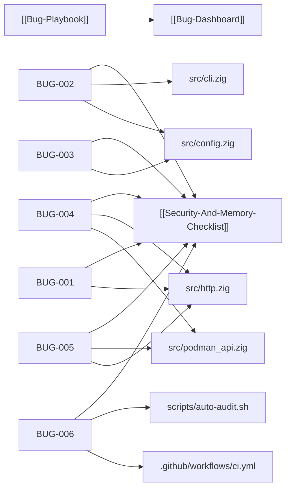

---
tags:
  - dashboard
  - bug-pattern
  - memory-safety
  - security-gate
aliases:
  - Bug Tracking Dashboard
status: active
---

# ZigPod Bug Tracking & Security Dashboard

กลับไปที่ [[00-Index]] · คู่มือบั๊กที่ [[Bug-Playbook]] · แผนผังระบบ [[Architecture-Map]] · เช็กลิสต์ [[Security-And-Memory-Checklist]]

> สร้างอัตโนมัติจาก [scripts/bug-dashboard.py](../../scripts/bug-dashboard.py) (`make dashboard` / `make bugs` / `make dashboard-serve`)

## Overview Metrics

| Metric | Value |
| :--- | :--- |
| Tracked Bug Patterns | **6** (6 Guarded) |
| Zig Source Modules | **8** |
| Unit & Integration Tests | **39** |
| Static Security & Memory Gates | **9/9 PASS** |

## Guard Coverage Map

## Bug Pattern Registry

| ID | Title | Tags | Guarded Files | Status |
| :--- | :--- | :--- | :--- | :--- |
| [BUG-001](../../docs/vault/Bug-Playbook.md#L20) | Error Set Mismatch on `std.net.connectUnixSocket` | `#bug-pattern` | [http.zig](../../src/http.zig) | **Guarded** |
| [BUG-002](../../docs/vault/Bug-Playbook.md#L29) | `ArenaAllocator` in Tests Hiding Memory Leaks | `#bug-pattern` `#memory-safety` | [cli.zig](../../src/cli.zig), [config.zig](../../src/config.zig), [auto-audit.sh](../../scripts/auto-audit.sh) | **Guarded** |
| [BUG-003](../../docs/vault/Bug-Playbook.md#L40) | Sub-slice Pointer Returned from Owned Env Buffer | `#bug-pattern` `#memory-safety` | [config.zig](../../src/config.zig) | **Guarded** |
| [BUG-004](../../docs/vault/Bug-Playbook.md#L49) | Integer Overflow & OOB Read in Chunked / Frame Decoders | `#bug-pattern` `#security-gate` | [http.zig](../../src/http.zig), [podman_api.zig](../../src/podman_api.zig) | **Guarded** |
| [BUG-005](../../docs/vault/Bug-Playbook.md#L60) | Path Traversal & CRLF Injection via Container ID / Path | `#bug-pattern` `#security-gate` | [podman_api.zig](../../src/podman_api.zig), [http.zig](../../src/http.zig) | **Guarded** |
| [BUG-006](../../docs/vault/Bug-Playbook.md#L71) | Missing `ripgrep` (`rg`) on CI Runners Causing `auto-audit.sh` Failure | `#bug-pattern` `#security-gate` | [auto-audit.sh](../../scripts/auto-audit.sh), [ci.yml](../../.github/workflows/ci.yml) | **Guarded** |

## Module Test & Allocator Coverage

| Module | Lines | Public Decls | Unit Tests | Memory Gate |
| :--- | ---: | ---: | ---: | :--- |
| [cli.zig](../../src/cli.zig) | 480 | 11 | 8 | `std.testing.allocator` |
| [config.zig](../../src/config.zig) | 112 | 4 | 4 | `std.testing.allocator` |
| [demo.zig](../../src/demo.zig) | 379 | 1 | 1 | `std.testing.allocator` |
| [http.zig](../../src/http.zig) | 332 | 10 | 9 | `std.testing.allocator` |
| [log.zig](../../src/log.zig) | 343 | 16 | 5 | `std.testing.allocator` |
| [main.zig](../../src/main.zig) | 216 | 2 | 0 | `gpa.deinit() != .leak` |
| [podman_api.zig](../../src/podman_api.zig) | 710 | 21 | 10 | `std.testing.allocator` |
| [utils.zig](../../src/utils.zig) | 42 | 3 | 2 | `stack-only (no heap)` |

## Static Security & Memory Gates

| Gate | Bug Ref | Result |
| :--- | :--- | :--- |
| No page_allocator in src/ | BUG-002 | **PASS** |
| GPA leak check enforced in main.zig | BUG-002 | **PASS** |
| No error.AccessDenied in http.zig | BUG-001 | **PASS** |
| std.testing.allocator in heap modules | BUG-002 | **PASS** |
| validateRequestTarget() in http.zig | BUG-005 | **PASS** |
| validateIdentifier() in podman_api.zig | BUG-005 | **PASS** |
| Checked arithmetic std.math.add/mul | BUG-004 | **PASS** |
| Timeout poll, HostConfig hardening, audit chain & demo | Security | **PASS** |
| Verification scripts executable (+x) | BUG-006 | **PASS** |

## Tracked Bug Details

### BUG-001 — Error Set Mismatch on `std.net.connectUnixSocket`
- **Source**: [docs/vault/Bug-Playbook.md:20](../../docs/vault/Bug-Playbook.md#L20) · **Status**: `Guarded`
- **Symptom**: `zig build test` บน Zig 0.13.0 ล้มเหลว: `'error.AccessDenied' not a member of destination error set`
- **Root Cause**: `std.net.connectUnixSocket` ใน Zig 0.13.0 คืน `error.PermissionDenied` ไม่ได้รวม `error.AccessDenied`
- **Fix**: เปลี่ยน `src/http.zig` ให้ match เฉพาะ `error.PermissionDenied => Error.PermissionDenied`
- **Prevention**: ตรวจสอบ error union ของ stdlib เวอร์ชันเป้าหมาย (Zig `0.13.0`) และรัน `zig build test` ใน CI ทุกครั้ง

### BUG-002 — `ArenaAllocator` in Tests Hiding Memory Leaks
- **Source**: [docs/vault/Bug-Playbook.md:29](../../docs/vault/Bug-Playbook.md#L29) · **Status**: `Guarded`
- **Symptom**: เทสใน `cli.zig` และ `config.zig` เดิมใช้ `ArenaAllocator` (หรือ `page_allocator` แบบ global) ซึ่งไม่เคยรายงาน leak
- **Root Cause**: `ArenaAllocator` กวาดคืนทีเดียว ทำให้ตรวจไม่พบกรณีลืม `deinit` หรือคืนหน่วยความจำไม่ครบใน error path
- **Fix**: เพิ่ม `Parsed.deinit` ใน `src/cli.zig` และ `Config.deinit` ใน `src/config.zig`; เปลี่ยนทุก `test` block ให้ใช้ `std.testing.allocator` โดยตรง พร้อมเทส error path ที่จอง memory ไปแล้วบางส่วน
- **Prevention**: ห้ามใช้ `page_allocator` หรือ `ArenaAllocator` ใน `test` blocks; `scripts/auto-audit.sh` ตรวจบล็อก pattern นี้โดยอัตโนมัติ

### BUG-003 — Sub-slice Pointer Returned from Owned Env Buffer
- **Source**: [docs/vault/Bug-Playbook.md:40](../../docs/vault/Bug-Playbook.md#L40) · **Status**: `Guarded`
- **Symptom**: `resolveSocket` ใน `src/config.zig` เดิมคืน `stripUnixScheme(s)` ซึ่งชี้เข้าไปกลาง buffer ที่ `getEnv` จองไว้
- **Root Cause**: หาก caller เรียก `allocator.free(socket_path)` บน sub-slice ที่ไม่ได้เริ่มที่ address แรกของ allocation จะเกิด panic/invalid free หรือ leak buffer ระหว่างทางจาก `getEnv`
- **Fix**: free buffer ชั่วคราวของ `getEnv` ด้วย `defer allocator.free(s)` และ `allocator.dupe` ค่าที่ตัด prefix แล้วให้เป็น owned slice ที่เป็นอิสระ
- **Prevention**: ทุกฟังก์ชันที่คืน slice ให้ caller ต้องคืน owned allocation เต็มก้อน หรือระบุ lifetime อย่างชัดเจนและมี `deinit` คู่กัน

### BUG-004 — Integer Overflow & OOB Read in Chunked / Frame Decoders
- **Source**: [docs/vault/Bug-Playbook.md:49](../../docs/vault/Bug-Playbook.md#L49) · **Status**: `Guarded`
- **Symptom**: `decodeChunked` และ `demuxLogs` เดิมใช้ `pos + size` และ `pos += size + 2` โดยไม่ตรวจ overflow หรือ trailer `\r\n`
- **Root Cause**: ค่า chunk size ขนาดใหญ่ (เช่น `FFFFFFFFFFFFFFFF`) หรือ payload ที่ขาด `\r\n` อาจทำให้ `pos` ทะลุ `data.len` แล้ว panic ใน `std.mem.indexOfPos`
- **Fix**: ใช้ `std.math.add` ทุกจุดใน `decodeChunked` (`src/http.zig`) และ `demuxLogs` (`src/podman_api.zig`); ตรวจ `max_response_bytes` และตรวจยืนยัน `"\r\n"` ท้ายทุก chunk พร้อม unit tests เคส malformed
- **Prevention**: ทุกขนาด/offset ที่มาจาก socket หรือไฟล์ภายนอกต้องผ่าน `std.math.add` และ bounds check เสมอ

### BUG-005 — Path Traversal & CRLF Injection via Container ID / Path
- **Source**: [docs/vault/Bug-Playbook.md:60](../../docs/vault/Bug-Playbook.md#L60) · **Status**: `Guarded`
- **Symptom**: ค่า `id` หรือ `name` เช่น `../containers` หรือ `id\r\nX-Evil: 1` สามารถแทรกเข้า URL path หรือ HTTP request line ได้
- **Root Cause**: ไม่มีการ validate input ก่อน `allocPrint` เข้า path และ HTTP request line
- **Fix**: เพิ่ม `podman_api.validateIdentifier` ใน `src/podman_api.zig`; เพิ่ม `http.validateRequestTarget` ใน `src/http.zig`
- **Prevention**: ทุก endpoint ที่รับ identifier จาก CLI ต้องเรียก `validateIdentifier` และ `Client.request` ต้องเรียก `validateRequestTarget`

### BUG-006 — Missing `ripgrep` (`rg`) on CI Runners Causing `auto-audit.sh` Failure
- **Source**: [docs/vault/Bug-Playbook.md:71](../../docs/vault/Bug-Playbook.md#L71) · **Status**: `Guarded`
- **Symptom**: บน CI runner (เช่น GitHub Actions `ubuntu-latest`) การรัน `scripts/auto-audit.sh` ล้มเหลวด้วย `./scripts/auto-audit.sh: line 49: rg: command not found` (exit code `1`) แม้ unit test และ build จะผ่านครบ
- **Root Cause**: `scripts/auto-audit.sh` เรียก `rg` โดยตรงโดยไม่มี fallback เมื่อไม่มี binary `rg` ทำให้เกิด exit code `127`: ตรวจเชิงบวก (`if rg -q ...`) ล้มเหลวทั้งหมด และตรวจเชิงลบ (`if rg -n ... >/dev/null 2>&1`) ซ่อน stderr จนกลายเป็น false-pass
- **Fix**: เพิ่ม helper `has_match()` ใน `scripts/auto-audit.sh` ให้ใช้ `rg -q` เป็นหลักและ fallback เป็น `grep -REq` เมื่อไม่มี `rg`; เพิ่ม step ติดตั้ง `ripgrep` ใน `ci.yml`
- **Prevention**: สคริปต์ตรวจอัตโนมัติที่รันบน CI ต้องตรวจ `command -v <tool>` พร้อม fallback หรือติดตั้ง dependency ใน `ci.yml` ให้ครบ และทดสอบกรณีไม่มีเครื่องมือด้วย
