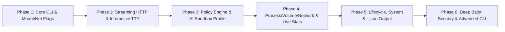

# Zig Program that Mimics `podman` / `docker` CLI

## 1️⃣ Architecture Overview

| Component | Responsibility | Zig‑API / Lib |
|----------|----------------|--------------|
| **CLI parser** | Parse sub‑commands (`run`, `build`, `push`, `pull`, `ps`, …) and flags | `std.process.ArgIterator` |
| **HTTP client** | Talk to Podman’s socket (`/run/podman/podman.sock`) using the Docker‑compatible REST API | `std.http.Client` (Unix‑socket support via `std.net.Address.unix`) |
| **JSON encoder/decoder** | Serialize request bodies (e.g., `ContainerCreate`) and parse responses | `std.json` |
| **Error handling & logging** | Uniform error messages, exit‑codes, optional verbose mode | `std.log` |
| **Helper utilities** | Stream I/O, attach to container logs, progress bars for pulls/builds | `std.io`, `std.time`, `std.fmt` |

```
+-------------------+      +-------------------+      +-------------------+
|    Zig CLI (main) | -->  |  HTTP → Podman    | <--  |  Podman daemon    |
| (arg parsing, …) |      |  unix socket API  |      | (already installed|
+-------------------+      +-------------------+      +-------------------+
```

*Why this design?*
- **Leverages existing container runtime** – no need to re‑implement low‑level container primitives.
- **Docker‑compatible** – any Docker client (e.g., `docker-compose`) can also talk to the same socket if you point it there.
- **Pure Zig code** – only the thin wrapper is written in Zig; all heavy lifting stays in Podman.

---

## 2️⃣ Project Layout

```
zigpod/
│
├─ src/
│   ├─ main.zig          # entry point, Arg parsing
│   ├─ cli.zig           # sub‑command definitions
│   ├─ podman_api.zig    # HTTP request helpers, JSON structs
│   └─ utils.zig         # logging, error types
│
├─ build.zig             # Zig build file
└─ README.md
```

---

## 3️⃣ Core Data Structures (excerpt)

```zig
// src/podman_api.zig
const std = @import("std");

pub const ContainerConfig = struct {
    Image: []const u8,
    Cmd: ?[][]const u8 = null,
    Env: ?[]const []const u8 = null,
    // … add more fields as needed (PortBindings, Volumes, …)
};

pub const CreateResponse = struct {
    Id: []const u8,
    // … other fields you care about
};

pub fn createContainer(
    client: *std.http.Client,
    cfg: ContainerConfig,
) !CreateResponse {
    const request_body = try std.json.stringifyAlloc(
        client.allocator,
        cfg,
        .{},
    );
    defer client.allocator.free(request_body);

    var req = try client.request(
        .POST,
        "/v1.40/containers/create",
        .{ .content_type = "application/json" },
        request_body,
    );
    defer req.deinit();

    const resp = try req.wait();
    if (resp.status != .Ok) return error.PodmanError;

    const parsed = try std.json.parseFromSlice(
        CreateResponse,
        client.allocator,
        resp.body,
        .{},
    );
    defer parsed.deinit();

    return parsed.value;
}
```

---

## 4️⃣ CLI Skeleton

```zig
// src/main.zig
const std = @import("std");
const cli = @import("cli.zig");
const pod = @import("podman_api.zig");

pub fn main() !void {
    var gpa = std.heap.GeneralPurposeAllocator(.{}){};
    defer _ = gpa.deinit();
    const allocator = gpa.allocator();

    var args = try std.process.argsWithAllocator(allocator);
    defer args.deinit();

    // Skip program name
    _ = args.next();

    const subcmd = try cli.parseSubcommand(&args);
    switch (subcmd) {
        .run => |run_opt| {
            var client = try pod.initClient(allocator);
            defer client.deinit();

            const cfg = pod.ContainerConfig{
                .Image = run_opt.image,
                .Cmd = run_opt.command,
                .Env = run_opt.env,
            };
            const create = try pod.createContainer(&client, cfg);
            // Start container
            try pod.startContainer(&client, create.Id);
            // Optional: attach logs, wait, etc.
        },
        .ps => {
            // GET /containers/json and pretty‑print
        },
        .pull => |pull_opt| {
            // POST /images/create?fromImage=...
        },
        // … other commands
    }
}
```

`cli.zig` would define an enum:

```zig
pub const SubCommand = union(enum) {
    run: RunOpts,
    ps,
    pull: PullOpts,
    // …
};

pub const RunOpts = struct {
    image: []const u8,
    command: ?[][]const u8 = null,
    env: ?[]const []const u8 = null,
};

pub fn parseSubcommand(it: *std.process.ArgIterator) !SubCommand {
    const cmd = try it.next() orelse return error.MissingCommand;

    if (std.mem.eql(u8, cmd, "run")) {
        // parse flags like --image foo --env KEY=VAL …
        // return .{ .run = RunOpts{ ... } };
    } else if (std.mem.eql(u8, cmd, "ps")) {
        return .ps;
    } else if (std.mem.eql(u8, cmd, "pull")) {
        // …
    } else {
        return error.UnknownCommand;
    }
}
```

---

## 5️⃣ Connecting to the Podman Socket

Podman exposes a Unix domain socket by default at `unix:///run/podman/podman.sock`.

```zig
pub fn initClient(allocator: *std.mem.Allocator) !std.http.Client {
    var client = std.http.Client{
        .allocator = allocator,
        .reuse_address = false,
    };
    const sock_path = "/run/podman/podman.sock";
    client.connectUnix(sock_path) catch |e| {
        std.log.err("Cannot connect to Podman socket {s}: {any}", .{ sock_path, e });
        return e;
    };
    return client;
}
```

If you want to use the HTTP‑over‑TCP API (`localhost:8080`), just change the address.

---

## 6️⃣ Extending the Wrapper

| Feature | Where to add |
|--------|--------------|
| **Image building** (`docker build`) | Use the **BuildKit** HTTP endpoint (`/build`) or invoke `podman build` as a subprocess (`std.ChildProcess`). |
| **Compose‑like orchestration** | Parse a simple YAML file (`std.yaml`) and loop over `createContainer` + `startContainer`. |
| **Push / Pull with auth** | Add `Authorization` header (`Bearer <token>`) when needed; expose `--username/--password` flags. |
| **Progress bars** | Stream the response body for `pull`/`push` and render with `std.progress`. |
| **Log attachment** | `GET /containers/{id}/logs?stdout=1&stderr=1&follow=1` and forward to stdout. |

---

## 7️⃣ Building & Installing

```bash
# In the project root
zig build -Drelease-safe   # produces ./zig-out/bin/zigpod
```

Copy the binary to a location in your `$PATH`:

```bash
sudo cp zig-out/bin/zigpod /usr/local/bin/
```

Make sure **Podman is running** (`systemctl start podman` or `podman system service -t 0`) so the socket exists.

---

## 8️⃣ Quick Usage Example

```bash
# Pull an image (the wrapper forwards to Podman's API)
zigpod pull alpine:3.18

# Run a container
zigpod run --image alpine:3.18 --command sh -c "echo Hello from Zig!"

# List containers (ps)
zigpod ps
```

---

## 📚 Further Reading

| Topic | Link |
|------|------|
| Podman REST API (Docker compatible) | <https://docs.podman.io/en/latest/_static/api.html> |
| Zig `std.http` docs (Unix sockets) | <https://ziglang.org/documentation/master/std/#Http-Client> |
| Docker JSON request/response structs | <https://docs.docker.com/engine/api/v1.40/> |
| Writing CLI tools in Zig | <https://zig.news/adam/cli-parsing-in-zig-2b7b> |

---

### Next Steps for You
1. **Clone the skeleton** (or create a new Zig project) and copy the files shown above.
2. Run `zig build` to ensure it compiles against your Zig version (≥0.12).
3. Test each sub‑command against a running Podman daemon.
4. Incrementally add more Docker‑compatible endpoints as you need them (e.g., `exec`, `network`, `volume`).

Feel free to ask for any specific command implementation, deeper error‑handling patterns, or how to embed authentication for private registries!

---

## 9️⃣ Development Roadmap (Completed Baseline & Next Phases)

### ✅ Completed Baseline (`v0.1.0`)

- **Core CLI & Podman API Client** (`src/cli.zig`, `src/podman_api.zig`, `src/config.zig`, `src/main.zig`):
  - Subcommands: `run`, `ps`, `images`, `pull`, `stop`, `rm`, `logs`, `version`, `audit`, `demo`
  - Checked GPA leak verification (`gpa.deinit() != .leak`) and `std.testing.allocator` across all heap-allocating tests
- **Transport & Container Hardening** (`src/http.zig`, `src/cli.zig`, `src/podman_api.zig`):
  - Request target validation (`validateRequestTarget`), container ID/name validation (`validateIdentifier`), checked chunk/frame arithmetic (`std.math.add`), and `std.posix.poll` socket timeout (`default_timeout_ms = 30_000`)
  - `HostConfig` hardening flags on `run`: `-m`/`--memory`, `--pids-limit`, `--read-only`, `--no-new-privileges`
- **Auditability, Knowledge Graph & CI Gates** (`src/log.zig`, `src/demo.zig`, `docs/vault/`, `scripts/`):
  - Tamper-evident SHA-256 hash-chained `audit.log` (`zigpod audit`) alongside `system.log` and `error.log`
  - Built-in 14-case fail-closed self-test (`zigpod demo`)
  - Obsidian Knowledge Vault + offline `scripts/graph-query.py`, `scripts/auto-audit.sh`, `scripts/security-check.sh`, `scripts/smoke.sh`, and `scripts/check-ci-parity.py`



### Phase 1: Container Networking, Mounts & Core Subcommands

- [x] **`run` flags**:
  - `-p, --publish <HOST:CONTAINER[/proto]>`: mapping to `ExposedPorts` and `HostConfig.PortBindings` -- DONE (`src/cli.zig`, `src/podman_api.zig`)
  - `-v, --volume <SRC:DST[:ro]>`: with strict **Host Path Policy Validator** (default `:ro` option / block dangerous host paths such as `/`, `/etc`, `/proc`, and container-engine socket dirs) -- DONE (`src/cli.zig`, `src/podman_api.zig`)
  - `--network <MODE>` (`none`, `bridge`, `host`, `pasta`/`slirp4netns`), `-w, --workdir`, `-u, --user`, and `--cap-drop` / `--cap-add` -- DONE (`src/cli.zig`, `src/podman_api.zig`)
- [x] **Additional subcommands**:
  - `zigpod exec <CONTAINER> <CMD...>`: (`POST /v1.40/containers/{id}/exec` and `/exec/{id}/start`) -- DONE (`src/podman_api.zig`, `src/cli.zig`)
  - `zigpod inspect <CONTAINER|IMAGE>`: (inspect state, IP, mounts, exit code, and active hardening limits) -- DONE (`src/podman_api.zig`, `src/cli.zig`)
  - `zigpod stats --no-stream` (display CPU, memory, and PIDs metrics) -- DONE (`src/podman_api.zig`, `src/cli.zig`)

### Phase 2: Streaming HTTP Client & Interactive TTY

- [x] **Streaming HTTP Response Reader** (`src/http.zig`):
  - Separate response header parsing from streaming chunked/body reads so `zigpod pull` prints download progress in real time without the 64 MiB `readAllAlloc` ceiling -- DONE (`src/http.zig`, `src/podman_api.zig`)
  - Add `zigpod logs -f` (`follow=1`) live log streaming -- DONE (`src/cli.zig`, `src/podman_api.zig`, `src/main.zig`)
- [x] **Interactive / TTY Support (`-i`, `-t`)**:
  - Support HTTP `101 Switching Protocols` on Unix sockets and raw terminal handling (`std.posix.tcgetattr` / `tcsetattr`) for `zigpod run -it` and `zigpod exec -it` -- DONE (`src/http.zig`, `src/cli.zig`, `src/podman_api.zig`, `src/main.zig`)

### Phase 3: Fail-Closed Policy Engine & AI Sandbox Guardrails

- [x] **Sandbox Security Profiles (`--profile=sandbox`)**:
  - Enforce fail-closed defaults for untrusted or AI-agent workloads (`--read-only`, `--no-new-privileges`, `--cap-drop=ALL`, `--network=none`, `--pids-limit=64`, `--memory=256m`, bounded tmpfs) -- DONE (`src/policy.zig`, `src/cli.zig`, `src/main.zig`)
  - Reject container creation pre-flight if requested flags exceed limits defined in `zigpod-policy.json` -- DONE (`src/policy.zig`, `zigpod-policy.json`, `src/main.zig`)
- [x] **Audit & Balor Toolkit Integration**:
  - Add `zigpod audit --json` structured output and `DENY` event telemetry for `balorsh` (`loganalyst` / `blueteam`) automated auditing -- DONE (`src/log.zig`, `src/cli.zig`, `src/main.zig`)

### Phase 4: Process Control, Volume/Network Subcommands, Live Stats & Fuzz Testing

- [x] **Process, Volume & Network Subcommands**:
  - `zigpod kill [-s SIGNAL] <CONTAINER>` with strict allow-listed signal validation (`validateSignal`) -- DONE (`src/podman_api.zig`, `src/cli.zig`, `src/main.zig`)
  - `zigpod top <CONTAINER>` process table inspection -- DONE (`src/podman_api.zig`, `src/podman_types.zig`, `src/cli.zig`, `src/main.zig`)
  - `zigpod volume ls|create|rm|inspect [NAME]` and `zigpod network ls|inspect [NAME]` -- DONE (`src/podman_api.zig`, `src/podman_types.zig`, `src/cli.zig`, `src/main.zig`)
- [x] **Live Streaming Container Stats**:
  - `zigpod stats [CONTAINER]` (`stream=true`) real-time streaming table via `Client.streamRequest` -- DONE (`src/podman_api.zig`, `src/main.zig`)
- [x] **Deterministic PRNG Fuzz & Property Testing**:
  - Property/fuzz tests for `decodeChunked`, `demuxLogs`, `parseMemoryBytes`, and `verifyAuditFile` using `std.Random.DefaultPrng(0x5A16_90D2_2026_F00D)` and `std.testing.allocator` -- DONE (`src/http.zig`, `src/podman_api.zig`, `src/cli.zig`, `src/log.zig`)

### Phase 5: Lifecycle Management, System Maintenance & Structured JSON Output

- [x] **Lifecycle & Image Management Subcommands**:
  - `zigpod start <CONTAINER>`, `zigpod restart [-t SECS] <CONTAINER>`, `zigpod pause <CONTAINER>`, `zigpod unpause <CONTAINER>`, `zigpod rename <CONTAINER> <NEW_NAME>`, and `zigpod rmi [-f] <IMAGE>` -- DONE (`src/podman_api.zig`, `src/cli.zig`, `src/main.zig`)
- [x] **System Maintenance Subcommands**:
  - `zigpod system ping`, `zigpod system df`, and `zigpod system prune [-f]` -- DONE (`src/podman_api.zig`, `src/podman_types.zig`, `src/cli.zig`, `src/main.zig`)
- [x] **Structured `--json` Output Mode**:
  - `zigpod ps [-a] --json`, `zigpod images --json`, `zigpod inspect --json <NAME|ID>`, and `zigpod stats [--no-stream] --json [CONTAINER]` for SIEM, `jq`, and `balorsh` automation -- DONE (`src/podman_api.zig`, `src/podman_types.zig`, `src/cli.zig`, `src/main.zig`)

### Phase 6: Deep Balor (`balorsh`) Security Integration & Advanced Observation/Policy Tooling

#### 🛡️ 6A. Balor Toolkit (`balorsh` v1.2.0) Security Integration
- [ ] **1. AI Log Analyst & Blue-Team Pipeline (`scripts/balor-security-audit.sh` & `scripts/security-check.sh`)**:
  - Connect `zigpod audit --json`, `audit.log`, `system.log`, and `error.log` (including structured `DENY` telemetry from `--profile=sandbox`, path traversal, capability, port, and volume blocks) directly to `balorsh llm` (`balor:loganalyst` and `balor:blueteam` Seneca Cybersecurity personas on Ollama)
  - Generate automated **Incident & Threat Reports** in `/opt/balorsh/data/llm/logs/` (or project report output) with actionable `zigpod-policy.json` hardening recommendations, plus deterministic offline rule-based analysis when Ollama is not running
- [ ] **2. Container Attack-Surface & Vulnerability Scanner (`networkscan` + `webexploit`)**:
  - Extract live container IP addresses and published host/container ports (`-p`) automatically from `zigpod inspect --json <CONTAINER>`
  - Feed discovered endpoints into Balor's `networkscan` (`nmap -F`, `-sV -sC`, `--script vuln`) and `webexploit` (`whatweb`, `nikto`, `gobuster`, `ffuf`) stacks to audit exposed container services, then optionally pipe XML/text scan results into `balor:blueteam`
- [ ] **3. Purple-Team Policy Review & Red-Team Adversarial Suite (`purpleteam` / `redteam`)**:
  - Audit `zigpod inspect --json <CONTAINER>` (`HostConfig.CapDrop`, `CapAdd`, `ReadonlyRootfs`, `SecurityOpt`, `PidsLimit`, `Memory`, `Mounts`) against `zigpod-policy.json` using `balor:purpleteam` / `balor:redteam` to detect privilege escalation or container-escape risks
  - Expand `zigpod demo` (`src/demo.zig`) with adversarial Red-Team/Blue-Team test vectors and JSON security report export
- [ ] **4. Environment & Image Secret/Hash Hygiene (`password` stack — `hashid`)**:
  - Inspect container `-e KEY=VALUE` flags and `Config.Env` from `zigpod inspect --json` for accidental password hashes, tokens, or credentials, integrating with `balorsh password` (`hashid`) and fail-closed policy warnings/blocks

#### ⚙️ 6B. Advanced CLI, Runtime Config & Release Tooling
- [ ] **Container & Daemon Observation (`port`, `wait`, `diff`, `events`)**:
  - `zigpod port <CONTAINER> [PRIVATE_PORT[/PROTO]]`, `zigpod wait <CONTAINER>`, `zigpod diff <CONTAINER>`, and `zigpod events [--since TS] [--until TS] [--json]`
- [ ] **Image Tagging & Container Checkpointing (`tag`, `history`, `commit`)**:
  - `zigpod tag <SRC_IMAGE> <TARGET_IMAGE>`, `zigpod history [--json] <IMAGE>`, and `zigpod commit [-m MSG] [-a AUTHOR] <CONTAINER> <REPO[:TAG]>`
- [ ] **Runtime Config & Policy CLI (`zigpod.toml` & `zigpod policy`)**:
  - Pure-Zig parser for `zigpod.toml` in `src/config.zig` and `zigpod policy check|show [--json]` pre-flight dry-run inspector
- [ ] **Shell Tab-Completion, Image Build, Native Pods & Static Releases**:
  - `zigpod completion bash|zsh|fish`
  - `zigpod build -t <TAG> <DIR>` (`POST /v1.40/build`) and `zigpod pod create|ps|stop|rm`
  - Static multi-arch release binaries (`x86_64-linux-musl` & `aarch64-linux-musl`) with SHA-256 checksums
